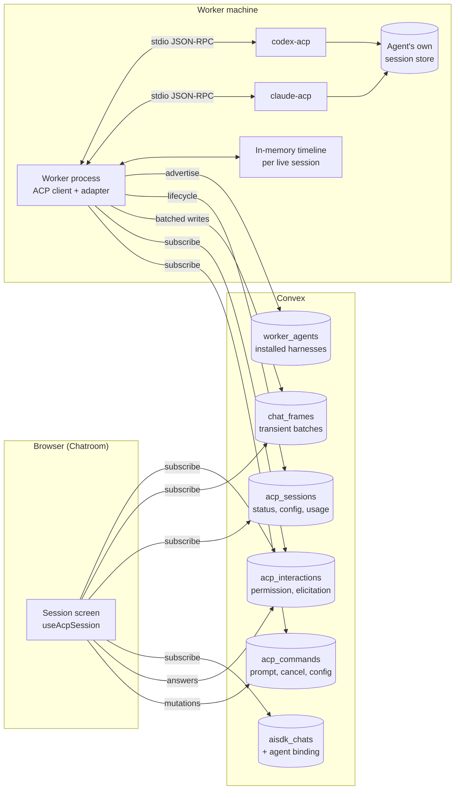
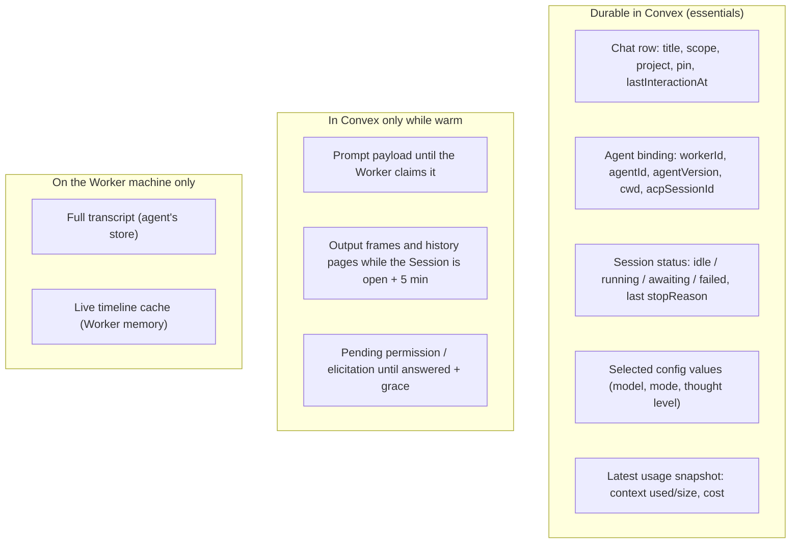

# ACP Agents

Status: **transport and Chatroom implemented.** Snapshot of the protocol: 2026-10-31. The Worker hosts ACP agents with `@agentclientprotocol/sdk` and relays them through Convex; Chatroom creates, opens and drives ACP Sessions on the same controls as the built-in agent (agent picker, Session screen, approvals, questions, Model picker, Stop, import, delete). Agents are configured in Settings → ACP (`/chatroom/acp`: registry presets or custom commands, stored in Convex); every Worker checks each command on its own `PATH` and reports it available or not, and the New session picker lists every agent and Worker with that availability. Still open: attachments, registry binary install, Gateway mode, MCP pass-through, terminal login. Code: `packages/backend/src/acp/` (contract, Convex functions, client frame fold), `packages/worker/src/acp/` (Worker host), `apps/web/src/components/session/acp/` (Session) and `apps/web/src/components/chatroom/acp-panel.tsx` (settings).

ACP ([Agent Client Protocol](https://agentclientprotocol.com)) lets an editor or
other client drive an independent agent harness (Claude Agent, Codex, Gemini CLI,
OpenCode, Goose, …) over JSON-RPC. In Radium an ACP agent is a second kind of
**Agent** for a Session (`docs/Interface_Design.md` §2): instead of the built-in
Radium agent running the AI SDK pipeline in Convex, a harness installed on a
Worker runs the Session, and Chatroom becomes its client UI.

Focused guides:

| Guide                                    | Contents                                                                                        |
| ---------------------------------------- | ----------------------------------------------------------------------------------------------- |
| [Agents and the Worker](ACP/Agents.md)   | Registry, install, discovery, launch, agent authentication, capabilities Radium advertises      |
| [Sessions](ACP/Sessions.md)              | Chat ↔ ACP session binding, lifecycle, config/model/mode, history on reopen, import, fork, delete |
| [Transport](ACP/Transport.md)            | Convex relay: commands, viewer-gated frames, interactions, batching, retention, recovery         |
| [Chatroom mapping](ACP/Interactions.md)  | Rendering, tools, permissions, questions, plans, slash commands, run state, notifications       |

## Principles

1. **The agent owns the conversation.** Messages, thoughts, tool calls, diffs and
   terminal output belong to the ACP agent's own session store on the Worker's
   machine. They pass through Convex to reach clients and stay there only while
   the Session is open somewhere, plus five minutes; they are never written to
   `chat_messages`, receipts or logs. The one exception is opt-in: Gateway
   telemetry of agents running in [Gateway mode](ACP/Agents.md#telemetry).
   Radium stores only the essentials needed to list, open, notify and authorize
   a Session.
2. **One Session, one Agent, forever.** The Agent (built-in or a specific ACP
   harness) and, for ACP, its Worker and directory are fixed when the Session is
   created. There is no conversion between harnesses: they have different tool
   sets, models, system prompts and history formats, so a handoff would silently
   change meaning. Only the model *inside* the harness can change, through the
   agent's own config options. Cross-agent handoff may be a future feature, but
   it must be an explicit new Session, never an in-place switch.
3. **No background crawling.** Radium never enumerates every session an agent
   has. It knows the sessions it created; anything else is imported one at a
   time, on request.
4. **Content is warm only while viewed.** Live output is written to Convex only
   while someone has the Session open (and for five minutes after). Otherwise
   the Worker keeps the turn local and reports only lifecycle changes (running,
   waiting for you, finished, failed), which are what notifications need.
5. **Pass through the agent's own surface.** Radium shows what the agent
   advertises (models, modes, commands, permission options) rather than imposing
   Radium's model list, tools, system prompt or approval policy on it.
6. **Stable ACP v1 first.** Implement the stable v1 stdio protocol. The
   normalized event model inside Radium follows the v2 draft's ID-addressed
   upserts, so adopting v2 later changes only the Worker adapter.

## Architecture

The browser never talks to the Worker directly and never speaks raw ACP. The
Worker is the ACP **client**: it launches the agent subprocess, speaks stdio
JSON-RPC, normalizes updates into Radium timeline operations, and relays them
through Convex using the outbound [Convex Client transport](Worker/Convex_Transport.md)
already selected for Worker. Convex keeps authorization, durable intent
(commands and permission decisions) and metadata.

## Responsibilities

| Component | Owns | Never owns |
| --- | --- | --- |
| ACP agent | Conversation history, model calls, its tools, its permission memory (`allow_always`), its credentials | Radium identity or authorization |
| Worker | Agent processes, ACP client capabilities, normalization, batching, in-memory timeline of live sessions, install/launch of registry agents | Chat authorization, durable decisions |
| Convex | Chat metadata and agent binding, authorization, commands, permission/elicitation decisions, warm content of open Sessions, notifications | Transcripts of Sessions nobody has open, agent credentials |
| Chatroom | Agent selection, rendering, Composer controls, approval/question UX, viewer heartbeats | Protocol state; it renders normalized ops only |
| Gateway | Model calls of agents switched to Gateway mode ([Agents](ACP/Agents.md#gateway-mode)); otherwise nothing, the agent calls its own provider | — |

## What Radium Stores

Consequences to accept:

- Opening an ACP Session needs its Worker online. Offline, the Session shows its
  metadata and status, not its content. Mobile and other devices see content only
  through the Worker, like any other viewer.
- Revert, edit-and-resend, regenerate and arbitrary-point fork do not exist in
  ACP v1 and are hidden for ACP Sessions ([Sessions](ACP/Sessions.md#unsupported-chatroom-actions)).
- Telemetry, usage limits and Gateway routing do not see ACP model calls unless
  the agent runs in [Gateway mode](ACP/Agents.md#gateway-mode).
- "Not saved" means not kept once nobody is looking. Convex has no ephemeral
  message bus, so warm content is real documents while a Session is open; the
  cleanup rules are in [Transport](ACP/Transport.md#warm-and-cold-sessions).

## Who Can Use It

Choosing a Worker is owner-only today ([Worker tools](Worker/Chatroom.md)), so
the workspace owner creates ACP Sessions and manages agents on Workers. After
that, access follows the chat's scope:

| Scope | Who sees it | Who can act on it |
| --- | --- | --- |
| `personal` | Its creator only | Its creator |
| `workspace` | Owner and every member, while the Worker is online | Every member, the same as the owner: prompt, Stop, answer permissions and questions, change model/mode/config and MCP servers, rename, pin, fork, delete (including in the agent) |

A shared ACP Session therefore lets members run the agent on the owner's
machine with the owner's agent login; making an ACP Session `workspace`-scoped
is that grant, and the scope control says so. Agent-level actions outside a chat
(install, custom agents, sign-in, Gateway access, importing sessions) stay
owner-only.

## Protocol Surface

| Area | Radium v1 support | Notes |
| --- | --- | --- |
| Transport | stdio, Worker-launched | Streamable HTTP / WebSocket remain an active RFD; a remote agent would be a Worker-side transport, not a browser one |
| `initialize`, `authenticate`, `logout` | Yes | Agent-handled auth only; terminal auth needs a PTY ([Agents](ACP/Agents.md#agent-authentication)) |
| `session/new`, `session/prompt`, `session/cancel` | Yes | Core turn |
| `session/load` | Yes when `loadSession` | Replay is consumed on the Worker, not relayed in full |
| `session/resume`, `session/close` | Yes when advertised | Resume after Worker restart; close on idle |
| `session/list` | Import only | On demand, paginated, cwd-filtered |
| `session/delete` | On chat delete, when advertised, after a second confirmation | [Sessions](ACP/Sessions.md#delete) |
| `session/fork` | Unstable; behind a flag | Fork from the latest point only |
| `session/set_config_option`, `session/set_mode` | Yes | Model selection uses the `model` config category; `session/set_model` was removed from ACP |
| `session/request_permission` | Yes | Approval prompt |
| `elicitation/create` (form, url) | Yes | Question prompt; URL mode opens after consent |
| `session/update` (all stable variants) | Yes | Normalized into timeline ops |
| `fs/*`, `terminal/*` client capabilities | Not advertised initially | Agents use their own tools on the same machine |
| ACP v2 draft | Not yet | Adapter-only change later |

## Rollout

| Milestone | Scope | State |
| --- | --- | --- |
| M0 Worker host | ACP client in Worker with `@agentclientprotocol/sdk`, a scripted test agent, agent definitions, `worker_agents` advertisement | Implemented; definitions come from Settings → ACP (`acp_agents`) and each Worker checks the command on its `PATH` |
| M1 Relay | `acp_sessions`, `acp_commands`, `chat_frames` and `chat_viewers` (shared with [Live Sessions](Radium_Chatroom/Live_Sessions.md)), warm/cold cron, snapshots, history pages | Implemented, verified against the dev deployment |
| M2 Chatroom | Agent picker in the Run target picker, `aisdk_chats.agent`, ACP Session screen on shared renderers, Stop, run state, notifications | Implemented, smoke-tested with the scripted agent against the dev deployment |
| M3 Interactions | Permissions, elicitation, plan → Todo panel, config options and modes in the Composer, slash commands, attachments | Implemented except attachments (the attach control is disabled for ACP Sessions) |
| M4 Agents | Registry and custom agents from Settings, auth states, Gateway mode, MCP pass-through, import from `session/list`, fork (unstable) | Settings → ACP (registry and custom agents, per-Worker availability, sign in/out), import (the picker's **Session** row), close/delete and fork (behind `VITE_ACP_FORK`) implemented; registry binary install, Gateway mode, MCP pass-through and terminal login open |
| M5 Protocol | ACP v2 adapter behind a per-agent flag once agents ship it | Open |

## Decisions

Settled on 2026-10-31:

| Topic | Decision |
| --- | --- |
| Content retention | Warm while any Tab has the Session open, cold 5 minutes after the last heartbeat; a cron deletes the content ([Transport](ACP/Transport.md#warm-and-cold-sessions)) |
| Worker transcript cache | None on disk. The Worker keeps live sessions in memory and asks the agent to replay (`session/load`) after eviction or restart |
| Scopes | ACP Sessions can be `personal` or `workspace`; in a `workspace` Session every member can do anything the owner can |
| Adding agents | The owner adds registry agents and any other ACP program (their own harness, forks, agents not in the registry) in Settings → ACP; definitions apply to every Worker, which reports whether it can run them ([Agents](ACP/Agents.md#sources)) |
| Gateway | One Gateway key per Worker, saved locally by the Worker; per-agent Gateway profiles; the agent's own models always available; owner can disable it; deleted keys fail closed and can be reissued ([Agents](ACP/Agents.md#gateway-mode)) |
| Gateway telemetry | ACP model calls through the Gateway are captured like any other request; each Gateway key gets a telemetry switch, set automatically from the Worker's settings for Worker keys ([Agents](ACP/Agents.md#telemetry)) |
| Workspace MCP servers | Passed to ACP agents by default, with a per-server switch and a per-Session menu ([Sessions](ACP/Sessions.md#mcp-servers)) |
| Deleting a chat | Deletes the Radium chat; the Chatroom asks beforehand whether to delete the session in the agent too, and `DeleteChat({deleteInAgent})` queues `delete` or `close` ([Sessions](ACP/Sessions.md#delete)) |
| Title | The agent's title when it sends one, else Radium's title generator |

No design decisions are open.
