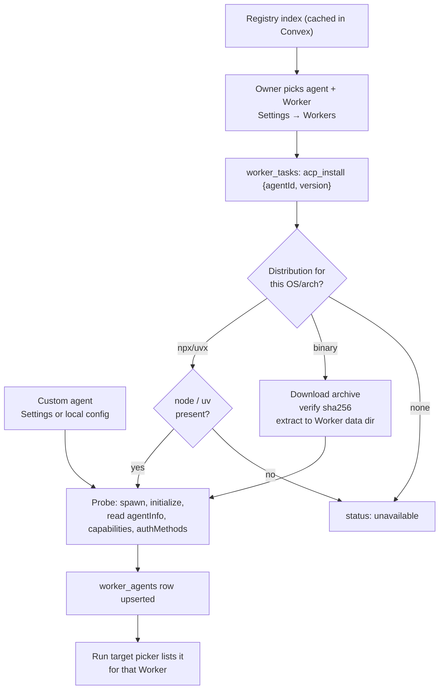
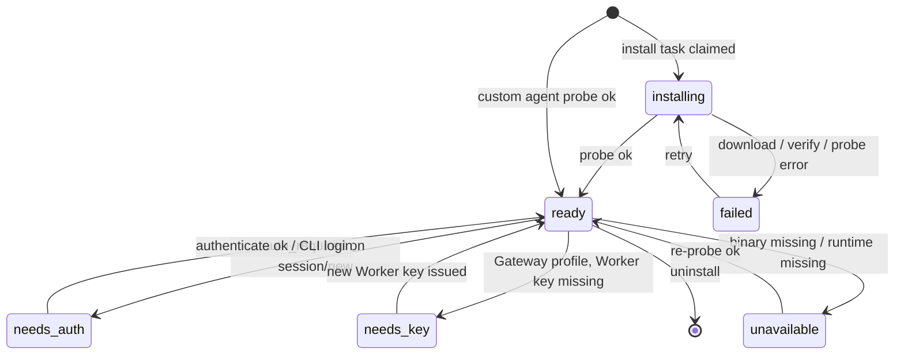
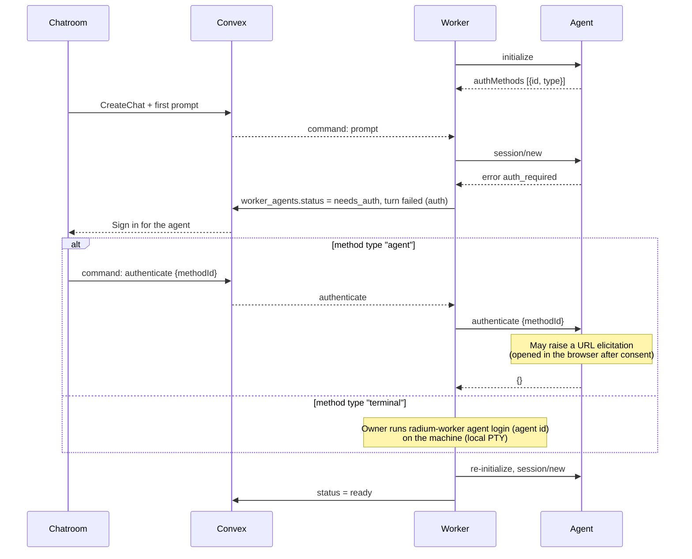
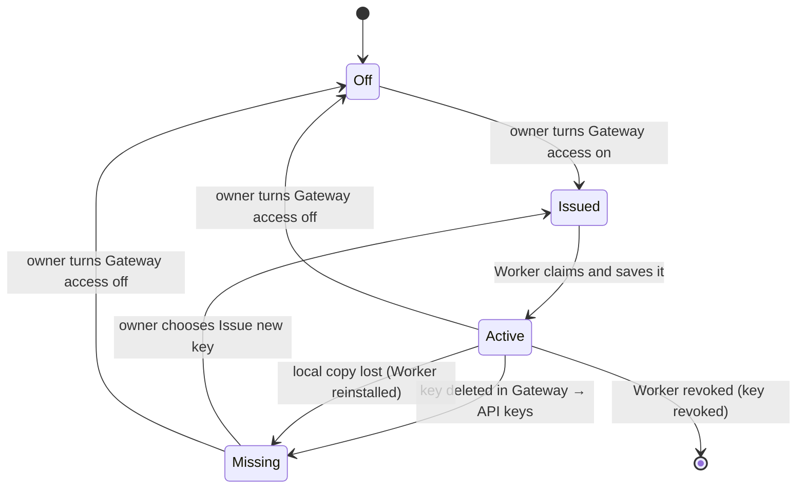

# ACP Agents On The Worker

Status: **local agents implemented; registry install, Settings-defined agents, terminal login and Gateway mode open.** Overview: [ACP Agents](../ACP.md).

Today an agent is defined in the Worker's local `<state-dir>/agents.json` (`id`, `name`, `command`, `args`, `env`; format and examples in [`packages/worker/README.md`](../../packages/worker/README.md#acp-agents)). On every connect the Worker probes each definition (spawn, `initialize`, stop) and replaces its `worker_agents` rows through `acp.reportAgents`; `bun src/cli.ts agents` runs the same probe locally without a network. Agents run as `source: "custom"` with the `native` profile; statuses are `ready`, `needs_auth`, `unavailable` (command not found) and `failed`. Process model, environment filtering, stderr handling and client capabilities below are implemented as described, with the idle window at 15 minutes.

An ACP agent is a program on the Worker's machine. The Worker installs or finds
it, launches it, speaks stdio ACP to it, and advertises it to Convex so the Run
target picker can offer it. Agents are defined only in Settings → Workers (or the
Worker's local config); a chat request never chooses an executable, arguments or
environment, only the Session's directory.

## Sources

| Source | Where it comes from | Who adds it |
| --- | --- | --- |
| Registry | [ACP Registry](https://agentclientprotocol.com/get-started/registry) index, `https://cdn.agentclientprotocol.com/registry/v1/latest/registry.json` (`{version, agents[]}`) | Owner from Settings → Workers, or the Worker CLI |
| Custom | Any other ACP program on the machine: `command`, `args`, `env`; name and version from its `initialize` | Owner from Settings → Workers, or the Worker's local config file |

A custom agent is any other ACP-speaking program on the Worker's machine: the
owner's own harness, a fork, or an agent not (yet) in the registry. The owner
adds it from Settings → Workers with the command that starts it in ACP mode;
the Worker probes it, and its name, version and capabilities come from its
`initialize` response (`agentInfo`). Definitions are stored per Worker in
`worker_agent_configs` (proposed, owner-only). The Worker runs that command as
its OS user, so the form shows the exact command line and refuses the same
risky `env` entries as registry agents.

A registry entry has `id`, `name`, semver `version`, `description`,
`distribution`, and optional `icon`, `repository`, `authors`, `license`.
`distribution` is any of:

- `npx: { package, args?, env? }` (needs Node on the machine)
- `uvx: { package, args?, env? }` (needs uv)
- `binary: { <os>-<arch>: { archive, cmd, args?, env?, sha256? } }` for
  darwin/linux/windows × aarch64/x86_64

Observed entries include `claude-acp` (`@agentclientprotocol/claude-agent-acp`),
`codex-acp`, `gemini` (`@google/gemini-cli --acp`), `opencode` (binary
`opencode acp`), `goose`, `cline`, Copilot, Cursor and others. Radium uses the
registry `id` as `agentId` and its `icon` in the picker; `components/session/agents.ts`
currently maps logos to models.dev slugs and moves to registry icons.

Convex caches the registry index once a day in a single document so Settings
can browse it without a Worker online. The Worker re-fetches the entry it
installs and never trusts browser-supplied distribution data.

## Install And Discovery

Install reuses `worker_tasks` (owner-dispatched, machine-claimed, five-minute
terminal cleanup); it is a discrete task, not part of a Session. Binaries live
under the Worker's data directory per `agentId/version`; npx/uvx entries pin the
registry version so an upstream release does not silently change a Session's
harness. Upgrades are explicit and apply to new processes.

### `worker_agents` (proposed)

One row per (Worker, agentId), written only by that Worker through `workerMutation`:

| Field | Meaning |
| --- | --- |
| `worker`, `workspace` | Owning Worker identity and its workspace |
| `agentId`, `name`, `version`, `icon`, `source` | Identity shown in the picker; `source` is `registry` or `custom` |
| `status` | Per profile (native, Gateway); see the state diagram below |
| `capabilities` | Summary from `initialize`: `loadSession`, session `list`/`resume`/`close`/`delete`/`fork`, prompt `image`/`audio`/`embeddedContext`, MCP `http`/`sse` |
| `authMethods` | `{id, name, type}` as advertised |
| `defaults` | Last seen `configOptions`, `modes` and `availableCommands` from a `session/new` on this Worker, used to populate a draft's Composer before a session exists |
| `checkedAt` | Last probe time |

Rows are small and change only on install, probe, auth or upgrade, so the
picker's subscription stays quiet. The worker-component `capabilities` array
remains identity metadata and is not used for agents.

The picker shows `ready` agents as selectable, `needs_auth` with a Sign in
action, and hides the rest behind the Worker's settings row.

## Process Model

- **One process per (Worker, agent, profile).** ACP multiplexes sessions on a
  connection, so sessions of the same agent share a process; a
  [Gateway profile](#gateway-mode) is a separate process because its environment
  differs. Each session gets its own absolute `cwd` in `session/new`.
- **Lazy start, idle stop.** The process starts on the first command for that
  agent. After every session is idle for the idle window (proposed 15 minutes),
  the Worker calls `session/close` where supported and stops the process. A
  session waiting on a permission or elicitation is never idle.
- **Crash handling.** A crashed process fails its in-flight turns (`failed`,
  `Agent process exited`), then restarts lazily with bounded backoff. Sessions
  come back through `session/resume` or `session/load` when next used
  ([Sessions](Sessions.md#reopening-and-recovery)).
- **Environment.** The agent gets the Worker user's environment minus Radium's
  own variables: no machine key, JWT, Convex URL or Worker config paths. Registry
  `env` is applied; entries that change program lookup, loaders, proxies or TLS
  trust (`PATH`, `LD_*`, `DYLD_*`, `NODE_OPTIONS`, `HTTPS_PROXY`, …) are refused,
  following ACP's launch-safety guidance.
- **Streams.** stdout carries ACP only. stderr goes to the Worker's bounded local
  diagnostics, never into a Session or Convex.

## Agent Authentication

ACP agent credentials (Anthropic login, OpenAI key, …) belong to the agent on the
machine. Radium never stores or relays them.

- **Agent-type methods** run through `authenticate` from a Sign in action. An
  agent that opens a browser on the Worker's machine only works when the owner
  is at that machine; agents that use URL-mode elicitation work remotely.
- **Terminal-type methods** need an interactive terminal. The Worker has no
  PTY transport to the browser, so Radium does not advertise
  `clientCapabilities.auth.terminal`; the Worker CLI offers a local
  `agent login <id>` command that reproduces the agent invocation with the
  method's `args`/`env` in the operator's own terminal.
- `logout` is offered when `agentCapabilities.auth.logout` is advertised.

## Client Capabilities Radium Advertises

| Capability | Initial value | Reason |
| --- | --- | --- |
| `protocolVersion` | `1` | Stable surface only |
| `fs.readTextFile`, `fs.writeTextFile` | off | The agent runs on the same machine and uses its own file tools; there are no unsaved editor buffers to serve |
| `terminal` | off | Requires managed background processes and streamed output the Worker does not have yet ([Bash guide](../Worker/Bash_Tool.md#acp-terminal-bridge)) |
| `auth.terminal` | off | No browser PTY |
| `elicitation.form`, `elicitation.url` | on | Question prompt and consented URL opening |
| Session notices / compaction / boolean config | on as stable | Rendered as markers and Composer switches |

Turning on `fs`/`terminal` later lets the Worker apply its own confinement and
show writes and commands it executes itself; that is a separate slice.

## Library

Use `@agentclientprotocol/sdk` 2.x with its default (stable v1) entry point:
`client({ name })`, typed `onRequest`/`onNotification` handlers, `connect(stream)`
over `ndJsonStream(stdin, stdout)`. SDK 2.0 removed `ClientSideConnection` and
`Client`; older examples using them are historical. The `/unstable` entry is
imported only for `session/fork`; `/experimental/v2` waits for M5.

## Gateway Mode

An agent always runs with its own models and credentials. Gateway mode is an
additional **launch profile** of the same agent that sends its model calls
through the Radium Gateway, gaining usage limits, multi-account routing, cost
tracking and telemetry.

- **A separate entry, never a toggle.** The picker lists `Codex` and
  `Codex · Gateway` as two agents on that Worker (one process each, since the
  environment differs per process). A Session picks one at creation and keeps it,
  like any Agent, so the native models are always available.
- **Recipes per adapter.** Radium ships a small table of adapters it knows how
  to point at the Gateway (base-URL and API-key environment variables, or a
  config file the agent reads). Agents without a recipe have no Gateway profile.
  Recipes are verified against each adapter before they ship.
- **Not offered where it would break provider terms.** `claude-acp` wraps the
  Claude Agent SDK; its Gateway profile is not offered, and subscription
  (OAuth) credentials are never routed through the Gateway for any agent.
- **Models.** The agent still advertises its own model choices; in Gateway mode
  those IDs must resolve to models the workspace has providers for. Unresolvable
  IDs fail at the Gateway with its normal error, shown on the interruption card.

### Worker Gateway Key

Each Worker has at most one Gateway key, used by all of its Gateway profiles.

- **Issue.** The owner turns on **Gateway access** on the Worker's row in
  Settings → Workers. Convex creates a `rad-sk` key linked to that Worker and
  delivers the plaintext once through a command the Worker claims (payload
  cleared on claim), like every Gateway key, whose plaintext is shown only once.
  The Worker saves it in its local credential store beside its machine identity
  (owner-only file permissions) and injects it only into Gateway-profile agent
  processes.
- **Visible as a Worker key.** Gateway → API keys lists it with its Worker's
  name; deleting it from there warns that the Worker's Gateway profiles stop.
- **Disable.** Turning Gateway access off revokes the key and hides the
  Worker's Gateway profiles from the picker. Each agent row also has its own
  Gateway profile switch. Revoking the Worker revokes its key.

A deleted or lost key fails closed, and nothing is replaced silently:

- Convex marks the Worker's Gateway key `missing`; the Worker sees it on its
  control subscription, deletes its local copy, stops Gateway-profile processes
  and fails their in-flight turns with `Gateway key deleted`. Their
  `worker_agents` profiles become `needs_key`.
- A Session on a Gateway profile is **not** moved to the agent's native profile:
  that would change credentials, billing and possibly models mid-Session, which
  the Agent lock forbids. It shows the interruption card with **Issue new key**
  for the owner (members see that the owner must reissue it).
- A new key is never minted automatically, since deletion was an explicit owner
  action. Issue new key delivers a fresh key; the profiles return to `ready`,
  and Sessions continue through `session/resume` or `session/load`.
- If the Worker was offline when the key was deleted, the agent's next model
  call gets a Gateway 401 whose message names the deleted Worker key, so the
  agent's error is readable; the Worker reconciles when it reconnects.
- A Worker that lost its local copy reports it; the owner reissues, which
  revokes the old key.

### Telemetry

Gateway-profile model calls are ordinary Gateway requests, so
[Gateway telemetry](../Radium_Gateway/Telemetry.md) captures them under the
workspace's settings (`recordInputs`, `recordOutputs`, retention). This is
one of the reasons for Gateway mode, and it is the one place ACP conversation
content may be stored by Radium, only when the owner records content.

- **Per-key switch.** Every Gateway key gets a **Telemetry** setting:
  *Workspace settings* (default) or *Off* (nothing captured for that key's
  requests). It applies to ordinary API keys too.
- **Worker keys follow the Worker.** The Worker's row has a **Gateway telemetry**
  switch that sets its key's setting automatically, and a reissued key inherits it.
- **Attribution.** Requests are attributed to the Worker's key. Telemetry groups
  them into sessions by its content lineage; tying a request to a specific chat
  needs an agent that forwards a custom header, which is a later refinement.

## Security

An ACP agent runs as the Worker's OS user with that user's full access, like
Worker Bash: the Session directory is a `cwd`, not a sandbox. The agent's own
permission system decides what asks for approval; Radium relays those requests
and records the decision but cannot enforce anything the agent does not ask
about. Owners should treat enabling an ACP agent on a Worker like granting
unrestricted Bash on it.
