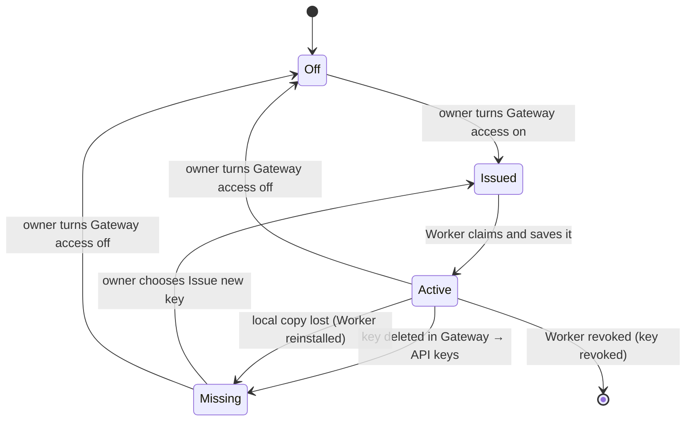

# ACP Agents On The Worker

Status: **workspace agent definitions, registry selection, Worker discovery and Chatroom authentication implemented.** Binary archive installation, terminal login and Gateway mode remain open. Overview: [ACP Agents](../ACP.md).

An ACP agent is a program on the Worker's machine. The workspace owner configures
it in **Settings → ACP**, in the Workspace group immediately after Workers, not
in a local Worker file. Convex
stores workspace-wide definitions in `acp_agents`; every enrolled Worker
subscribes to enabled definitions through machine-authorized
`acp.agentDefinitions`. A chat request selects an agent ID and Session directory,
never an executable, arguments or environment.

## Sources And Configuration

| Source   | Where it comes from                                                                                                                          | Who adds it                          |
| -------- | -------------------------------------------------------------------------------------------------------------------------------------------- | ------------------------------------ |
| Registry | [ACP Registry](https://agentclientprotocol.com/get-started/registry), `https://cdn.agentclientprotocol.com/registry/v1/latest/registry.json` | Workspace owner in Settings → ACP |
| Custom   | Any ACP program installed on the Worker, defined by a command and arguments                                                                  | Workspace owner in Settings → ACP |

The ACP page uses the same workspace header and Group lists as other Settings
pages, with an **About ACP** link to the protocol site. Its **Agents** group lists
configured definitions: icon, name and muted version, a truncated command with
the full command in a tooltip, per-Worker availability pills, and an Enabled
switch. One actions menu holds Edit, per-Worker Sign in/Sign out where supported,
and Delete with confirmation.

The **Add agents** group shows the searchable registry inline, initially the first
eight matches with **Show all** for the remainder. Each row includes the agent's
icon, name, version, description and launch type. **Add** saves an enabled
`npx`/`uvx` definition directly; **Set up** opens a prefilled form for binary
entries. An existing agent ID shows **Added** instead. **Custom agent** and Edit
open a focused form, without a source toggle. Registry icons adapt to the theme.

The command-line field supports quotes and backslashes and previews the parsed
argument vector. Agent IDs appear only when creating: Sessions retain that ID
permanently. Environment rows are stored in Convex and visible to the owner;
they are **not secret storage**. Agents keep their own login and credentials on
each Worker's machine.

Definitions contain `agentId`, `name`, `command`, `args`, `env: [{name, value}]`,
`enabled`, `source: "registry" | "custom"` and optional `icon`/`version`.
Convex and the Worker share the same launch validation and forbidden environment
policy. At most 64 definitions can be configured per workspace.

The registry is fetched when the ACP page opens by an owner-authorized Convex
action (bounded to 1 MiB, 10 seconds and 200 valid entries). `npx` entries save
`npx -y <package> ...`; `uvx` entries save `uvx <package> ...`, using the registry's
versioned package names. Binary entries prefill the command basename and
arguments with an instruction to install the binary on each Worker's `PATH`.
Radium does not download, extract or automatically upgrade binary archives.

## Discovery And Availability

On each definitions update and Worker reconnect, the Worker:

1. Validates each enabled definition with the shared `acpAgentDefinitionError`.
   Invalid definitions report `failed` with that validation error, without spawning.
2. Resolves commands on **its own `PATH`** using `Bun.which`. A command containing
   `/` instead must point to an existing executable file; relative paths resolve
   from the Worker's working directory. Missing or non-executable commands report
   `unavailable` with `<command> was not found on this Worker's PATH`, without spawning.
3. Probes present commands by spawning, sending ACP `initialize`, reading
   capabilities/authentication methods and stopping the probe.
4. Replaces its full `worker_agents` catalog through `acp.reportAgents`.

There is no discovery polling loop. The configured name, source and icon are
used for display; the version comes from `agentInfo`, falling back to the
definition's version and then `unknown`. Native is the only implemented profile.

Each definition shows a compact pill for every active Worker. Its tooltip reports
**Available** (with version), **Needs sign in**, **Not on PATH**, **Failed** (with
the reported error), **Offline** when Worker presence is stale, or **Waiting**
when an online Worker has not reported the agent yet. Offline takes precedence
over stale agent reports. Disabled agents wait for discovery after being enabled.
Sign in and supported Sign out actions live in the agent's menu and name the
online Worker they affect. Terminal-only login instructs the owner to use the
agent's CLI on that machine. The Workers page links to ACP settings rather than
duplicating this management surface.

`worker_agents` is one availability row per (Worker, agentId), written only by
that machine. It contains identity (`name`, `source`, `icon`, `version`), status,
capabilities (`loadSession`, list/resume/close/delete/fork/logout, prompt
image/audio/embeddedContext, MCP HTTP/SSE), auth methods and probe time. Session
creation can add last-seen defaults (config, modes, available commands) for draft
Composer controls.

### Editing And Removing Definitions

New commands use the latest definition. A process started from a superseded
definition is stopped once it has no running turn; edits never interrupt a
running turn or its approval/question wait. The next prompt starts the new
definition and loads/resumes the agent's existing Session when supported.

Removing or disabling a definition does not rebind or delete existing Sessions.
Their active turns can finish; new prompts fail with **Agent removed**. Restoring
the same agent ID makes it possible to use the existing binding again, subject
to that agent's own Session storage and reopening capabilities.

For a real scripted ACP fixture configured through this same form, see the
[Worker README](../../packages/worker/README.md#acp-agents).

## Process Model

- **One process per (Worker, agent, profile).** ACP multiplexes sessions on a
  connection, so sessions of the same agent share a process; a
  [Gateway profile](#gateway-mode) is a separate process because its environment
  differs. Each session gets its own absolute `cwd` in `session/new`.
- **Lazy start, idle stop.** The process starts on the first command for that
  agent. After every session is idle for the idle window (15 minutes),
  the Worker calls `session/close` where supported and stops the process. A
  session waiting on a permission or elicitation is never idle.
- **Crash handling.** A crashed process fails its in-flight turns (`failed`,
  `Agent process exited`), then restarts lazily with bounded backoff. Sessions
  come back through `session/resume` or `session/load` when next used
  ([Sessions](Sessions.md#reopening-and-recovery)).
- **Environment.** The agent gets the Worker user's environment minus Radium's
  own variables (`RADIUM_*` and `CONVEX_*`): no machine key, JWT, Convex URL or
  Worker config paths. Definition `env` is applied; entries that change program lookup, loaders, proxies or TLS
  trust (`PATH`, `LD_*`, `DYLD_*`, `NODE_OPTIONS`, `HTTPS_PROXY`, …) are refused,
  following ACP's launch-safety guidance.
- **Streams.** stdout carries ACP only. stderr goes to the Worker's bounded local
  diagnostics, never into a Session or Convex.

## Agent Authentication

ACP agent credentials (Anthropic login, OpenAI key, …) belong to the agent on the
machine. Radium never stores or relays them.

```mermaid
sequenceDiagram
    participant UI as Chatroom
    participant CX as Convex
    participant W as Worker
    participant A as Agent

    W->>A: initialize
    A-->>W: authMethods [{id, type}]
    UI->>CX: CreateChat + first prompt
    CX-->>W: command: prompt
    W->>A: session/new
    A-->>W: error auth_required
    W->>CX: worker_agents.status = needs_auth, turn failed (auth)
    CX-->>UI: Sign in for the agent
    alt method type "agent"
        UI->>CX: command: authenticate {methodId}
        CX-->>W: authenticate
        W->>A: authenticate {methodId}
        Note over A: May raise a URL elicitation<br/>(opened in the browser after consent)
        A-->>W: {}
    else method type "terminal"
        Note over W: Owner uses the agent's own login command<br/>on the machine; Worker terminal login is not implemented
    end
    W->>A: re-initialize, session/new
    W->>CX: status = ready
```

- **Agent-type methods** run through `authenticate` from a Sign in action. An
  agent that opens a browser on the Worker's machine only works when the owner
  is at that machine; agents that use URL-mode elicitation work remotely.
- **Terminal-type methods** need an interactive terminal. The Worker has no
  PTY transport to the browser and does not advertise
  `clientCapabilities.auth.terminal`. Use the agent's own CLI login on the Worker
  machine; a dedicated Worker terminal-login command is not implemented.
- `logout` is offered when `agentCapabilities.auth.logout` is advertised.

## Client Capabilities Radium Advertises

| Capability                                    | Initial value | Reason                                                                                                                                            |
| --------------------------------------------- | ------------- | ------------------------------------------------------------------------------------------------------------------------------------------------- |
| `protocolVersion`                             | `1`           | Stable surface only                                                                                                                               |
| `fs.readTextFile`, `fs.writeTextFile`         | off           | The agent runs on the same machine and uses its own file tools; there are no unsaved editor buffers to serve                                      |
| `terminal`                                    | off           | Requires managed background processes and streamed output the Worker does not have yet ([Bash guide](../Worker/Bash_Tool.md#acp-terminal-bridge)) |
| `auth.terminal`                               | off           | No browser PTY                                                                                                                                    |
| `elicitation.form`, `elicitation.url`         | on            | Question prompt and consented URL opening                                                                                                         |
| Session notices / compaction / boolean config | on as stable  | Rendered as markers and Composer switches                                                                                                         |

Turning on `fs`/`terminal` later lets the Worker apply its own confinement and
show writes and commands it executes itself; that is a separate slice.

## Library

Use `@agentclientprotocol/sdk` 2.x with its default (stable v1) entry point:
`client({ name })`, typed `onRequest`/`onNotification` handlers, `connect(stream)`
over `ndJsonStream(stdin, stdout)`. SDK 2.0 removed `ClientSideConnection` and
`Client`; older examples using them are historical. The `/unstable` entry is
imported only for `session/fork`; `/experimental/v2` waits for M5.

## Gateway Mode

Gateway mode below is planned, not implemented.

An agent always runs with its own models and credentials. Gateway mode is an
additional **launch profile** of the same agent that sends its model calls
through the Radium Gateway, gaining usage limits, multi-account routing, cost
tracking and telemetry.

- **A separate entry, never a toggle.** The picker lists `Codex` and
  `Codex · Gateway` as two agents on that Worker (one process each, since the
  environment differs per process). A Session picks one at creation and keeps it,
  like any Agent, so the native models are always available.
- **Recipes per adapter.** Radium ships a small table of adapters it knows how
  to point at the Gateway (base-URL and API-key environment variables, or a
  config file the agent reads). Agents without a recipe have no Gateway profile.
  Recipes are verified against each adapter before they ship.
- **Not offered where it would break provider terms.** `claude-acp` wraps the
  Claude Agent SDK; its Gateway profile is not offered, and subscription
  (OAuth) credentials are never routed through the Gateway for any agent.
- **Models.** The agent still advertises its own model choices; in Gateway mode
  those IDs must resolve to models the workspace has providers for. Unresolvable
  IDs fail at the Gateway with its normal error, shown on the interruption card.

### Worker Gateway Key

Each Worker has at most one Gateway key, used by all of its Gateway profiles.

- **Issue.** The owner turns on **Gateway access** on the Worker's row in
  Settings → Workers. Convex creates a `rad-sk` key linked to that Worker and
  delivers the plaintext once through a command the Worker claims (payload
  cleared on claim), like every Gateway key, whose plaintext is shown only once.
  The Worker saves it in its local credential store beside its machine identity
  (owner-only file permissions) and injects it only into Gateway-profile agent
  processes.
- **Visible as a Worker key.** Gateway → API keys lists it with its Worker's
  name; deleting it from there warns that the Worker's Gateway profiles stop.
- **Disable.** Turning Gateway access off revokes the key and hides the
  Worker's Gateway profiles from the picker. Each agent row also has its own
  Gateway profile switch. Revoking the Worker revokes its key.



A deleted or lost key fails closed, and nothing is replaced silently:

- Convex marks the Worker's Gateway key `missing`; the Worker sees it on its
  control subscription, deletes its local copy, stops Gateway-profile processes
  and fails their in-flight turns with `Gateway key deleted`. Their
  `worker_agents` profiles become `needs_key`.
- A Session on a Gateway profile is **not** moved to the agent's native profile:
  that would change credentials, billing and possibly models mid-Session, which
  the Agent lock forbids. It shows the interruption card with **Issue new key**
  for the owner (members see that the owner must reissue it).
- A new key is never minted automatically, since deletion was an explicit owner
  action. Issue new key delivers a fresh key; the profiles return to `ready`,
  and Sessions continue through `session/resume` or `session/load`.
- If the Worker was offline when the key was deleted, the agent's next model
  call gets a Gateway 401 whose message names the deleted Worker key, so the
  agent's error is readable; the Worker reconciles when it reconnects.
- A Worker that lost its local copy reports it; the owner reissues, which
  revokes the old key.

### Telemetry

Gateway-profile model calls are ordinary Gateway requests, so
[Gateway telemetry](../Radium_Gateway/Telemetry.md) captures them under the
workspace's settings (`recordInputs`, `recordOutputs`, retention). This is
one of the reasons for Gateway mode, and it is the one place ACP conversation
content may be stored by Radium, only when the owner records content.

- **Per-key switch.** Every Gateway key gets a **Telemetry** setting:
  _Workspace settings_ (default) or _Off_ (nothing captured for that key's
  requests). It applies to ordinary API keys too.
- **Worker keys follow the Worker.** The Worker's row has a **Gateway telemetry**
  switch that sets its key's setting automatically, and a reissued key inherits it.
- **Attribution.** Requests are attributed to the Worker's key. Telemetry groups
  them into sessions by its content lineage; tying a request to a specific chat
  needs an agent that forwards a custom header, which is a later refinement.

## Security

An ACP agent runs as the Worker's OS user with that user's full access, like
Worker Bash: the Session directory is a `cwd`, not a sandbox. The agent's own
permission system decides what asks for approval; Radium relays those requests
and records the decision but cannot enforce anything the agent does not ask
about. Owners should treat enabling an ACP agent on a Worker like granting
unrestricted Bash on it.
