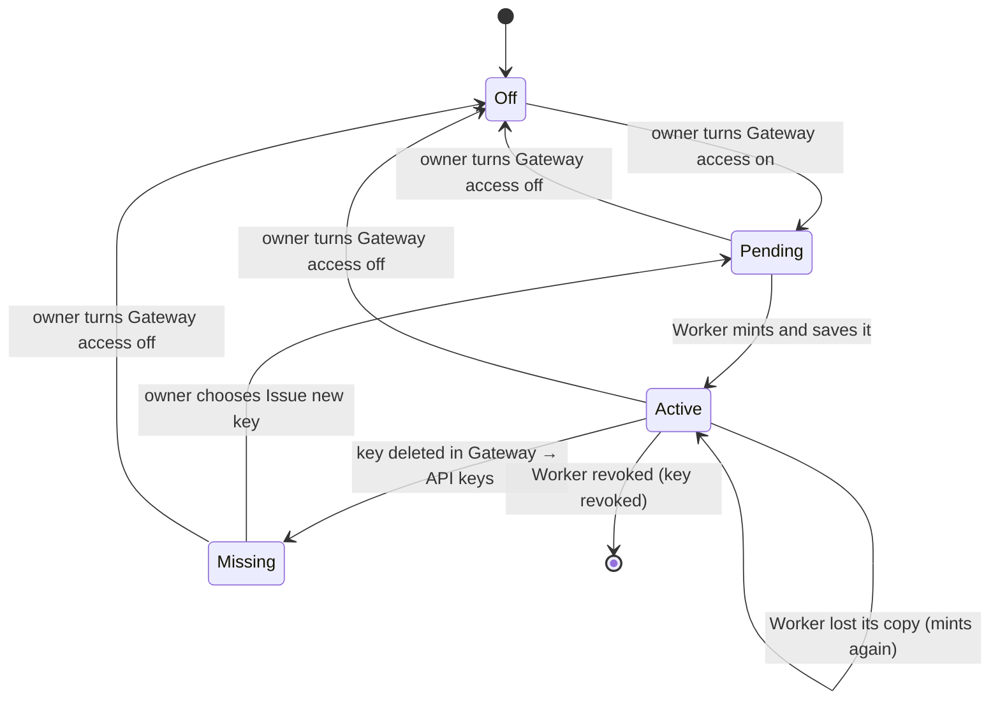

# ACP Agents On The Worker

Status: **workspace agent definitions, registry selection, Worker discovery, Chatroom authentication and Gateway mode implemented.** Binary archive installation and terminal login remain open. Overview: [ACP Agents](../ACP.md).

An ACP agent is a program on the Worker's machine. The workspace owner configures
it in **Settings → ACP**, in the Workspace group immediately after Workers, not
in a local Worker file. Convex
stores workspace-wide definitions in `acp_agents`; every enrolled Worker
subscribes to enabled definitions through machine-authorized
`acp.agentDefinitions`. A chat request selects an agent ID and Session directory,
never an executable, arguments or environment.

## Sources And Configuration

| Source   | Where it comes from                                                                                                                          | Who adds it                       |
| -------- | -------------------------------------------------------------------------------------------------------------------------------------------- | --------------------------------- |
| Registry | [ACP Registry](https://agentclientprotocol.com/get-started/registry), `https://cdn.agentclientprotocol.com/registry/v1/latest/registry.json` | Workspace owner in Settings → ACP |
| Custom   | Any ACP program installed on the Worker, defined by a command and arguments                                                                  | Workspace owner in Settings → ACP |

The ACP page uses the same workspace header and Group lists as other Settings
pages, with an **About ACP** link to the protocol site. Its **Agents** group lists
configured definitions: icon, name and muted version, a truncated command with
the full command in a tooltip, per-Worker availability pills, and an Enabled
switch. One actions menu holds Edit, per-Worker Sign in/Sign out where supported,
and Delete with confirmation.

The **Add agents** group shows the searchable registry inline, initially the first
eight matches with **Show all** for the remainder. Each row includes the agent's
icon, name, version, description and launch type. **Add** saves an enabled
`npx`/`uvx` definition directly; **Set up** opens a prefilled form for binary
entries. An existing agent ID shows **Added** instead. **Custom agent** and Edit
open a focused form, without a source toggle. Registry icons adapt to the theme.

The command-line field supports quotes and backslashes and previews the parsed
argument vector. Agent IDs appear only when creating: Sessions retain that ID
permanently. Environment rows are stored in Convex and visible to the owner;
they are **not secret storage**. Agents keep their own login and credentials on
each Worker's machine.

Definitions contain `agentId`, `name`, `command`, `args`, `env: [{name, value}]`,
`enabled`, `source: "registry" | "custom"` and optional `icon`/`version` and
`gateway: {enabled, env}` ([Gateway environment](#gateway-environment)).
Convex and the Worker share the same launch validation and forbidden environment
policy. At most 64 definitions can be configured per workspace.

The registry is fetched when the ACP page opens by an owner-authorized Convex
action (bounded to 1 MiB, 10 seconds and 200 valid entries). `npx` entries save
`npx -y <package> ...`; `uvx` entries save `uvx <package> ...`, using the registry's
versioned package names. Binary entries prefill the command basename and
arguments with an instruction to install the binary on each Worker's `PATH`.
Radium does not download, extract or automatically upgrade binary archives.

## Discovery And Availability

On each definitions update and Worker reconnect, the Worker:

1. Validates each enabled definition with the shared `acpAgentDefinitionError`.
   Invalid definitions report `failed` with that validation error, without spawning.
2. Resolves commands on **its own `PATH`** using `Bun.which`. A command containing
   `/` instead must point to an existing executable file; relative paths resolve
   from the Worker's working directory. Missing or non-executable commands report
   `unavailable` with `<command> was not found on this Worker's PATH`, without spawning.
3. Probes present commands by spawning, sending ACP `initialize`, reading
   capabilities/authentication methods and stopping the probe.
4. Replaces its full `worker_agents` catalog through `acp.reportAgents`.

There is no discovery polling loop. The configured name, source and icon are
used for display; the version comes from `agentInfo`, falling back to the
definition's version and then `unknown`. Only the native profile is probed; a
[Gateway profile](#gateway-mode) shares its availability.

Each definition shows a compact pill for every active Worker. Its tooltip reports
**Available** (with version), **Needs sign in**, **Not on PATH**, **Failed** (with
the reported error), **Offline** when Worker presence is stale, or **Waiting**
when an online Worker has not reported the agent yet. Offline takes precedence
over stale agent reports. Disabled agents wait for discovery after being enabled.
Sign in and supported Sign out actions live in the agent's menu and name the
online Worker they affect. Terminal-only login instructs the owner to use the
agent's CLI on that machine. The Workers page links to ACP settings rather than
duplicating this management surface.

`worker_agents` is one availability row per (Worker, agentId), written only by
that machine. It contains identity (`name`, `source`, `icon`, `version`), status,
capabilities (`loadSession`, list/resume/close/delete/fork/logout, prompt
image/audio/embeddedContext, MCP HTTP/SSE), auth methods and probe time. Session
creation adds last-seen defaults (config, modes, available commands) for draft
Composer controls; an agent advertising `delete` gets them right after its probe
from a throwaway session ([Draft Defaults](Sessions.md#draft-defaults)).
`sessionsSync` records the last [session index](Sessions.md#agent-session-index)
sync on that Worker.

### Editing And Removing Definitions

New commands use the latest definition. A process started from a superseded
definition is stopped once it has no running turn; edits never interrupt a
running turn or its approval/question wait. The next prompt starts the new
definition and loads/resumes the agent's existing Session when supported.

Removing or disabling a definition does not rebind or delete existing Sessions.
Their active turns can finish; new prompts fail with **Agent removed**. Restoring
the same agent ID makes it possible to use the existing binding again, subject
to that agent's own Session storage and reopening capabilities.

For a real scripted ACP fixture configured through this same form, see the
[Worker README](../../packages/worker/README.md#acp-agents).

## Process Model

- **One process per (Worker, agent, profile).** ACP multiplexes sessions on a
  connection, so sessions of the same agent share a process; a
  [Gateway profile](#gateway-mode) is a separate process because its environment
  differs. Each session gets its own absolute `cwd` in `session/new`.
- **Lazy start, idle stop.** The process starts on the first command for that
  agent. After every session is idle for the idle window (15 minutes),
  the Worker calls `session/close` where supported and stops the process. A
  session waiting on a permission or elicitation is never idle.
- **Crash handling.** A crashed process fails its in-flight turns (`failed`,
  `Agent process exited`), then restarts lazily with bounded backoff. Sessions
  come back through `session/resume` or `session/load` when next used
  ([Sessions](Sessions.md#reopening-and-recovery)).
- **Environment.** The agent gets the Worker user's environment minus Radium's
  own variables (`RADIUM_*` and `CONVEX_*`): no machine key, JWT, Convex URL or
  Worker config paths. Definition `env` is applied; entries that change program lookup, loaders, proxies or TLS
  trust (`PATH`, `LD_*`, `DYLD_*`, `NODE_OPTIONS`, `HTTPS_PROXY`, …) are refused,
  following ACP's launch-safety guidance. A Gateway-profile process also gets
  the expanded [Gateway environment](#gateway-environment), the only place the
  Worker's Gateway key enters an agent.
- **Streams.** stdout carries ACP only. stderr goes to the Worker's bounded local
  diagnostics, never into a Session or Convex.

## Agent Authentication

ACP agent credentials (Anthropic login, OpenAI key, …) belong to the agent on the
machine. Radium never stores or relays them.

```mermaid
sequenceDiagram
    participant UI as Chatroom
    participant CX as Convex
    participant W as Worker
    participant A as Agent

    W->>A: initialize
    A-->>W: authMethods [{id, type}]
    UI->>CX: CreateChat + first prompt
    CX-->>W: command: prompt
    W->>A: session/new
    A-->>W: error auth_required
    W->>CX: worker_agents.status = needs_auth, turn failed (auth)
    CX-->>UI: Sign in for the agent
    alt method type "agent"
        UI->>CX: command: authenticate {methodId}
        CX-->>W: authenticate
        W->>A: authenticate {methodId}
        Note over A: May raise a URL elicitation<br/>(opened in the browser after consent)
        A-->>W: {}
    else method type "terminal"
        Note over W: Owner uses the agent's own login command<br/>on the machine; Worker terminal login is not implemented
    end
    W->>A: re-initialize, session/new
    W->>CX: status = ready
```

- **Agent-type methods** run through `authenticate` from a Sign in action. An
  agent that opens a browser on the Worker's machine only works when the owner
  is at that machine; agents that use URL-mode elicitation work remotely.
- **Terminal-type methods** need an interactive terminal. The Worker has no
  PTY transport to the browser and does not advertise
  `clientCapabilities.auth.terminal`. Use the agent's own CLI login on the Worker
  machine; a dedicated Worker terminal-login command is not implemented.
- `logout` is offered when `agentCapabilities.auth.logout` is advertised.

## Client Capabilities Radium Advertises

| Capability                                    | Initial value | Reason                                                                                                                                            |
| --------------------------------------------- | ------------- | ------------------------------------------------------------------------------------------------------------------------------------------------- |
| `protocolVersion`                             | `1`           | Stable surface only                                                                                                                               |
| `fs.readTextFile`, `fs.writeTextFile`         | off           | The agent runs on the same machine and uses its own file tools; there are no unsaved editor buffers to serve                                      |
| `terminal`                                    | off           | Requires managed background processes and streamed output the Worker does not have yet ([Bash guide](../Worker/Bash_Tool.md#acp-terminal-bridge)) |
| `auth.terminal`                               | off           | No browser PTY                                                                                                                                    |
| `elicitation.form`, `elicitation.url`         | on            | Question prompt and consented URL opening                                                                                                         |
| Session notices / compaction / boolean config | on as stable  | Rendered as markers and Composer switches                                                                                                         |

Turning on `fs`/`terminal` later lets the Worker apply its own confinement and
show writes and commands it executes itself; that is a separate slice.

## Library

Use `@agentclientprotocol/sdk` 2.x with its default (stable v1) entry point:
`client({ name })`, typed `onRequest`/`onNotification` handlers, `connect(stream)`
over `ndJsonStream(stdin, stdout)`. SDK 2.0 removed `ClientSideConnection` and
`Client`; older examples using them are historical. The `/unstable` entry is
imported only for `session/fork`; `/experimental/v2` waits for M5.

## Gateway Mode

An agent always runs with its own models and credentials. Gateway mode is an
additional **launch profile** of the same agent that sends its model calls
through the Radium Gateway, gaining usage limits, multi-account routing, cost
tracking and telemetry. Code: `packages/backend/src/acp/gateway.ts` (placeholders,
templates, expansion), `packages/backend/src/worker/gateway.ts` (Worker key
state), `packages/worker/src/acp/` (key store, profile processes).

- **A separate entry, never a toggle.** The picker lists `OpenCode` and
  `OpenCode · Gateway` as two agents on that Worker (one process each, since the
  environment differs). A Session picks one at creation and keeps it
  (`aisdk_chats.agent.profile`), like any Agent, so the native models are always
  available.
- **Chat Completions only.** The Gateway serves OpenAI Chat Completions, so only
  agents that can point an OpenAI-compatible provider at a base URL can use it.
  Codex (Responses API only), Gemini CLI (Gemini API) and Claude Agent (Anthropic
  Messages, and excluded by provider terms) cannot. Subscription (OAuth)
  credentials are never routed through the Gateway for any agent.
- **Session id on every call.** Activity joins Gateway calls to the Session by the
  client session id (`X-Session-ID`, [Agents on the Gateway](../observability.md#local-cli-usage-ccusage)).
  A Gateway-profile turn's own usage report is never counted, so an agent that
  sends no session id is not counted twice: its calls stay under the Worker's
  key in Activity, without a Session.

### Gateway Environment

Gateway mode is general: any agent definition may carry a **Gateway
environment** (`gateway: {enabled, env}` on `acp_agents`), environment rows
applied only to the Gateway profile on top of the definition's own `env`. Values
may contain placeholders the Worker fills in locally when it starts the process:

| Placeholder          | Value                                                                                                                                        |
| -------------------- | -------------------------------------------------------------------------------------------------------------------------------------------- |
| `{{gateway.url}}`    | `<Convex site>/api/openai/v1`, from the Worker's setup                                                                                       |
| `{{gateway.key}}`    | The Worker's Gateway key; substituted on the Worker, never stored in Convex                                                                  |
| `{{gateway.models}}` | JSON object of the workspace's Gateway models: `{"<slug>":{"name":"…","limit":{"context":N,"output":M}}}` (`limit` only when both are known) |
| `{{gateway.model}}`  | The first Gateway model's slug, for agents that take one default model                                                                       |

The rows follow the definition `env` rules (at most 32, refused names such as
`PATH`, `LD_*` or proxies); an unknown `{{…}}` placeholder is rejected on save,
and an enabled Gateway profile needs at least one row. The models are read when
the Gateway process starts, so a model added to the workspace appears after the
process restarts (idle stop or definition edit). A workspace with no Gateway
models fails the turn with **The workspace has no Gateway models.**

**Templates.** Registry agents with a verified template get it prefilled on
**Add**/**Set up**, and Edit offers it again. Only OpenCode (`opencode` and
`opencode-v2`) has one, verified with OpenCode 2.2.4 over ACP: the session's model
option lists only the Gateway models, and every call carries the key and
`X-Session-Id: <ACP session id>`.

```text
OPENCODE_CONFIG_CONTENT={"enabled_providers":["radium"],"provider":{"radium":{"name":"Radium Gateway","npm":"@ai-sdk/openai-compatible","options":{"baseURL":"{{gateway.url}}","apiKey":"{{gateway.key}}"},"models":{{gateway.models}}}}}
```

Other agents can be configured by hand. Qwen Code, for example, works with
`OPENAI_BASE_URL={{gateway.url}}`, `OPENAI_API_KEY={{gateway.key}}` and
`OPENAI_MODEL={{gateway.model}}`, but offers that single model and sends no
session id, so it has no template.

### Native Provider Configuration (Planned)

ACP's draft [Configurable LLM Providers](https://github.com/agentclientprotocol/agent-client-protocol/blob/main/docs/rfds/custom-llm-endpoint.mdx)
RFD lets a client redirect an agent's model calls without env vars or config
files. Radium does not use it yet. The agent advertises
`agentCapabilities.providers: {}` in `initialize`, and the client then calls:

- `providers/list` → `{providerId, supported: [apiType…], required, current: {apiType, baseUrl} | null}`;
  headers are never returned.
- `providers/set {providerId, apiType, baseUrl, headers}`: replaces that
  provider's whole configuration (`apiType`: `openai`, `anthropic`, `azure`,
  `vertex`, `bedrock` or an extension).
- `providers/disable {providerId}` for providers that are not `required`.

Calls belong after `initialize` and before `session/new`/`session/load`. The
configuration lasts for the process and is not persisted, which matches one
Gateway-profile process per (Worker, agent). `@agentclientprotocol/sdk` 2.2.0
ships the methods in its `/unstable` entry.

Probed on 2026-11-05 (`initialize`, then `providers/set` against a logging mock):

| Agent                                                                           | `providers` | `supported`                      | Behaviour after `providers/set`                                                                                                                                                                                         |
| ------------------------------------------------------------------------------- | ----------- | -------------------------------- | ----------------------------------------------------------------------------------------------------------------------------------------------------------------------------------------------------------------------- |
| Codex ACP 2.5.0                                                                 | yes         | `openai`                         | `GET <base>/models`, then `POST <base>/responses`, both with the supplied `Authorization`. Its model list therefore comes from the base URL. No `session_id`/`x-session-id` header was seen (other headers not checked) |
| Claude Agent ACP 0.101.0                                                        | yes         | `anthropic`, `bedrock`, `vertex` | `GET <base>/v1/models` with the supplied header, `POST <base>/v1/messages` with `Authorization: Bearer acp-proxy` instead; how it forwards credentials needs checking                                                   |
| OpenCode 2.2.4, Qwen Code 0.26.8, Gemini CLI 0.67.0, pi-acp 0.0.34, omp 18.16.0 | no          | —                                | Use the [Gateway environment](#gateway-environment)                                                                                                                                                                     |

The agents that support it speak the APIs the Gateway lacks: Codex needs the
Responses API, Claude Agent needs Anthropic Messages
([Gateway protocols](../tasks/10_Gateway_Protocols.md)). Claude Agent also stays
excluded from Gateway mode by provider terms unless that decision is revisited.

Planned Worker behaviour, once the Gateway serves an `apiType` the agent lists:

1. A definition may offer a Gateway profile without Gateway env rows when its
   Worker probe reports `providers` with a supported `apiType`; the probe
   result needs a field on `worker_agents` so Convex and the picker know it.
2. On a Gateway-profile process, the Worker calls `providers/list`, then
   `providers/set` for the matching provider with `baseUrl` = the Gateway URL
   of that protocol and `headers.Authorization = Bearer <Worker key>`, and
   `providers/disable` for the other non-required providers, all before the
   first `session/new`/`session/load`. Gateway env rows are then not applied.
3. The key travels over the ACP connection only, never in the agent's
   environment, so commands the agent runs cannot read it (an improvement on
   env templates, see [Security](#security)).
4. Key rotation needs a process restart (or a fresh `providers/set` before the
   next session), the same as today.

Still to verify then: how each agent sends its session id (Activity's join),
Claude Agent's credential forwarding, and whether the RFD's method names change
before it stabilizes.

### Worker Gateway Key

Each Worker has at most one Gateway key, used by all of its Gateway profiles.
Its state lives in `worker_gateway` (`access`: `off`, `pending`, `active`,
`missing`; `telemetry`; current `key`); the key itself is an ordinary `api_keys`
row with `worker` set.

- **Issue.** The owner turns on **Gateway access** on the Worker's row in
  Settings → Workers (`workers.setGatewayAccess`), which only marks the Worker
  `pending`. The Worker sees that on its control subscription (`acp.gatewayState`)
  and calls the machine-authorized `acp.mintGatewayKey`, which creates the key and
  returns the plaintext in its response. The plaintext is never stored in Convex.
  The Worker saves it beside its machine identity (owner-only file permissions)
  and injects it only into Gateway-profile processes.
- **Lost response or local copy.** While access is on, the Worker mints again
  whenever it holds no key or a different key than Convex records; each mint
  revokes the previous key. Only the Worker's own machine identity can mint.
- **Visible as a Worker key.** Gateway → API keys lists it under the Worker's
  name with a `Worker` tag (`Worker · <name>` once the key is renamed);
  deleting it from there warns that the Worker's Gateway agents stop.
- **Disable.** Turning Gateway access off revokes the key and hides the
  Worker's Gateway profiles from the picker. Each agent's Gateway switch in
  Settings → ACP hides that agent's profile. Revoking the Worker revokes its key.



A deleted key fails closed, and nothing is replaced silently:

- Convex marks the Worker's access `missing`; the Worker sees it on its
  control subscription, deletes its local copy, stops Gateway-profile processes
  and fails their in-flight turns with `Gateway key deleted` (`Gateway access
  turned off` when access is switched off). The picker shows the profile as
  **Gateway key deleted**, and `acp.Prompt` refuses new prompts.
- A Session on a Gateway profile is **not** moved to the agent's native profile:
  that would change credentials, billing and possibly models mid-Session, which
  the Agent lock forbids. The Session shows a notice with **Issue new key** for
  the owner (`workers.issueGatewayKey`); members see that the owner must issue it.
- A new key is never minted after a deletion until the owner issues one, since
  deletion was an explicit owner action. The Worker then mints a fresh key and
  Sessions continue through `session/resume` or `session/load`.
- If the Worker was offline when the key was deleted, the agent's next model
  call gets a Gateway 401 naming the Worker whose key was deleted, so the agent's
  error is readable; the Worker reconciles when it reconnects.

### Telemetry

Gateway-profile model calls are ordinary Gateway requests, so
[Gateway telemetry](../Radium_Gateway/Telemetry.md) captures them under the
workspace's settings (`recordInputs`, `recordOutputs`, retention). This is
one of the reasons for Gateway mode, and it is the one place ACP conversation
content may be stored by Radium, only when the owner records content.

- **Per-key switch.** Every Gateway key has a **Telemetry** setting:
  _Workspace settings_ (default) or _Off_ (nothing captured for that key's
  requests, `api_keys.telemetry`). Gateway → API keys sets it for ordinary keys
  (`keys.setKeyTelemetry`).
- **Worker keys follow the Worker.** The Worker's row has a **Gateway telemetry**
  switch (`workers.setGatewayTelemetry`) that sets its key's setting, and every
  newly minted key inherits it.
- **Attribution.** Requests are attributed to the Worker's key, and to the
  Session through the agent's session id when it sends one.

## Security

An ACP agent runs as the Worker's OS user with that user's full access, like
Worker Bash: the Session directory is a `cwd`, not a sandbox. The agent's own
permission system decides what asks for approval; Radium relays those requests
and records the decision but cannot enforce anything the agent does not ask
about. Owners should treat enabling an ACP agent on a Worker like granting
unrestricted Bash on it.

A Gateway-profile agent, and every command it runs, can read the Worker's
Gateway key from its environment. That grants no more than the agent already
has as the OS user, but the key can call any model of the workspace: revoke it
(Gateway access off, or delete it in Gateway → API keys) if the machine is
compromised.
