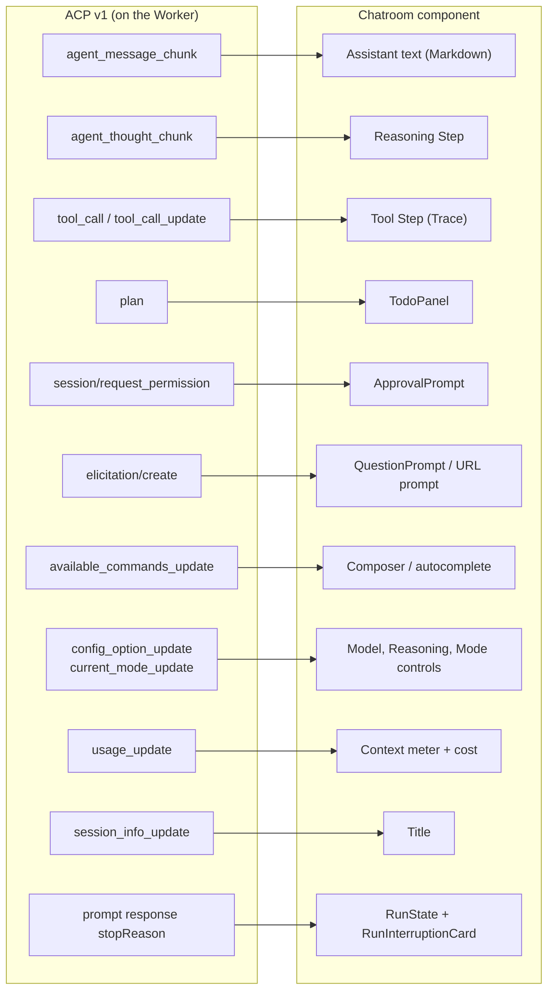

# ACP In Chatroom

Status: **implemented.** Overview: [ACP Agents](../ACP.md). Code: `apps/web/src/components/session/acp/` — `useAcpSession` (subscriptions and actions), `view-model.ts` (items → messages, RunState), `acp-session-screen.tsx`, the permission/elicitation prompts, config controls and ACP tool renderers; frames are folded by `packages/backend/src/acp/fold.ts`. `SessionScreen` renders `AcpSessionScreen` for chats whose `GetChat.agent` is set.

An ACP Session uses the same Composer, `ModelPicker`, Tools trigger,
`SessionWorkerControl`, `ContextUsage`, Trace Steps, Approval prompt, Question
prompt, Todo panel and Run state as the built-in agent. Only the data source
differs: `useAcpSession(chat)` builds the view from frames, `acp_sessions` and
`acp_interactions` instead of `useChat` over `POST /api/aisdk/chat`.

## Loading And Visibility

A Session is **visible** when its Radium Tab is active and the browser tab is
visible (`document.visibilityState`). Many Tabs and devices can view one Session;
each pays only for what it shows.

| Subscription                                                                     | Mounted, not visible                     | Visible                                       |
| -------------------------------------------------------------------------------- | ---------------------------------------- | --------------------------------------------- |
| `aisdk.GetChat`, `acp.GetSession` (quiet metadata: title, status, config, usage) | Yes, drives the Tab's title and RunState | Yes                                           |
| `chatroom.Watch` heartbeat                                                       | No                                       | On becoming visible, then every 60 s          |
| `chatroom.LiveFrames`                                                            | No                                       | Yes, from the folded timeline's next sequence |
| `acp.OpenInteractions`, `acp.WorkerStatus`                                       | No                                       | Yes                                           |

- Content subscriptions use Convex's own `useQueries`, so they end as soon as the
  Session is hidden (TanStack Query would keep them alive until its cache GC).
- The folded timeline stays in memory while hidden. Returning resubscribes from its
  next sequence; frames stay warm for five minutes after the last heartbeat, so a
  short absence costs only the missed frames.
- A Session that went cold meanwhile is warmed again by the heartbeat and starts a
  new epoch; the client replaces its content with the new snapshot. Older pages are
  kept across an epoch switch only when the switch happened while the Tab was
  following the stream live (a size rollover).
- `LiveFrames.fromSeq` advances only when a page returns 64 frames, so the
  subscription arguments stay stable while a turn streams.
- `acp.WorkerStatus` (Worker name and last heartbeat) drives the `Worker offline`
  badge and the "Content lives on <Worker>" state; it wakes on every Worker
  heartbeat, which is why only visible Sessions subscribe.

## View Model

`useAcpSession` turns timeline items into the message shapes
`session-message.tsx` already renders: `user` items become user turns, and
`agent`, `thought` and `tool` items between two user items become one assistant
turn with text, reasoning and tool parts. Tool items use the AI SDK
`dynamic-tool` part shape with the ACP kind as tool name, so Trace, Steps and
`tool-parts.ts` keep one rendering path; `tool-step.tsx` gains renderers per ACP
kind. Components never read ACP types directly.

The assistant footer shows the agent name (`message-actions.tsx` already has
`agentName`) and the selected model option's name. Actions hidden for ACP are
listed in [Sessions](Sessions.md#unsupported-chatroom-actions).

## Tool Steps

| ACP kind         | Trace line                              | Body                                           |
| ---------------- | --------------------------------------- | ---------------------------------------------- |
| `read`           | Read + path from `locations`            | `content` text, numbered when it is code       |
| `edit`           | Edit + path, `+added −removed`          | `diff` content as per-file diffs (`CodeBlock`) |
| `delete`, `move` | Delete / Move + path(s)                 | Content, if any                                |
| `search`         | Search + title                          | Content                                        |
| `execute`        | Run + command (from title or raw input) | Text content as `TerminalLog`                  |
| `fetch`          | Fetch + URL                             | Content                                        |
| `think`          | Title                                   | Rendered like a reasoning Step                 |
| `switch_mode`    | Title                                   | Marker only                                    |
| `other`          | Title                                   | Content, else raw input/output as JSON         |

| ACP status                       | RunState                                          |
| -------------------------------- | ------------------------------------------------- |
| `pending`                        | `queued`                                          |
| `in_progress`                    | `executing`                                       |
| `completed`                      | `succeeded`                                       |
| `failed`                         | `failed`                                          |
| open when the turn was cancelled | `cancelled` (ACP v1 has no cancelled tool status) |

`locations` show as Machine text paths. `terminal` content only appears if Radium
advertises the terminal capability, which it does not initially.

## Permissions

`session/request_permission` opens the existing `ApprovalPrompt` in the
Composer's place with the tool call's title and content (diff or command), and
buttons built from the agent's options:

| Option kind     | Button                 |
| --------------- | ---------------------- |
| `allow_once`    | Approve (⌘/Ctrl+Enter) |
| `allow_always`  | Always allow           |
| `reject_once`   | Reject (Esc)           |
| `reject_always` | Always reject          |

Option `name`s from the agent are the button labels; kinds only choose
placement and shortcuts. ACP has no rejection reason, so `Reject with reason` is
hidden: the user can send a message after rejecting. The agent remembers
`allow_always`/`reject_always`; Radium does not keep its own allow-list for ACP.
Several open requests are answered one at a time (`1 of N`).

## Questions (Elicitation)

`elicitation/create` replaces the built-in `question` tool. The prompt names the
requesting agent, as ACP requires.

**Form mode** renders the shadcn `Questionnaire` through `QuestionPrompt`, one
schema property per question:

| Schema property                | Question                                |
| ------------------------------ | --------------------------------------- |
| `string` with `enum` / `oneOf` | Single choice (option titles as labels) |
| `array` of enum                | Multiple choice                         |
| `boolean`                      | Yes / No                                |
| `string`, `number`, `integer`  | `Type your own answer…` only, validated |

`title` is the header, `description` (or the request `message` for the first
question) the question. Defaults are pre-selected, required properties cannot be
skipped, and the user reviews answers before Submit. Submit → `accept` with
content; Dismiss (Esc) → `cancel`; an explicit Decline → `decline`. The server
validates content against the stored schema before the Worker relays it.

**URL mode** shows a Composer-shaped card with the message and the full URL,
host emphasized and Punycode flagged. Open launches it in a new browsing context
(`noopener`) and answers `accept`; nothing is prefetched. `elicitation/complete`
closes the card if it is still open.

Agents that never send elicitations (some ask in plain text instead) simply
continue in text; Radium does not inject its own `question` tool into ACP
agents.

## Plans

The latest `plan` item feeds `TodoPanel` unchanged: entry `content` and `status`
(`pending`, `in_progress`, `completed`) match `todo_write`. Priority is not
shown. Each `plan` update replaces the list, like `todo_write`.

## Composer

- **Model / Reasoning / Mode** come from the agent's config options
  ([Sessions](Sessions.md#config-model-and-mode)). The normal `ModelPicker`
  displays the agent's models and thought-level labels in drafts and Sessions;
  mode stays a chip beside it and extra options stay in overflow. Gateway
  providers, service tiers, Pro/Normal presets and token budgets are hidden.
- **Tools:** the normal `ToolsDialog` trigger remains visible but disabled,
  explaining **The agent brings its own tools**. ACP does not substitute a
  separate tool picker.
- **Session corner:** the normal `SessionWorkerControl` displays the fixed
  Worker and agent, with no target-change action. `ContextUsage` displays the
  agent's used/size context snapshot and optional native-currency cost, not a
  fabricated Gateway token breakdown or converted cost.
- **Slash commands:** typing `/` lists `available_commands_update` entries with
  descriptions and input hints; the command is sent as ordinary prompt text.
- **Attachments** follow `promptCapabilities`: images when `image`, audio when
  `audio`, text files as embedded resources when `embeddedContext`; otherwise
  the attach control is disabled with the reason. Uploads use the existing
  `chat_files` upload URL as transient files deleted once the Worker has
  delivered the prompt.
- **Stop** sends `cancel`; the turn ends when the agent answers the prompt with
  `cancelled`.
- **Send while running** is disabled; Stop first.

## Run State

Mapped once in `useAcpSession`:

| Backend state                                    | RunState    |
| ------------------------------------------------ | ----------- |
| `starting`, prompt command not yet claimed       | `queued`    |
| `running`, latest item is a streaming `thought`  | `thinking`  |
| `running`, latest item is streaming `agent` text | `streaming` |
| `running`, a `tool` item is `in_progress`        | `executing` |
| `awaiting`                                       | `awaiting`  |
| `idle` after `end_turn`                          | `succeeded` |
| `idle` after `cancelled`                         | `cancelled` |
| `failed`                                         | `failed`    |

A Worker that goes offline (presence older than 60 s) during a turn keeps the
last state with a `Worker offline` label; the turn becomes `failed` only when
the Worker reports it lost or restarts.

Stop reasons and failures surface on `RunInterruptionCard`:

| Cause                                   | Card                                               |
| --------------------------------------- | -------------------------------------------------- |
| `max_tokens`                            | Request failed: output limit reached               |
| `max_turn_requests`                     | Request failed: the agent's turn limit was reached |
| `refusal`                               | Request failed: the model refused                  |
| `auth_required`                         | Sign in to the agent (action)                      |
| Agent process exited / Worker restarted | Request failed with the reason                     |
| `cancelled`                             | Interrupted                                        |

## Notifications

Worker lifecycle mutations schedule the existing
`internal.notifications.notifySession` with the same kinds the built-in agent
uses: finished (`end_turn`), failed, waiting for approval (permission), waiting
for an answer (elicitation). Stopped turns notify nobody. This lifts the current
limit in [Notifications](../Notifications.md) that ACP agents do not notify.

## Agent Picker

The Run target picker's Agent list (`run-target-picker.tsx`) replaces "ACP
agents are planned." with the Worker's `worker_agents` rows: `ready` agents are
selectable with their registry icon, `needs_auth` agents show Sign in, and the
built-in agent stays first. An agent's [Gateway profile](Agents.md#gateway-mode)
is its own entry (`Codex · Gateway`). `agentsOnWorker` and `sessionAgentById` in
`components/session/agents.ts` read those rows; the fallback to the built-in
agent when a Worker change removes the chosen agent stays as implemented. After
the first message, the Session context reads `Worker (Agent)` and is fixed.
