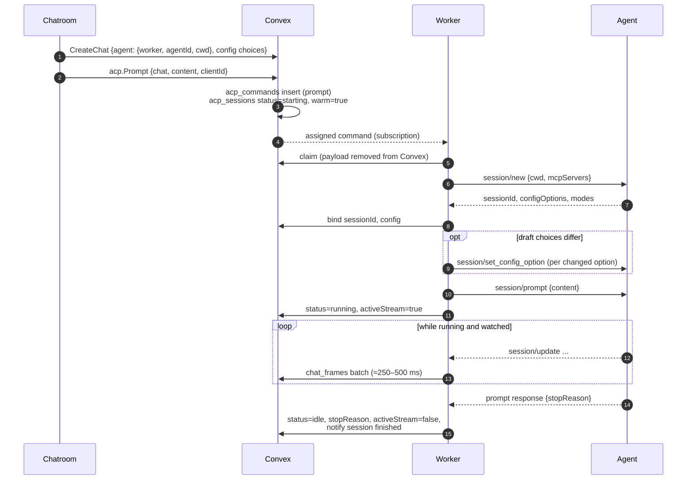
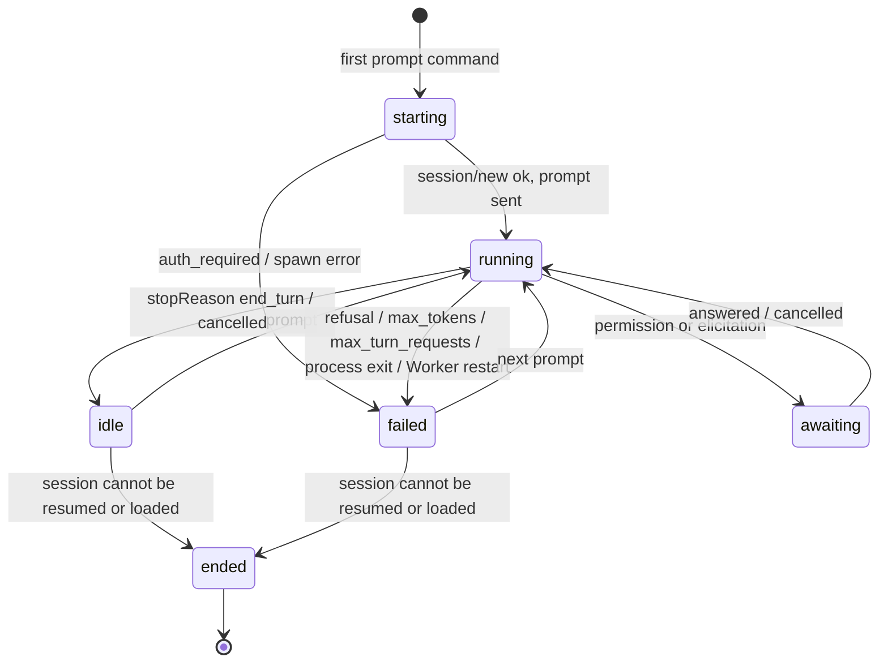
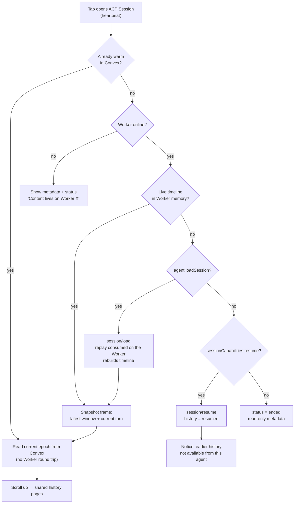

# ACP Sessions

Status: **proposed.** Overview: [ACP Agents](../ACP.md).

A Radium Session (`aisdk_chats` row) with an ACP agent is bound to exactly one
ACP session on one Worker. Radium keeps the binding and a small status record;
the conversation lives in the agent.

## Binding

`aisdk_chats.agent` (proposed, optional; absent means the built-in agent):

```ts
type ChatAgent = {
  kind: "acp";
  worker: string;        // Worker identity ID, same workspace as the chat
  agentId: string;       // registry id or custom id, e.g. "claude-acp"
  profile: "native" | "gateway"; // launch profile (Agents.md#gateway-mode)
  agentVersion: string;  // version that created the session
  cwd: string;           // absolute directory on the Worker (Project folder or explicit)
  sessionId?: string;    // ACP session ID, set by the Worker after session/new
};
```

Invariants, enforced server-side:

- `agent` is set only by `CreateChat` (or import) and no mutation changes
  `kind`, `worker`, `agentId`, `profile` or `cwd` afterwards. `sessionId` is
  written once, by the bound Worker.
- `SetChatWorker` rejects ACP chats; Worker tool selections (`aisdk_chats.worker`,
  `tools`) do not apply to them. The built-in agent's Worker tools stay editable
  as today.
- Forking an ACP chat produces an ACP chat with the same `worker`, `agentId` and
  `cwd`. A built-in chat cannot fork into an ACP chat and vice versa.
- `POST /api/aisdk/chat` rejects ACP chats; ACP turns go only through
  `acp_commands` ([Transport](Transport.md)).

### `acp_sessions` (proposed)

One row per ACP chat, kept apart from `aisdk_chats` so frequent changes (config,
usage, pending interactions) do not invalidate the Home `ListChats`
subscription. Only turn boundaries touch `aisdk_chats` (`activeStream`,
`lastInteractionAt`, `interruption`, `title`).

| Field | Meaning |
| --- | --- |
| `chat`, `worker` | Owning chat and its bound Worker (indexed for the Worker's subscription) |
| `status` | `starting`, `idle`, `running`, `awaiting`, `failed`, `ended` |
| `epoch` | Stream epoch; bumped on each snapshot so stale frames are ignored |
| `stopReason` | Last `session/prompt` stop reason |
| `config` | Current `configOptions` (ids, categories, choices, selected values), `modes`, `currentModeId` |
| `commands` | Latest `available_commands_update` (names, descriptions, input hints) |
| `usage` | Latest `usage_update`: context `used`/`size`, optional cumulative `cost` |
| `warm` | Whether content is currently held in Convex ([Transport](Transport.md#warm-and-cold-sessions)); flips only on transitions |
| `history` | `full` (load), `resumed` (resume, no replay) or `none` |

None of these fields contain conversation content.

## Creating A Session

The draft shows the agent's last known config (`worker_agents.defaults`) so the
owner can pick a model and mode before any ACP session exists. The ACP session
is created on the first prompt, never on draft selection, so abandoned drafts
leave nothing in the agent's store.



Only one prompt is in flight per session. While `running` or `awaiting`, the
Composer offers Stop; queued sends are not supported because agents differ in
how they handle a second `session/prompt`.

## Status



`acp_sessions.status` is the backend status mapped once to `RunState` at the
data boundary ([mapping](Interactions.md#run-state)).

## Config, Model And Mode

The agent, not Radium, defines which models and modes exist:

| ACP | Composer control |
| --- | --- |
| config option, category `model` | Model control lists the agent's choices instead of Gateway models |
| config option, category `thought_level` | Reasoning control |
| `modes` / `current_mode_update` (or a `mode` category option) | Mode chip next to Model |
| Other config options (select, boolean) | Overflow menu in the Composer |

Changing a value sends a `set_config` command; the Worker calls
`session/set_config_option` (or `session/set_mode`), and the response's complete
config replaces `acp_sessions.config`. An agent-initiated
`config_option_update` or `current_mode_update` does the same. Service tiers,
Gateway reasoning presets and the Radium tool menu are hidden for ACP Sessions.

## Reopening And Recovery

Opening a Session asks for content; it does not assume the agent still has a
live session.



- A reload, a second Tab or another device within five minutes of the last
  heartbeat finds the Session warm and reads it straight from Convex.
- `session/load` replays the entire conversation as `session/update`
  notifications before it returns. The Worker consumes that replay to rebuild its
  in-memory timeline and sends only the requested window to Convex, so reopening
  a long session costs one bounded snapshot, not the full transcript.
- Older content is fetched page by page on scroll ([history pages](Transport.md#history-pages)).
- A Worker or agent restart during a turn loses that turn: ACP v1 cannot
  re-attach to an in-flight `session/prompt`. The Worker marks it `failed`
  (`Worker restarted` / `Agent process exited`) when it next starts, and the next
  prompt resumes or loads the session first. Nothing is re-sent automatically.
- The live timeline is evicted when the session goes idle past the idle window,
  together with `session/close`.

## Title

The agent's `session_info_update.title` wins whenever present, including later
updates. Until then Radium uses its existing title generator over the first
prompt text; the prompt passes through the title model once and is not stored.
A user rename sets the Radium title and stops agent titles from overwriting it.

## MCP Servers

ACP sets a session's MCP servers in `session/new`, `session/load` and
`session/resume` (`mcpServers`). Radium passes the workspace's HTTP MCP servers
there when the agent advertises `mcpCapabilities.http`.

- **Per server:** each MCP server's settings get **Available to ACP agents**
  (`mcp_servers.acp`, absent means on).
- **Per Session:** ACP chats replace the Tools menu with an **MCP servers**
  menu listing the available servers, all on by default. The draft's choice is
  stored on the chat like today's tool override.
- **Overlap:** ACP does not report which MCP servers an agent already has in its
  own config, so Radium cannot detect duplicates; two copies of a server mean
  duplicated tools and possible name clashes in the agent. The Session menu is
  the fix, and Settings → Workers can keep a per-agent default exclusion list
  ("this agent already has GitHub").
- **Applying changes:** servers are fixed at session setup. A change mid-Session
  applies the next time the Worker sets the session up (load/resume after
  eviction or restart); **Apply now** closes and resumes it immediately when the
  agent supports `close` and `resume`, and is hidden otherwise.
- **Secrets:** bearer tokens go from Secret Store to the Worker through a
  machine-authorized query at session setup and are handed to the agent process.
  They never pass through the browser, commands or frames. Passing a server to
  an agent means trusting that agent with its token.

## Import

Sessions created outside Radium (Zed, the agent's own CLI) are not listed
automatically. New session → Run target → **Open existing** runs `session/list`
on demand:

1. The owner picks Worker, agent and directory; the browser sends a `list`
   command with `cwd` set to that directory.
2. The Worker calls `session/list` and returns one page (`sessionId`, `title`,
   `updatedAt`) as a transient reply. The opaque `nextCursor` stays inside that
   reply and browser memory only; ACP forbids persisting cursors.
3. Choosing one creates a chat with `agent.sessionId` set and no `session/new`;
   the reopen flow above loads it.

Requires `sessionCapabilities.list`. Without it the action is hidden.

## Fork

`session/fork` is unstable in ACP v1 and gated by
`sessionCapabilities.fork`. Behind a flag, the message footer Fork on the
**latest** assistant turn creates a new ACP chat bound to the forked session.
Forking from an older turn is not offered: ACP has no "fork at message".

## Delete

Deleting an ACP chat is two steps:

1. The normal delete confirmation removes the Radium rows (`aisdk_chats`,
   `acp_sessions`, pending commands, frames, interactions) and queues a `close`
   command for the Worker carrying the binding (`worker`, `agentId`, `profile`,
   `sessionId`).
2. When the agent advertises `sessionCapabilities.delete`, a second
   confirmation follows: **Also delete this session in Claude Agent?** (the agent's name). It explains
   that the conversation disappears from the agent and from other clients such as
   Zed. Confirming queues a `delete` command; dismissing leaves the session in
   the agent.

Both commands outlive the chat and expire after seven days if the Worker never
comes back.

## Unsupported Chatroom Actions

| Action | Built-in | ACP | Why |
| --- | --- | --- | --- |
| Revert / Restore | Yes | Hidden | ACP has no history truncation |
| Edit and resend | Yes | Hidden | Same |
| Regenerate | Yes | Hidden | Same |
| Retry (interruption card) | Continues after the last completed step | Hidden; the card keeps Copy error | No partial-step semantics; the next prompt continues |
| Switch model (interruption card) | Opens Model | Opens the agent's Model option | Model is an agent config option |
| Fork | Any assistant turn | Latest turn, flag, `fork` capability | Unstable `session/fork` |
| Change Worker / Agent / directory | Worker and tools editable | Locked | The session lives in that agent, on that machine |
| Tools menu, Code Mode, web search, system prompt | Yes | Hidden; an MCP servers menu instead ([MCP Servers](#mcp-servers)) | The agent brings its own tools and prompt |
