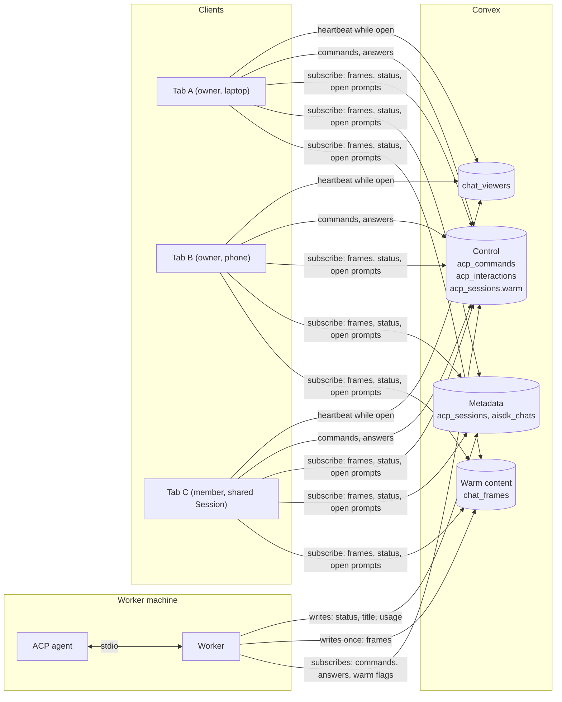
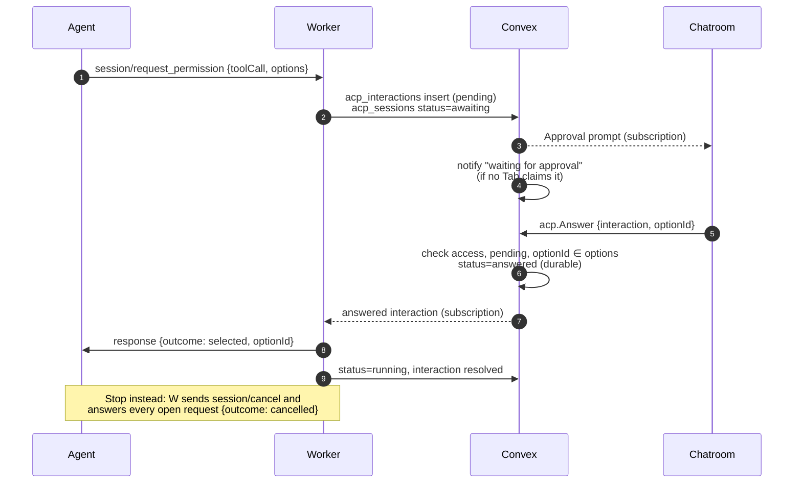

# ACP Transport Through Convex

Status: **proposed.** Overview: [ACP Agents](../ACP.md). Builds on the selected
[Worker Convex Client transport](../Worker/Convex_Transport.md); where that guide
proposes saving final messages in Convex, ACP Sessions instead keep content in
the agent and hold relayed content in Convex only while the Session is open
somewhere, plus five minutes.

The Worker speaks stdio ACP to the agent and a Radium-specific relay to Convex.
Raw JSON-RPC never leaves the Worker: the Worker answers agent requests itself
and forwards a normalized event model, so the browser is independent of ACP
versions and agent quirks.

## Connections

Nothing connects to the Worker, and clients never connect to each other. The
Worker and every client each hold one outbound Convex WebSocket; Convex tables are
the meeting point. The Worker writes a piece of output once, and Convex pushes it
to every subscribed client, so a second or tenth viewer adds reads, not Worker
writes.

| Channel | Direction | Table (proposed) | Write pattern | Lifetime |
| --- | --- | --- | --- | --- |
| Commands | Client → Worker | `acp_commands` | One insert per user action | Payload removed on claim; row pruned 5 min after done |
| Frames | Worker → Clients | `chat_frames` | Batched, only while the session is warm | Until the session goes cold |
| Interactions | Worker ↔ Clients | `acp_interactions` | Immediate, durable decision | Until answered + grace |
| Lifecycle | Worker → Clients, notifications | `acp_sessions`, `aisdk_chats` | Turn boundaries and state changes | Durable metadata |
| Viewer heartbeats | Clients → cron | `chat_viewers` | Once a minute per open Tab | Until the session goes cold |
| Agent catalog | Worker → Clients | `worker_agents` | Install, probe, auth changes | Durable metadata |

The Worker's subscriptions are small and quiet: pending commands, answered
interactions, and the list of its warm sessions. It never reads frames or
heartbeats. A client viewing a Session subscribes to that chat's `acp_sessions`
row, its open interactions, and its frames.

### Several clients at once

- Convex serializes mutations, so concurrent actions resolve deterministically:
  `acp.Prompt` is accepted only while the session is `idle`; a second client's
  prompt during a turn is rejected with "already running".
- An interaction is answered once: the first valid answer wins, later ones are
  rejected, and every client sees the prompt close.
- Stop and config changes from any controlling client apply to everyone.
- Viewing and controlling are separate: anyone who can see the chat may view;
  controlling actions follow [Who Can Use It](../ACP.md#who-can-use-it).

## Normalized Timeline

The Worker folds `session/update` notifications into a per-session timeline of
**items** and emits **ops** against it. The model follows ACP v2's draft
semantics (ID-addressed upserts; omitted = unchanged, `null` = clear, value =
replace; text chunks append), which makes the later v2 adapter a local change.

| Item kind | From ACP v1 |
| --- | --- |
| `user` | The prompt the Worker sent; `user_message_chunk` during load |
| `agent` | `agent_message_chunk` |
| `thought` | `agent_thought_chunk` |
| `tool` | `tool_call`, `tool_call_update` (title, kind, status, locations, content, raw input/output) |
| `plan` | `plan` (whole list replaced each time) |
| `notice` | `notice`, `compaction_update`, `compaction_summary_chunk`, errors |

| Op | Effect |
| --- | --- |
| `item.upsert {id, kind, ...fields}` | Create an item or patch its fields |
| `text.append {id, text}` | Append streamed text to an `agent`/`thought`/`user` item |
| `turn.start {turnId}` / `turn.end {turnId, stopReason}` | Turn boundaries |
| `session.patch {config?, commands?, usage?, info?}` | Also mirrored to `acp_sessions` at boundaries |

ACP v1 message IDs are optional. Without them the Worker starts a new `agent`
or `thought` item when the chunk kind changes or after a tool call, which
matches how Chatroom splits Steps today.

## Warm And Cold Sessions

A Session's content is in Convex only while someone has it open, plus five
minutes. That makes reloads, extra Tabs, and other devices free while it is in
use, and leaves nothing behind once everyone leaves.

```mermaid
stateDiagram-v2
    [*] --> Cold
    Cold --> Warming: a Tab opens (first heartbeat)
    Warming --> Warm: Worker wrote the snapshot
    Warm --> Warm: heartbeats; live frames; history pages
    Warm --> Cooling: no heartbeat for 5 minutes
    Cooling --> Cold: cron deletes frames, warm = false
    Cold --> Cold: turns run; only lifecycle is written
```

- **Heartbeat.** A Tab showing the Session calls `chatroom.Watch(chat)` on open and
  every 60 seconds while it stays open, setting `chat_viewers.lastSeenAt`. There is
  no unwatch: closing a Tab simply stops the heartbeat, so a quick return finds
  the Session still warm.
- **Warming.** The first heartbeat on a cold session sets `acp_sessions.warm = true`.
  The Worker sees the flag through its warm-sessions subscription, writes a
  **snapshot** (the current turn plus the latest items, up to 64 KiB) as the first
  frames of a new **epoch**, then streams live ops after it. If the Worker is
  offline the flag waits, and the client shows metadata only.
- **Warm.** Every client, whenever it joins, reads the current epoch from
  sequence 0: the same snapshot plus every op since. No client needs the Worker
  to resend anything. History pages requested by any viewer are shared and stay
  for everyone.
- **Cooling and cold.** A cron runs every minute over warm sessions only
  (indexed by `warm`). When a session's newest `lastSeenAt` is older than five
  minutes, it deletes that chat's frames and viewer rows in bounded batches and
  sets `warm = false`; the Worker stops writing frames. A turn running
  unattended keeps writing only lifecycle and interactions, so an agent working
  alone for an hour costs a handful of writes.
- **Size bound.** At a turn boundary, when a warm epoch has passed 1 MiB, the
  Worker starts a new epoch with a fresh snapshot. Clients switch to it and keep
  pages they already hold; the old epoch is deleted a minute later.

The warm flag flips only on transitions and heartbeats live in their own table,
so neither the Worker's subscription nor `acp_sessions` subscribers wake up once
a minute per Tab.

## Frames

Frames live in the `chat_frames` table shared with the built-in agent
([Live Sessions](../Radium_Chatroom/Live_Sessions.md#shared-live-layer)). An ACP
frame is `{chat, stream: "acp:<epoch>", seqFrom, seqTo, format: "acp", kind,
payload, for?}`, read by `(chat, stream, seqFrom)`; `payload` holds the ops.

- `kind`: `snapshot`, `live`, `history` (an older page, shared by all viewers),
  `reply` (a command result such as a `session/list` page).
- `for`: the requesting user for `reply` frames; others cannot read them.
- Size: at most 32 KiB of ops per frame (Convex documents cap at 1 MiB; small
  frames keep subscription updates cheap). A large tool output or diff is cut
  into several frames, and outputs beyond a per-item cap (proposed 256 KiB) are
  truncated with a marker; the full output stays in the agent.
- Batching: text flushes every 250–500 ms or at 32 KiB; tool starts, status
  changes and turn boundaries flush immediately.
- Ordering: per-(chat, stream) sequence numbers. An insert with an existing range
  and identical content is accepted as a retry; a conflicting one is rejected.
  The mutation's success is the Worker's acknowledgment; the Worker holds
  unacknowledged ops in memory and retries with jittered backoff.
- Client subscription: `chatroom.LiveFrames({chat, stream, fromSeq})` with `fromSeq`
  advanced in pages, not per frame, so the subscription arguments stay stable.

## History Pages

Scrolling above the snapshot sends `acp.RequestHistory({chat, before, limit})`.
If a warm `history` frame already covers that range, the client reads it
directly; otherwise the Worker answers from its timeline with a new `history`
frame. If the Worker evicted the timeline, it reloads the session first
([reopening](Sessions.md#reopening-and-recovery)). Pages go away with the rest of
the warm content.

## Commands

`acp_commands` (proposed): `{worker, chat?, kind, payload?, clientId, status,
error?}`, indexed by `(worker, status)`.

| `kind` | ACP call | Notes |
| --- | --- | --- |
| `prompt` | `session/new` (first), `session/prompt` | Payload: content blocks and attachment refs |
| `cancel` | `session/cancel` | Also resolves open permissions/elicitations as cancelled |
| `set_config`, `set_mode` | `session/set_config_option`, `session/set_mode` | Response config replaces `acp_sessions.config` |
| `history` | — | Worker-local timeline read |
| `list` | `session/list` | Import; one page per command |
| `authenticate`, `logout` | `authenticate`, `logout` | Agent-level, not session-level |
| `fork` | `session/fork` (unstable) | Creates the new chat's binding |
| `close`, `delete` | `session/close`, `session/delete` | Survive chat deletion; expire after 7 days |

Only a user who can act on the chat inserts commands: the creator of a personal
Session, any member of a workspace Session ([Who Can Use It](../ACP.md#who-can-use-it));
agent-level commands (`authenticate`, `logout`, `list`) are owner-only. The
mutation checks the chat's
binding, Worker identity and workspace in the same transaction. The Worker
claims a command with a mutation that also clears its payload, so a prompt's
text exists in Convex only between send and claim. `clientId` makes a
double-submitted prompt a no-op. A Worker crash after claiming and before the
agent responded makes the outcome unknown: the turn is marked failed, never
re-sent automatically.

## Interactions

Permission requests and elicitations block the agent until answered. They are
written immediately, never batched, and the decision is committed in Convex
before the Worker relays it.

`acp_interactions` (proposed): `{chat, worker, kind, toolCallId?, request,
status, answer?, answeredBy?}`.

- `request` for permissions: tool title, kind, locations, bounded content
  (diff or command) and the options `{optionId, name, kind}`. For elicitation:
  `message`, `mode`, the form schema, or the URL.
- Answers: a permission option ID; an elicitation `accept` with content,
  `decline` or `cancel`. The mutation validates against the stored request.
- There is no Radium timeout: the agent waits until someone answers or stops
  the turn, and an awaiting session is never idle-stopped. Built-in Code Mode's
  180-second limit does not apply.
- Rows are deleted 10 minutes after resolution; the decision's effect is in
  the agent's history.

## Retention

| Data | Deleted |
| --- | --- |
| Command payload | On claim |
| Command row | 5 minutes after `done`/`failed`; `close`/`delete` after 7 days undelivered |
| Frames (snapshot, live, history) | When the session goes cold (5 minutes without a heartbeat); superseded epochs one minute after the switch |
| Reply frames | 2 minutes after creation |
| Interactions | 10 minutes after resolution |
| Transient prompt attachments | After the Worker reports the prompt delivered |
| Viewer heartbeats | With the frames, when the session goes cold |

The per-minute cron handles cooling; the existing five-minute cleanup cron
handles commands, replies and interactions in bounded batches. Frames and
interactions are conversation data: they are excluded from operational logs and
Gateway telemetry.

## Load Profile

Rough expectations to verify in M1 measurements, not guarantees:

| Situation | Convex writes |
| --- | --- |
| Cold Session, nobody watching | 0 |
| Unattended turn | ~3–6 (start, awaiting/answers, end, notification) |
| Warm Session, turn streaming | 2–4 frame inserts per second, independent of viewer count |
| Opening a cold Session | 1 heartbeat + 1 flag flip + snapshot frames (≤ 64 KiB) |
| Opening a warm Session (reload, second device) | 1 heartbeat; reads only |
| Each open Tab | 1 heartbeat per minute |
| Going cold | 1 flag flip + bounded frame deletions |

## Recovery

- **Convex connection lost:** the Worker keeps running turns locally, holds
  unacknowledged ops and lifecycle changes, and flushes them on reconnect. Long
  outages drop buffered live ops beyond a bounded budget and start a new epoch
  with a snapshot instead; lifecycle and interactions are never dropped.
- **Browser reconnect:** re-subscribes to the current epoch from its last
  sequence; a superseded epoch means take the new snapshot.
- **Worker restart:** in-memory timelines and in-flight turns are gone; see
  [Sessions](Sessions.md#reopening-and-recovery). Epochs restart above the last
  stored epoch.
