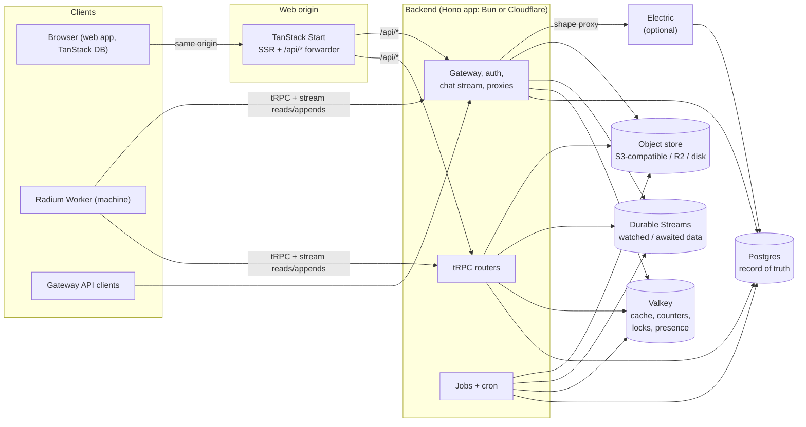

# Backend Migration: Convex to Bun, Hono, Postgres

Status: **planned, not started.** Nothing in this guide is implemented. The running system is still the Convex backend described in [architecture](architecture.md). Execution plan and status: [task 14](tasks/14_Backend_Migration.md).

Focused guides:

- [Runtime and code layout](Backend_Migration/Runtime.md): packages, platform adapters for Bun and Cloudflare, tRPC, auth, jobs, schema migrations and tests
- [Live data](Backend_Migration/Live_Data.md): where each kind of data lives (Postgres, Valkey, Durable Streams, Electric) and how chats, ACP, Workers and notifications stay live
- [Convex import](Backend_Migration/Convex_Import.md): the one-time, verified move of a Convex deployment into Postgres

Inputs: [backend pre-rewrite handoff](Backend_Pre_Rewrite_Report.md) (older snapshot), [Convex reuse research](research/Convex_Reuse.md), and the current source.

## Why

- **Database I/O cost.** Convex has no channel between connected clients except the database. Every ACP frame, viewer heartbeat, Worker command, approval, Worker task and Worker presence ping is a document write that every subscriber then re-reads. Nine of about 70 tables exist only to fake pub/sub or an RPC queue (`chat_frames`, `chat_viewers`, `acp_streams`, `acp_commands`, `acp_interactions`, `worker_tasks`, `codemode_interactions`, `worker_presence`, the `notifications` inbox), and 13 crons clean them up. The chat HTTP action also polls the database every 500 ms for Worker results and every second for Code Mode answers.
- **Self-hosting.** Radium targets self-hosted, bring-your-own-everything operation (see `AGENTS.md`). A Postgres + Valkey + HTTP-service stack is ordinary infrastructure for an operator. The self-hosted Convex backend is a single-vendor runtime with its own deploy, codegen and component model.
- **Reviewability.** Plain SQL schemas, explicit transactions and HTTP handlers are easier to review than Convex's component, scheduler and OCC semantics. Several invariants today work only because Convex serializes mutations (17 are listed in [Runtime](Backend_Migration/Runtime.md#transactions-and-invariants)).

## Decisions

| #   | Decision                                                                                                                                                                                                                                                                                                                               | Status             |
| --- | -------------------------------------------------------------------------------------------------------------------------------------------------------------------------------------------------------------------------------------------------------------------------------------------------------------------------------------- | ------------------ |
| 1   | Backend is a **Hono** app on **Bun**, with every database call through **Drizzle** on **Postgres**. **Valkey** handles cache, counters, locks and expiring state.                                                                                                                                                                      | Decided            |
| 2   | The same app runs on **Cloudflare Workers**. Only the platform adapter differs: Bun uses `Bun.SQL`, `RedisClient` and `S3Client`; Workers use Hyperdrive with Postgres.js, a Valkey TCP client and R2. The Cloudflare adapter lands after the Bun backend works and is gated by spikes.                                                | Decided (CF gated) |
| 3   | **tRPC** is the typed API between web, Worker and backend. Non-tRPC HTTP is kept only for external protocols: Gateway OpenAI API, Better Auth, Worker auth handshake, AI SDK chat stream, stream and shape proxies.                                                                                                                    | Decided            |
| 4   | **Durable Streams** (Electric's open HTTP protocol, self-hosted Caddy binary or Electric Cloud) carries everything someone watches or waits on: token streams, ACP frames, Worker inboxes and invalidation events. The backend is the only party that talks to the stream server; it authorizes every read and write.                  | Decided            |
| 5   | **Electric** Postgres sync with **TanStack DB** is **optional per deployment**. Each synced collection is defined once and sourced either from Electric or from tRPC queries refetched on invalidation events; the components that consume it don't change. Correctness never depends on Electric.                                     | Decided            |
| 6   | Browsers talk only to the **web origin**. TanStack Start forwards `/api/*` (tRPC, auth, chat stream, stream reads, shapes) to the backend, so there is no browser CORS. Gateway API clients and Workers call the backend origin directly.                                                                                              | Decided            |
| 7   | Migrated rows **keep their Convex `_id` verbatim** as `text` primary keys. New rows get UUIDv7 strings. Convex ids are signed into E2EE data and cannot change ([why](Backend_Migration/Convex_Import.md#identifiers)).                                                                                                                | Required           |
| 8   | **Narrow first.** The importer accepts only the final Convex release, with every Convex-side migration finished and its verifiers clean. Postgres starts without the legacy bridge (`balances`, `keys`, `chatroom_settings`, deprecated telemetry, embedded chat messages). Sealed E2EE history and the custody seed are carried over. | Decided            |
| 9   | Port domain behavior, not Convex mechanics. Batch continuations, `runAfter(0)` chains, `.unique()` emulation of constraints, DB heartbeats and polling loops are **not** reproduced; each becomes a SQL constraint, a transaction, a Valkey key with TTL, or a stream.                                                                 | Decided            |

## Target Architecture

Rules of placement, detailed in [Live data](Backend_Migration/Live_Data.md):

- **Postgres** holds anything whose loss is a bug: identities, workspaces, chats and messages, keys and grants, durable decisions (command claimed, approval answered), usage, telemetry.
- **Valkey** holds anything that may expire or be rebuilt: caches, rate-limit counters, leases and locks, presence, routing cursors and cooldowns, session affinity, single-use challenges.
- **Durable Streams** holds anything a client watches or a request waits on: streamed replies, ACP frames, Worker inbox doorbells, invalidation events. Streams carry ciphertext for keyed workspaces, exactly as the Convex relay does today.
- **Object store** holds attachment and large telemetry blobs (replaces Convex File Storage).

## What Replaces Each Convex Feature

| Convex today                                                    | Replacement                                                                                                                                                                                                                          |
| --------------------------------------------------------------- | ------------------------------------------------------------------------------------------------------------------------------------------------------------------------------------------------------------------------------------ |
| Tables, indexes, `v` validators                                 | Drizzle tables per domain, SQL indexes and **constraints**; zod for request validation                                                                                                                                               |
| `query` / `mutation` / `action`                                 | tRPC procedures calling domain services; one Postgres transaction where the old mutation relied on atomicity                                                                                                                         |
| `workspaceQuery`, `ownedWorkspaceQuery`, `workerQuery` wrappers | tRPC middlewares: `sessionProcedure`, `workspaceProcedure`, `ownedWorkspaceProcedure`, `workerProcedure`                                                                                                                             |
| Reactive subscriptions                                          | tRPC queries + invalidation events on Durable Streams; Electric shapes where enabled; Durable Streams for content streams                                                                                                            |
| `ctx.scheduler.runAfter(0)`                                     | Transactional outbox (`jobs` table written in the same transaction), dispatched after commit                                                                                                                                         |
| `runAfter(delay)`                                               | Same outbox with `run_at`                                                                                                                                                                                                            |
| Self-continuing batch deletes                                   | Set-based SQL (`DELETE … WHERE … LIMIT` loops inside one job)                                                                                                                                                                        |
| `crons.ts` (13 jobs)                                            | Four become Valkey TTLs, five plain deletes merge into one retention job, and five scheduled jobs remain on `Bun.cron` or Cloudflare Cron Triggers, each behind a Valkey lease ([list](Backend_Migration/Runtime.md#scheduled-work)) |
| File Storage, upload URLs                                       | Object store port: `Bun.S3Client` (any S3-compatible) or local disk on Bun, R2 on Cloudflare; presigned uploads                                                                                                                      |
| `@convex-dev/better-auth` component                             | Better Auth on Drizzle adapter, Valkey `secondaryStorage`, same OPAQUE plugin                                                                                                                                                        |
| Worker custom JWT in `auth.config.ts`                           | `jose` verification in `workerProcedure`; issuer becomes the backend origin                                                                                                                                                          |
| `worker-component` (`workerIdentity`)                           | Plain `worker_*` tables in the backend's `worker` domain; the package is deleted                                                                                                                                                     |
| `convex-secret-store` component                                 | `secrets` table in the backend, **same envelope format and AAD**, so rows import byte-for-byte                                                                                                                                       |
| `@convex-dev/rate-limiter`, Better Auth DB rate limit           | Valkey counters                                                                                                                                                                                                                      |
| `@convex-dev/migrations`                                        | `drizzle-kit` SQL migrations + versioned backfill scripts ([policy](Backend_Migration/Runtime.md#schema-migrations))                                                                                                                 |
| Local `logging` component                                       | `log_events` table or stdout sink; same bounded contract (`docs/logging.md`)                                                                                                                                                         |
| `convex-test` offline tests                                     | Vitest against real Postgres + Valkey + stream server ([tests](Backend_Migration/Runtime.md#verification))                                                                                                                           |
| `Id<"table">`, `Doc<>`, `FunctionReturnType` in web             | Branded string ids from `packages/contracts`, `inferRouterOutputs<AppRouter>`                                                                                                                                                        |

## Workers

The Worker keeps its identity, keys and enrollment. It needs a new backend URL but no re-enrollment, because its `workerId`, `workspaceId` and keys are imported verbatim. Its transport changes from one Convex WebSocket with 9–10 live queries to:

- tRPC over HTTP for every call it makes today (claim, finish, append metadata, report presence, usage sync);
- one SSE read of its own **inbox stream**, carrying doorbells only (`commands`, `tasks`, `answers`, `warm`, `trust`, `gateway`, `definitions`, `identity`); on a doorbell it refetches that topic through tRPC;
- appends of ACP frames to per-epoch streams through the backend, which checks the epoch fence and forwards them with idempotent-producer headers.

Machine authentication (challenge, proof, ES256 JWT) is unchanged; only the issuer origin moves from the Convex site to the backend. Details: [Live data → Workers](Backend_Migration/Live_Data.md#workers).

## Constraints Carried Over

- Workspace ownership and personal-chat privacy rules (`AGENTS.md`, [ownership](Radium_Gateway/Ownership.md)) are re-implemented in tRPC middlewares and services and keep their tests. A workspace event stream never names personal chats; per-user events go to the user's own stream.
- E2EE: the backend still sees only what it sees today. Every stream payload that the Convex relay sealed stays sealed. Built-in chat token streams for keyed chats are sealed per run with the chat key, the same way ACP epochs are; see [Live data → E2EE](Backend_Migration/Live_Data.md#e2ee-on-streams).
- Write-only credentials, masked previews, owner-only telemetry with private-chat filtering, logging bounds: unchanged contracts.
- Gateway HTTP surface (`/api/openai/v1/*`) keeps its paths and behavior on the backend origin.

## Risks

| Risk                                                                                                                | Mitigation                                                                                                                                                                            |
| ------------------------------------------------------------------------------------------------------------------- | ------------------------------------------------------------------------------------------------------------------------------------------------------------------------------------- |
| One big cutover: two backends can't share live data                                                                 | Build the new backend on the branch against imported copies; ship one cutover release; rehearse the import on a restored copy ([runbook](Backend_Migration/Convex_Import.md#runbook)) |
| Convex export may omit component tables or storage                                                                  | Phase 0 spike on the local deployment; fallback is a paginated export through internal queries ([export](Backend_Migration/Convex_Import.md#export))                                  |
| Valkey over TCP from Cloudflare Workers is not verified for `node-redis`/`ioredis`                                  | Spike before committing to the Cloudflare adapter; the fallback adapter keeps the same port ([Runtime](Backend_Migration/Runtime.md#cloudflare-spikes))                               |
| Durable Streams is young; Electric joined Databricks (August 2026)                                                  | Open protocol (Apache 2.0) with a conformance suite and an in-repo stream port. If the server goes away, a replacement only has to implement the protocol subset we use               |
| Detached runs (a reply continuing after its tab closes) need a long-lived process                                   | Natural on Bun; on Cloudflare they need a Durable Object or Workflow, so they are out of scope for the first Cloudflare release                                                       |
| Convex-only invariants silently lost                                                                                | Each of the 17 OCC invariants becomes a constraint or a locked transaction, and each gets a concurrency test ([list](Backend_Migration/Runtime.md#transactions-and-invariants))       |
| Plans that assume Convex relays (task 12 Local Models transport, [Live sessions](Radium_Chatroom/Live_Sessions.md)) | Re-target them to Durable Streams; Live Sessions is superseded by [Live data → Built-in chat runs](Backend_Migration/Live_Data.md#built-in-chat-runs)                                 |

## Sources

- [Durable Streams protocol](https://github.com/durable-streams/durable-streams/blob/main/PROTOCOL.md), [deployment](https://durablestreams.com/deployment), [AI SDK transport](https://electric.ax/docs/streams/integrations/vercel-ai-sdk)
- [Electric auth (proxy pattern)](https://electric.ax/docs/sync/guides/auth), [installation](https://electric.ax/docs/sync/guides/installation), [TanStack integration](https://electric.ax/docs/sync/integrations/tanstack)
- [Drizzle Bun SQL](https://orm.drizzle.team/docs/connect-bun-sql), [Hyperdrive with Postgres.js](https://developers.cloudflare.com/hyperdrive/examples/connect-to-postgres/postgres-drivers-and-libraries/postgres-js/)
- [Bun Redis client](https://bun.sh/docs/runtime/redis), [Bun 1.4 (`Bun.cron`)](https://bun.sh/blog/bun-v1.4)
- [Cloudflare `node:net`](https://developers.cloudflare.com/workers/runtime-apis/nodejs/net/), [TCP sockets](https://developers.cloudflare.com/workers/runtime-apis/tcp-sockets/)
- [tRPC subscriptions and links](https://trpc.io/docs/server/subscriptions), [`@hono/trpc-server`](https://www.npmjs.com/package/@hono/trpc-server)
