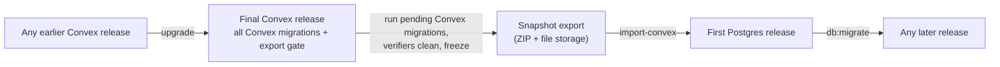

# Convex Import

Status: **planned.** Part of the [backend migration](../Backend_Migration.md). The one-time, verified move of a Convex deployment's data into Postgres, the object store and the new secrets table. Every self-hosted deployment runs it once, as an operator action. Running it against a deployment needs the same explicit authorization as any remote migration (`AGENTS.md`).

## Upgrade Path

Any install reaches the Postgres backend through the same three steps, whatever release it runs today:

1. **Final Convex release.** The last release built on Convex, cut from `dev` before the migration branch merges. It contains every Convex migration ever defined (ownership `runAll`, `runCredentialLimits`, `runChatMessages`, `runTelemetryTraces`, the E2EE phase 9 runner) plus two additions: an internal `migrationStatus` query that reports each migration's state and verifier results, and a **maintenance mode** that rejects browser and Worker writes while an export runs.
2. **Import** into the first Postgres release with `bun run --cwd packages/backend import-convex`. The importer refuses an export taken from any other release.
3. From then on, Postgres schema changes follow the [migration policy](Runtime.md#schema-migrations): `db:migrate` takes any later release forward in one run.

## Preconditions

The importer only accepts a narrowed source. Each gate is checked from `migrationStatus` and from the export itself, and any failure stops it before it writes anything:

| Gate                                                                                                                                                                     | Why                                                                                                                                  |
| ------------------------------------------------------------------------------------------------------------------------------------------------------------------------ | ------------------------------------------------------------------------------------------------------------------------------------ |
| Ownership `runAll` finished; `runCredentialLimits`, `runChatMessages`, `runTelemetryTraces` finished                                                                     | Postgres has no `balances`, `keys`, `chatroom_settings`, embedded `aisdk_chats.messages` or legacy traces                            |
| All 16 paginated verifiers (`verifyBalances` … `verifyTelemetryPayloads`) exhausted with zero issues                                                                     | Legacy rows are fully represented by their replacements, so dropping them loses nothing. Legacy keys all have mapped `api_keys` rows |
| E2EE phase 9 `cutoverComplete`, verify jobs clean                                                                                                                        | No plaintext-legacy writers or freeze flags need porting                                                                             |
| Custody **ended**, or retained with its `e2ee:custody` secret and `e2ee_legacy_custody` mapping present                                                                  | Custody-held history stays releasable                                                                                                |
| Maintenance mode on; no `pending` or `claimed` ACP commands, `pending` interactions, or `sent`/`processing` Worker tasks                                                 | Queues are drained, not translated                                                                                                   |
| Operator has `SECRET_STORE_KEYS`, `BETTER_AUTH_SECRET`, `OPAQUE_SERVER_SETUP`, `TELEMETRY_HASH_SECRET` (+ provenance), `WORKER_AUTH_*`, `WEB_PUSH_VAPID_*`, `LWC_SECRET` | The new backend must use the **same** values; several are bound into stored data                                                     |
| A restorable backup of the deployment (export ZIP with file storage) kept outside the target                                                                             | Rollback and audit                                                                                                                   |

Ownership migrations and phase 9 have never run on a remote deployment ([deployment](../deployment.md)). Running them there is its own approval-gated step and happens before this one.

## Identifiers

Convex ids are bound into signed and encrypted data, so **every imported row keeps its `_id` as its `text` primary key**, and every reference keeps the same string. Remapping is not an option: the backend cannot re-sign or re-encrypt for keyed workspaces.

| Bound id                       | Where                                                                                                                                                                                  |
| ------------------------------ | -------------------------------------------------------------------------------------------------------------------------------------------------------------------------------------- |
| Workspace `_id`                | AAD of chat messages, titles, files, capsules, Worker tasks, telemetry; grant, roster, chat-key and Worker-key statements; telemetry hash salt (HKDF); Secret Store namespaces and AAD |
| Chat `_id`                     | `chatKeyBindingStatement` v2 (`e2ee_chat_keys.bindingSignature`); Worker task, ACP session/command/interaction AAD; Worker approval high-water marks; Worker `requestId` hashes        |
| Better Auth user `_id`         | Grant recipients, chat-key binding creator and members, recovery wrapper statement, notification AAD                                                                                   |
| Worker component `workers._id` | `workerKeysStatement`; machine JWT claims; ids stored in each Worker's local state                                                                                                     |
| Any row with `legacyContent`   | Legacy sidecar AAD binds the source row's own `_id`                                                                                                                                    |
| Notification `_id`             | Notification content AAD                                                                                                                                                               |

Client- and Worker-chosen ids (`e2eeId`, `keyId`, `messageId`, `fileId`, `capsuleId`, `inviteId`, `phraseId`, `pairingId`, `requestKey`, `clientId`) are already portable.

`_creationTime` becomes `created_at` (`timestamptz(6)`), converted from fractional milliseconds. Telemetry hash provenance compares blob creation times against operator-attested epochs, so the conversion must preserve order and keep microseconds.

## Export

Primary: `bunx convex export --include-file-storage --path <zip>` from `packages/backend` against the frozen deployment. This produces one snapshot of app tables, component tables and storage blobs.

Phase 0 must confirm on the local deployment, before anything depends on it:

- component tables are present for `betterAuth`, `workerIdentity` and `secretStore`;
- `v.bytes()` values and `_storage` metadata (including `sha256`) round-trip;
- the ZIP layout and JSONL encoding the importer will parse.

If component data is missing, the fallback is an operator export command in the final Convex release: paginated internal queries per table, including component wrappers, plus storage downloads. It is slower but deterministic.

## Transform Rules

General:

- `_id` → `id`, `Id<…>` and id-valued strings → the same string; `_creationTime` → `created_at`.
- `bytes` → `bytea`; optional fields → `null`; `v.any()` and AI SDK message parts → `jsonb`.
- Nested objects become columns when the new schema indexes or filters on them (`chat_completions.bill.workspace`, `request.credential`, …) and stay `jsonb` otherwise. Each table's mapping lives next to its Drizzle schema in `src/<domain>/import.ts`, so schema and mapping are reviewed together.
- Rows are validated with the same zod schemas the new services use. A row that doesn't validate stops the import, with table, id and field reported. Nothing is coerced silently.

Per area:

| Area                                                                                                                              | Rule                                                                                                                                                                                                                                                                                                                                                                                                                                                 |
| --------------------------------------------------------------------------------------------------------------------------------- | ---------------------------------------------------------------------------------------------------------------------------------------------------------------------------------------------------------------------------------------------------------------------------------------------------------------------------------------------------------------------------------------------------------------------------------------------------- |
| Better Auth (`user`, `account`, `session`, `verification`)                                                | Copied into the Drizzle-generated tables with ids intact. `account.registrationRecord` and `opaque*` columns are preserved, so OPAQUE logins keep working with the same `OPAQUE_SERVER_SETUP`. Unexpired sessions are copied, so users stay signed in when `BETTER_AUTH_SECRET` is unchanged. `jwks` (Convex JWT keys) and `rateLimit` are dropped                                                                                                   |
| Worker identity component (`workers`, `keys`, `enrollments`)                                                                      | Imported into `worker` domain tables with ids intact; only unexpired `pending` enrollments are kept; merged with the app's `worker_enrollments` receipt                                                                                                                                                                                                                                                                                              |
| Secret Store (`secrets`, `secretEvents`)                                                                                          | Copied **byte for byte** (same envelope, same AAD, same namespaces). The importer test-decrypts every row in memory with `SECRET_STORE_KEYS` and reports only counts per `keyVersion`, never values                                                                                                                                                                                                                                                  |
| Legacy bridge (`balances`, `keys`, `chatroom_settings`, `telemetry_traces/spans/payloads`, deprecated chat and completion fields) | Not imported (gated above)                                                                                                                                                                                                                                                                                                                                                                                                                           |
| E2EE (`e2ee_*`)                                                                                                                   | Copied verbatim. `e2ee_device_recovery` (15-minute handoffs) is dropped. Migration-runner bookkeeping (`e2ee_migration_state`, `e2ee_migration_jobs`, telemetry proof tables) is not imported once cutover is complete; `e2ee_legacy_custody` and `e2ee_legacy_storage` are imported only while custody is retained                                                                                                                                  |
| Chats, messages, members                                                                                                          | Copied; `aisdk_chats.activeStream` cleared; `chat_runs` starts empty                                                                                                                                                                                                                                                                                                                                                                                 |
| File storage                                                                                             | Each `_storage` blob is streamed to `files/<storageId>` in the object store and its SHA-256 checked. `chat_files.url` becomes `legacy_url`. Message file parts in **sealed** messages still carry Convex storage URLs the server cannot rewrite, so `/api/files/resolve` maps a legacy URL to the file's current download through `legacy_url`. Plaintext (keyless) messages could be rewritten, but they are left alone so both kinds take one path |
| Telemetry                                                                                                                         | Blobs, nodes, sessions, requests copied with ids intact; workspace-keyed hashes remain valid because workspace ids and `TELEMETRY_HASH_SECRET` are unchanged. Inline content stays inline; storage-backed blobs move to the object store                                                                                                                                                                                                             |
| ACP                                                                                                                               | `acp_sessions` copied without `warm`; sessions not `idle` become `failed` with `Backend migrated`. `chat_frames`, `acp_streams`, `chat_viewers`, `acp_deferred_cleanups` are dropped, so every session starts cold and re-warms on the next view. Finished commands and resolved interactions are dropped (retention would delete them anyway)                                                                                                       |
| Workers                                                                                                                           | `worker_tasks` in terminal states dropped; `worker_chat_calls` receipts copied; `worker_presence`, `worker_auth_challenges` dropped (Workers re-report within 20 s)                                                                                                                                                                                                                                                                                  |
| Routing, limits, subscriptions                                                                                                    | `routing_*` dropped (Valkey state rebuilds); `credential_limits`, `limit_events` copied; `subscription_state` sessions copied, rate-limit buckets dropped                                                                                                                                                                                                                                                                                            |
| Notifications                                                                                                                     | Copied; push subscriptions copied                                                                                                                                                                                                                                                                                                                                                                                                                    |
| Components with no import (`rateLimiter`, `migrations`, `logging`)                                                                | Dropped                                                                                                                                                                                                                                                                                                                                                                                                                                              |

## Import Mechanics

- Target is a freshly migrated, **empty** database at the first Postgres release's schema. The importer refuses a non-empty target, so a failed run is retried from scratch rather than resumed.
- Tables load in foreign-key dependency order inside batched transactions; self-referencing `telemetry_nodes` load ordered by `depth`.
- Blobs upload with bounded concurrency before their referencing rows commit.
- The run writes a report (counts per table, dropped-by-rule counts, timings) to stdout and a JSON file. It contains no secrets and no content.

## Verification

All of these must pass before the deployment reopens:

1. **Counts**: per table, source rows = imported + dropped-by-rule; each drop rule's count is listed.
2. **Integrity**: enforced by foreign keys and unique constraints at insert time.
3. **Secrets**: every row decrypts with the configured KEKs (count only).
4. **Signatures**: every public signed statement is re-verified against the stored public keys using `radium-crypto`: grants, rosters, chat-key statements and v2 bindings, Worker key statements, agent definitions. This needs no private keys and proves that ids and bytes survived exactly.
5. **Blobs**: SHA-256 of every object matches `_storage.sha256`.
6. **Hashes**: a sample of telemetry blob and routing hashes recomputed with `TELEMETRY_HASH_SECRET` matches stored values.
7. **Behavior** on the imported copy: OPAQUE sign-in for a test account (rehearsal copies only, never production users); Gateway API key resolution and a streamed completion; owner/member/personal-chat isolation; opening a keyed chat and an ACP session from two Tabs; a Worker reconnecting with its existing identity.

## Workers

Workers keep their keys and ids but store the backend origin they enrolled with. That origin was the Convex site, which goes away. The Worker release that ships the new transport adds `relocate --backend <API_URL>`, which rewrites the stored origin (keys untouched) and fetches a fresh JWT through the unchanged challenge flow. Operators run it once per machine at cutover. Enrollment is not repeated.

## Runbook

1. **Rehearse** on a restored copy of the production export in an isolated environment: full import, all verification steps, timing recorded.
2. Upgrade production to the final Convex release; run any pending Convex migrations (separately approved) until `migrationStatus` is all green.
3. Announce the window. Turn on maintenance mode; wait until Worker queues drain; stop Workers.
4. Export with file storage; keep the ZIP and the env values together in the backup location.
5. Run `import-convex` into the new Postgres; run verification.
6. Point the web deployment and DNS at the new backend; `relocate` and restart Workers.
7. Smoke the behaviors from verification step 7 on production with operator accounts; reopen.

**Rollback**: until step 7 reopens writes, turn maintenance mode off on Convex and discard the Postgres target. After reopening the cutover is forward-only; writes made to Postgres would be lost by going back. Keep the Convex deployment frozen and read-only for an agreed period, then delete it.
