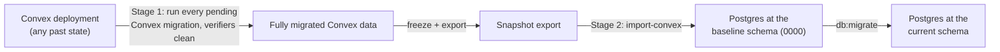

# Convex Import

Status: **planned.** Part of the [backend migration](../Backend_Migration.md). The one-time, verified move of a Convex deployment's data into Postgres, the object store and the new secrets table. Every self-hosted deployment runs it once, as an operator action. Running it against a deployment needs the same explicit authorization as any remote migration (`AGENTS.md`).

## Two Stages

Over its life the Convex backend gained its own data migrations: the ownership bridge (`runAll`), `runCredentialLimits`, `runChatMessages`, `runTelemetryTraces`, and E2EE phase 9. They are Convex functions, so they can only run on Convex. The move is therefore two separate stages with a fixed hand-off point between them:

1. **Stage 1, on Convex.** Using the last Convex version of the code (the commit before the cutover merge, which contains every Convex migration), run whatever is still pending on that deployment until all verifiers are clean. Two small additions ship in that version: an internal `migrationStatus` action that reports each migration's state, the verifier results and every other gate below, and a **maintenance mode** (`RADIUM_MAINTENANCE`) that rejects browser and then Worker writes while the export runs ([deployment → last Convex version](../deployment.md#last-convex-version-migration-status-and-maintenance-mode)). Whatever state a deployment was left in, Stage 1 brings it to the same end state.
2. **Stage 2, into Postgres.** `bun run --cwd packages/backend import-convex` loads that end state into a database at the **baseline** schema, the first Postgres migration (`0000_baseline`), never the latest one. It then hands over to the normal `db:migrate`, which applies every later SQL migration and backfill exactly as for any other install.

### Why The Baseline Keeps It Future-Proof

The Postgres schema will keep changing after the cutover. If the importer wrote rows through the current Drizzle schema, every later migration would have to keep the importer working too, and an import run a year from now would hit a schema it was never tested against. Pinning it to the baseline removes that coupling:

- The importer owns a **frozen copy** of the baseline table definitions (`src/import-convex/baseline-schema.ts`, generated once from `0000_baseline` and never edited) and its own row mappings. Domain schemas evolve freely; the importer never imports them.
- `import-convex` runs `db:migrate --to 0000_baseline` on an empty database, imports, verifies, then runs `db:migrate` to head. An import tomorrow and an import next year go through the same baseline, and later migrations see imported data exactly as they see data from an install that started on Postgres.
- Postgres migrations therefore never need to know the data came from Convex. If one does need to touch imported rows (for example by narrowing `legacy_content`), it is an ordinary backfill under the [migration policy](Runtime.md#schema-migrations), tested against a database built from the importer's fixture.
- CI runs the importer fixture → baseline → `db:migrate` to head on every PR that adds a migration, so a migration that breaks imported data fails before it merges.

## Preconditions

The importer only accepts a narrowed source. Each gate is checked from `migrationStatus` and from the export itself, and any failure stops it before it writes anything:

| Gate                                                                                                                                                                                                         | Why                                                                                                                                  |
| ------------------------------------------------------------------------------------------------------------------------------------------------------------------------------------------------------------ | ------------------------------------------------------------------------------------------------------------------------------------ |
| Ownership `runAll` finished; `runCredentialLimits`, `runChatMessages`, `runTelemetryTraces` finished                                                                                                         | Postgres has no `balances`, `keys`, `chatroom_settings`, embedded `aisdk_chats.messages` or legacy traces                            |
| All 16 paginated verifiers (`verifyBalances` … `verifyTelemetryPayloads`) exhausted with zero issues                                                                                                         | Legacy rows are fully represented by their replacements, so dropping them loses nothing. Legacy keys all have mapped `api_keys` rows |
| E2EE phase 9 `cutoverComplete`, verify jobs clean                                                                                                                                                            | No plaintext-legacy writers or freeze flags need porting                                                                             |
| Custody **ended**: every custodial row released, `endCustody` completed, no `e2ee:custody` secret left                                                                                                       | The new backend carries no custody or release code. Every historical row is already sealed to a real user, workspace or chat key     |
| Maintenance mode `1`; no `pending` or `claimed` ACP commands, `pending` or `answered` interactions, `sent`/`processing`/`retrying` Worker tasks, open Code Mode interactions, or pending scheduled functions | Queues are drained, not translated                                                                                                   |
| Operator has `SECRET_STORE_KEYS`, `BETTER_AUTH_SECRET`, `OPAQUE_SERVER_SETUP`, `TELEMETRY_HASH_SECRET` (+ provenance), `WORKER_AUTH_*`, `WEB_PUSH_VAPID_*`, `LWC_SECRET`                                     | The new backend must use the **same** values; several are bound into stored data                                                     |
| A restorable backup of the deployment (export ZIP with file storage) kept outside the target                                                                                                                 | Rollback and audit                                                                                                                   |

The remote (Convex Cloud) dev deployment is not a source. It was stopped because its Database I/O was exhausting the account-wide quota, and neither the ownership migrations nor phase 9 ran there. The local deployment, created from it by export and since migrated, is the only deployment to import.

## Identifiers

Convex ids are bound into signed and encrypted data, so **every imported row keeps its `_id` as its `text` primary key**, and every reference keeps the same string. Remapping is not an option: the backend cannot re-sign or re-encrypt for keyed workspaces.

| Bound id                       | Where                                                                                                                                                                                  |
| ------------------------------ | -------------------------------------------------------------------------------------------------------------------------------------------------------------------------------------- |
| Workspace `_id`                | AAD of chat messages, titles, files, capsules, Worker tasks, telemetry; grant, roster, chat-key and Worker-key statements; telemetry hash salt (HKDF); Secret Store namespaces and AAD |
| Chat `_id`                     | `chatKeyBindingStatement` v2 (`e2ee_chat_keys.bindingSignature`); Worker task, ACP session/command/interaction AAD; Worker approval high-water marks; Worker `requestId` hashes        |
| Better Auth user `_id`         | Grant recipients, chat-key binding creator and members, recovery wrapper statement, notification AAD                                                                                   |
| Worker component `workers._id` | `workerKeysStatement`; machine JWT claims; ids stored in each Worker's local state                                                                                                     |
| Any row with `legacyContent`   | Legacy sidecar AAD binds the source row's own `_id`                                                                                                                                    |
| Notification `_id`             | Notification content AAD                                                                                                                                                               |

Client- and Worker-chosen ids (`e2eeId`, `keyId`, `messageId`, `fileId`, `capsuleId`, `inviteId`, `phraseId`, `pairingId`, `requestKey`, `clientId`) are already portable.

`_creationTime` becomes `created_at` (`timestamptz(6)`): microseconds = `round(ms × 1000)`. Telemetry hash provenance compares blob creation times against operator-attested epochs, so the conversion must preserve order and keep microseconds. Rounding never reorders rows, but rows written by one mutation can tie (exported values carry 0.1 µs). Orderings therefore break ties by `id` ([conventions](Runtime.md#database-conventions)).

## Export

`bunx convex export --include-file-storage --path <zip>` from `packages/backend` against the frozen deployment. Phase 0 confirmed it on a copy of the local deployment ([results](../tasks/14_Backend_Migration.md#phase-0-results-2026-11-21)), so no fallback exporter is built. The importer parses:

- `<table>/documents.jsonl`, one document per line, for app tables;
- `_components/<component>/<table>/documents.jsonl` for component tables, nested for sub-components (`_components/rateLimiter/_components/batchWorker/…`); `betterAuth`, `workerIdentity` and `secretStore` are present;
- `_storage/documents.jsonl` (`_id`, `_creationTime`, `sha256` as standard base64, `size`, `contentType`) with each blob at `_storage/<_id>.bin`;
- `v.bytes()` values encoded as `{"$bytes": "<standard base64>"}`. `$integer` (int64) and `$float` (non-finite) encodings are handled but absent from current data. `_tables/documents.jsonl` and `generated_schema.jsonl` are ignored.

The export also contains tables of components that are no longer mounted: `resumableStream` and `persistentTextStreaming`. The importer maps tables from an explicit allowlist plus an explicit drop list, and stops on any table in neither. System tables such as `_scheduled_functions` are not exported, so scheduled work pending at export time is lost; `migrationStatus` gates on it.

## Transform Rules

General:

- `_id` → `id`, `Id<…>` and id-valued strings → the same string; `_creationTime` → `created_at`.
- `bytes` → `bytea`; optional fields → `null`; `v.any()` and AI SDK message parts → `jsonb`.
- Nested objects become columns when the baseline schema indexes or filters on them (`chat_completions.bill.workspace`, `request.credential`, …) and stay `jsonb` otherwise. Mappings live in `src/import-convex/`, next to the frozen baseline schema, not in the domain folders.
- Rows are validated with zod schemas frozen alongside the baseline. A row that doesn't validate stops the import, with table, id and field reported. Nothing is coerced silently.

Per area:

| Area                                                                                                                                      | Rule                                                                                                                                                                                                                                                                                                                                                                                                                                                 |
| ----------------------------------------------------------------------------------------------------------------------------------------- | ---------------------------------------------------------------------------------------------------------------------------------------------------------------------------------------------------------------------------------------------------------------------------------------------------------------------------------------------------------------------------------------------------------------------------------------------------- |
| Better Auth (`user`, `account`, `session`, `verification`)                                                        | `user`, `account` and `session` are copied into the Drizzle-generated tables with ids intact (their timestamps are `timestamp` without time zone, written as UTC). `account.registrationRecord` and `opaque*` columns are preserved, so OPAQUE logins keep working with the same `OPAQUE_SERVER_SETUP`. Unexpired sessions are copied into Postgres, the session record (Valkey only caches them), so users stay signed in when `BETTER_AUTH_SECRET` is unchanged. `verification` (OPAQUE login state, reset tokens: an hour at most), `jwks` (Convex JWT keys) and `rateLimit` are dropped; the new backend keeps verification values and rate-limit counters in Valkey. An outstanding reset link stops working; the operator issues a new one |
| Worker identity component (`workers`, `keys`, `enrollments`)                                                                              | Imported into `worker` domain tables with ids intact; only unexpired `pending` enrollments are kept; merged with the app's `worker_enrollments` receipt                                                                                                                                                                                                                                                                                              |
| Secret Store (`secrets`, `secretEvents`)                                                                                                  | Copied **byte for byte** (same envelope, same AAD, same namespaces). The importer test-decrypts every row in memory with `SECRET_STORE_KEYS` and reports only counts per `keyVersion`, never values                                                                                                                                                                                                                                                  |
| Legacy bridge (`balances`, `keys`, `chatroom_settings`, `telemetry_traces/spans/payloads`, deprecated chat and completion fields)         | Not imported (gated above)                                                                                                                                                                                                                                                                                                                                                                                                                           |
| E2EE (`e2ee_*`)                                                                                                                           | Copied verbatim. `e2ee_device_recovery` (15-minute handoffs) is dropped. Migration-runner bookkeeping (`e2ee_migration_state`, `e2ee_migration_jobs`, telemetry proof tables, `e2ee_legacy_custody`, `e2ee_legacy_storage`) is not imported, since cutover and custody are both finished. `legacyContent` sidecars are imported as ordinary ciphertext columns                                                                                       |
| Chats, messages, members                                                                                                                  | Copied; `aisdk_chats.activeStream` cleared; `chat_runs` starts empty                                                                                                                                                                                                                                                                                                                                                                                 |
| File storage                                                                                                     | Each `_storage` blob is streamed to `files/<storageId>` in the object store and its SHA-256 checked. `chat_files.url` becomes `legacy_url`. Message file parts in **sealed** messages still carry Convex storage URLs the server cannot rewrite, so `/api/files/resolve` maps a legacy URL to the file's current download through `legacy_url`. Plaintext (keyless) messages could be rewritten, but they are left alone so both kinds take one path |
| Telemetry                                                                                                                                 | Blobs, nodes, sessions, requests copied with ids intact; workspace-keyed hashes remain valid because workspace ids and `TELEMETRY_HASH_SECRET` are unchanged. Inline content stays inline; storage-backed blobs move to the object store                                                                                                                                                                                                             |
| ACP                                                                                                                                       | `acp_sessions` copied without `warm`; sessions not `idle` become `failed` with `Backend migrated`. `chat_frames`, `acp_streams`, `chat_viewers`, `acp_deferred_cleanups` are dropped, so every session starts cold and re-warms on the next view. Finished commands and resolved interactions are dropped (retention would delete them anyway)                                                                                                       |
| Workers                                                                                                                                   | `worker_tasks` in terminal states dropped; `worker_chat_calls` receipts copied; `worker_presence`, `worker_auth_challenges` dropped (Workers re-report within 20 s)                                                                                                                                                                                                                                                                                  |
| Routing, limits, subscriptions                                                                                                            | `routing_*` dropped (Valkey state rebuilds); `credential_limits`, `limit_events` copied; `subscription_state` sessions copied, rate-limit buckets dropped                                                                                                                                                                                                                                                                                            |
| Notifications                                                                                                                             | Copied; push subscriptions copied                                                                                                                                                                                                                                                                                                                                                                                                                    |
| Components with no import (`rateLimiter`, `migrations`, `logging`) and unmounted leftovers (`resumableStream`, `persistentTextStreaming`) | Dropped                                                                                                                                                                                                                                                                                                                                                                                                                                              |

## Import Mechanics

- Target is an **empty** database migrated only to `0000_baseline`. The importer refuses a non-empty target or one at any other version, so a failed run is retried from scratch rather than resumed. After verification it runs `db:migrate` to head.
- Tables load in foreign-key dependency order inside batched transactions; self-referencing `telemetry_nodes` load ordered by `depth`.
- Blobs upload with bounded concurrency before their referencing rows commit.
- The run writes a report (counts per table, dropped-by-rule counts, timings) to stdout and a JSON file. It contains no secrets and no content.

## Verification

All of these must pass before the deployment reopens:

1. **Counts**: per table, source rows = imported + dropped-by-rule; each drop rule's count is listed.
2. **Integrity**: enforced by foreign keys and unique constraints at insert time.
3. **Secrets**: every row decrypts with the configured KEKs (count only).
4. **Signatures**: every public signed statement is re-verified against the stored public keys using `radium-crypto`: grants, rosters, chat-key statements and v2 bindings, Worker key statements, agent definitions. This needs no private keys and proves that ids and bytes survived exactly.
5. **Blobs**: SHA-256 of every object matches `_storage.sha256`.
6. **Hashes**: a sample of telemetry blob and routing hashes recomputed with `TELEMETRY_HASH_SECRET` matches stored values.
7. **Behavior** on the imported copy: OPAQUE sign-in for a test account (rehearsal copies only, never production users); Gateway API key resolution and a streamed completion; owner/member/personal-chat isolation; opening a keyed chat and an ACP session from two Tabs; a Worker reconnecting with its existing identity.

## Workers

Workers keep their keys and ids but store the backend origin they enrolled with. That origin was the Convex site, which goes away. The Worker release that ships the new transport adds `relocate --backend <API_URL>`, which rewrites the stored origin (keys untouched) and fetches a fresh JWT through the unchanged challenge flow. Operators run it once per machine at cutover. Enrollment is not repeated.

## Runbook

1. **Rehearse** on a restored copy of the production export in an isolated environment: full import, all verification steps, timing recorded.
2. Deploy the last Convex version to the deployment; run any pending Convex migrations (separately approved) until `bunx convex run migration_status:migrationStatus '{}'` no longer lists `migrations:*` or `verifiers:*` gates in `failing`.
3. **End custody.** Sign in to each account that still owns custodial rows, set up encryption keys and open each chat whose history is held, so the scoped releases run. Then run a fresh exhaustive `verify`, then `endCustody` (procedure: [deployment → continued release and custody end](../deployment.md#continued-release-and-custody-end)). `e2ee_migration:custodialRows` lists what is left. Keep the phase 9 backup until a released row has been seen decrypting in the browser.
4. Announce the window. `bunx convex env set RADIUM_MAINTENANCE drain`; wait until `migrationStatus` shows the queues drained; stop Workers; `bunx convex env set RADIUM_MAINTENANCE 1`; confirm `migrationStatus` reports `ready: true`.
5. Export with file storage; keep the ZIP and the env values together in the backup location.
6. Run `import-convex` into the new Postgres; run verification.
7. Point the web deployment and DNS at the new backend; `relocate` and restart Workers.
8. Smoke the behaviors from verification step 7 on production with operator accounts; reopen.

**Rollback**: until step 8 reopens writes, turn maintenance mode off on Convex (`bunx convex env remove RADIUM_MAINTENANCE`) and discard the Postgres target. After reopening the cutover is forward-only; writes made to Postgres would be lost by going back. Keep the Convex deployment frozen and read-only for an agreed period, then delete it.
