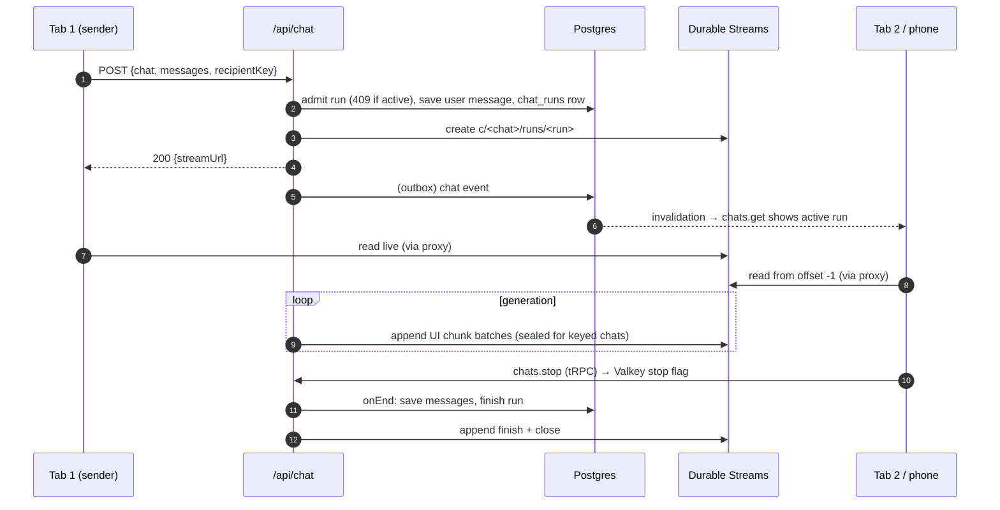
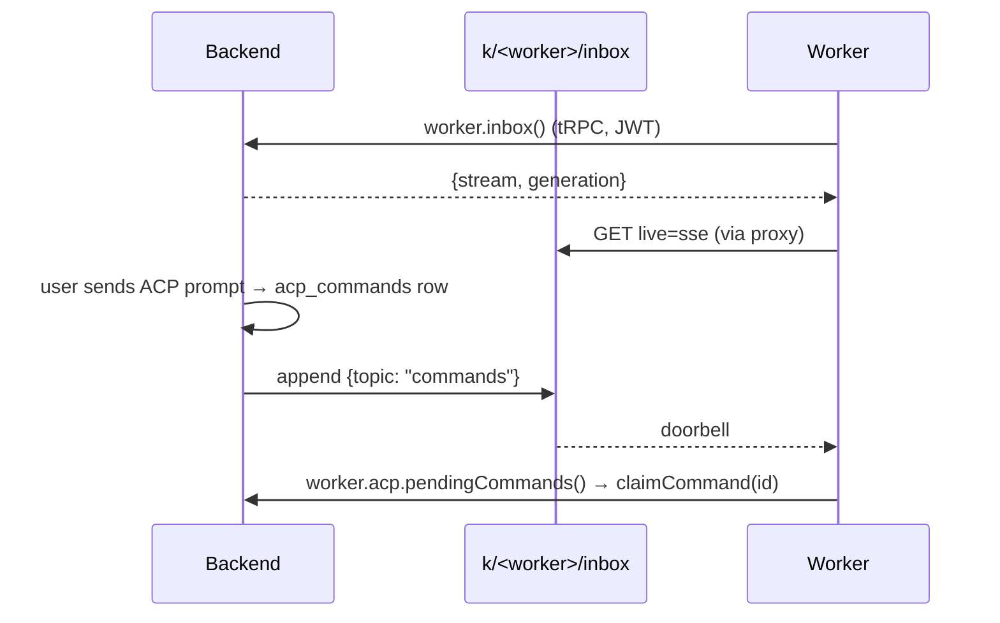

# Live Data After Convex

Status: **planned.** Part of the [backend migration](../Backend_Migration.md). This guide supersedes the Convex-based relay designs in [Live sessions](../Radium_Chatroom/Live_Sessions.md) (proposed, never built) and, once implemented, the transport parts of [ACP transport](../ACP/Transport.md) and [Worker Convex transport](../Worker/Convex_Transport.md). Their product behavior is kept: warm/cold sessions, epochs, snapshots, history pages, first answer wins, commands that run once.

## Where Data Lives

Rule: **Postgres** is the record, **Valkey** holds what may expire or be rebuilt, **Durable Streams** carries what someone watches or waits on. A table that only existed to move bytes between processes doesn't survive the migration.

| Data (current tables)                                                                                                                                                                                                                                                                                                                                                                | New home                                   | Why                                                                                                                          |
| ------------------------------------------------------------------------------------------------------------------------------------------------------------------------------------------------------------------------------------------------------------------------------------------------------------------------------------------------------------------------------------ | ------------------------------------------ | ---------------------------------------------------------------------------------------------------------------------------- |
| Workspaces, members, settings, projects, preferences, MCP servers, providers, models, credentials metadata, API keys, ACP agent definitions, ACP agent session catalog, Worker agents and gateway access, Worker identity, E2EE keys/grants/rosters/chat keys, chats, messages, chat members, files, completions, usage, telemetry, notifications, push subscriptions, secrets, auth | Postgres                                   | The record                                                                                                                   |
| `acp_sessions` (lifecycle, epoch, `cooled_epoch`, config, usage)                                                                                                                                                                                                                                                                                                                     | Postgres                                   | Durable lifecycle and the epoch fence; `warm` moves to Valkey                                                                |
| `acp_commands`, `acp_interactions`, `worker_tasks`, `worker_chat_calls`                                                                                                                                                                                                                                                                                                              | Postgres, with a doorbell on a stream      | They hold durable decisions: claimed once, first answer wins, fenced completion. Delivery no longer depends on subscriptions |
| `chat_frames`, `acp_streams`                                                                                                                                                                                                                                                                                                                                                         | Durable Streams (one stream per ACP epoch) | Bulk ephemeral content; sequence and dedupe come from the protocol                                                           |
| Built-in reply chunks (today only in the sender's HTTP response)                                                                                                                                                                                                                                                                                                                     | Durable Streams (one stream per run)       | Every Tab and device sees in-flight replies; reload resumes                                                                  |
| `chat_viewers`, `acp_sessions.warm`                                                                                                                                                                                                                                                                                                                                                  | Valkey sorted sets                         | Presence with expiry                                                                                                         |
| `worker_presence`                                                                                                                                                                                                                                                                                                                                                                    | Valkey key with TTL                        | Presence with expiry                                                                                                         |
| `codemode_interactions`                                                                                                                                                                                                                                                                                                                                                              | Valkey hash with TTL, answer by `SET NX`   | 180-second lifetime; losing one fails the prompt, as a timeout would                                                         |
| `worker_auth_challenges`, `e2ee_device_recovery`                                                                                                                                                                                                                                                                                                                                     | Valkey with TTL, consumed by `GETDEL`      | Single use, short lived                                                                                                      |
| `routing_cursors`, `routing_cooldowns`, `routing_sessions`, `subscription_state` rate-limit buckets                                                                                                                                                                                                                                                                                  | Valkey                                     | Hot counters and affinity; losing them resets routing fairness and nothing else                                              |
| `subscription_state` sessions                                                                                                                                                                                                                                                                                                                                                        | Postgres                                   | A lost ChatGPT subscription session forces re-login                                                                          |
| Rate-limiter and Better Auth rate-limit tables                                                                                                                                                                                                                                                                                                                                       | Valkey                                     | Counters                                                                                                                     |
| Legacy bridge tables and E2EE migration bookkeeping                                                                                                                                                                                                                                                                                                                                  | Not imported                               | [Narrow first](Convex_Import.md#preconditions)                                                                               |

## Durable Streams

The stream server (`durable-streams-server`, the Caddy plugin build, or Electric Cloud) is internal. Only the backend holds `STREAMS_TOKEN`, and browsers and Workers reach streams through the backend's authorizing proxy. Streams use JSON mode (`application/json`), so every append is one message and reads return message arrays.

| Stream path                  | Writer                             | Readers                       | Lifetime                                                                               |
| ---------------------------- | ---------------------------------- | ----------------------------- | -------------------------------------------------------------------------------------- |
| `u/<user>/events/<gen>`      | backend                            | that user's Tabs and devices  | rotated daily; old generation closed with a `rotate` message                           |
| `w/<workspace>/events/<gen>` | backend                            | workspace owner and members   | rotated daily                                                                          |
| `c/<chat>/runs/<run>`        | backend (`/api/chat`)              | anyone who can read the chat  | closed at run end; `Stream-Expires-At` = end + 10 min                                  |
| `c/<chat>/acp/<epoch>`       | the chat's Worker, via the backend | anyone who can read the chat  | `Stream-TTL: 300` (sliding); deleted when the session cools or the epoch is superseded |
| `c/<chat>/signals/<gen>`     | backend                            | backend request handlers only | rotated                                                                                |
| `k/<worker>/inbox/<gen>`     | backend                            | that Worker only              | rotated daily                                                                          |

`<gen>` exists because the protocol says a deleted stream path should not be reused. The current generation of each rotating stream is kept in Valkey and returned by a tRPC query (`events.streams()` for browsers, `worker.inbox()` for Workers). A reader that hits a closed stream, `404` or `410` asks again.

### Stream Proxy

`GET /api/streams/<path>` resolves the actor (session or Worker JWT), maps the path to a single authorization check, and only then forwards the request:

- `u/<user>`: the session's own user;
- `w/<workspace>`: owner or direct member (the same check as `workspaceProcedure`);
- `c/<chat>/runs|acp`: the chatroom access function used by `chats.get`, including personal-chat privacy;
- `k/<worker>`: the Worker JWT's own id, with identity epoch and revocation checked.

Only protocol parameters (`offset`, `live`, `cursor`) are forwarded. Long-poll and SSE responses are piped through unchanged. Live SSE connections are recycled by the server (`sse_reconnect_interval`), and every reconnect passes the proxy again, so access revocation takes effect within one interval.

`POST /api/streams/c/<chat>/acp/<epoch>` is the only append path open to a client, and only to the chat's bound Worker. The proxy checks the epoch fence (not cooled, not superseded; Valkey-cached from `acp_sessions`) and the per-frame and per-append size limits from `contracts`, then forwards with idempotent-producer headers (producer = Worker id + epoch). The protocol deduplicates retries and orders appends, which replaces `acp_streams.nextSeq` and the `ACP_FRAME_CONFLICT`/`ACP_FRAME_GAP` bookkeeping. Browsers never append; their writes are tRPC mutations.

## Invalidation Events

When data that other Tabs, devices or Workers display changes, the service appends a small event after the transaction commits:

```json
{ "topic": "chats", "ids": ["…"] }
```

- Events carry topic names and ids, never content. A workspace stream never names a personal chat. Changes to personal chats go to the creator's user stream only, and changes to shared chats go to each member's user stream.
- Browsers map topics to tRPC query keys and call `invalidateQueries`; TanStack Query refetches only what is mounted. That covers the chat list, chat metadata, settings, providers, keys, Worker list, E2EE workspace state, membership and notifications.
- Publishing is best effort after commit: a lost event means a stale view until the next refetch on focus or reconnect, never lost data. Events that drive correctness (Worker commands, tasks, answers) are doorbells for rows that the reader always re-reads, so a lost doorbell is recovered by the reader's periodic resync (Workers resync every topic on reconnect and every 60 s).

This replaces the always-on Convex subscriptions with one SSE connection per Tab per stream (user plus current workspace), proxied by the web origin.

## Electric Collections (Optional)

When `ELECTRIC_URL` is configured, selected row-shaped data syncs into TanStack DB collections through Electric. When it isn't, the same collections are TanStack Query collections filled by tRPC and refreshed by invalidation events. Each collection is defined once in `apps/web/src/lib/collections/`; the factory picks `electricCollectionOptions` or `queryCollectionOptions` based on server-provided config, so the components using `useLiveQuery` stay the same.

- **Shapes are server-defined.** `GET /api/shapes/:collection` sets `table`, `columns` and a parameterized `where` from the session (Electric's [proxy auth pattern](https://electric.ax/docs/sync/guides/auth)), passing through only Electric protocol parameters. Each live request passes the proxy, so revoked access stops at the next poll.
- **Writes go through tRPC.** Collection `onInsert`/`onUpdate`/`onDelete` call the tRPC mutation, which returns the Postgres transaction id (`pg_current_xact_id()`). With Electric, the collection waits for that txid to arrive before dropping its optimistic state; with the query source, it invalidates and refetches.
- **Eligible collections** have a filter that is a plain predicate on the row itself:

| Collection          | Shape                                                      |
| ------------------- | ---------------------------------------------------------- |
| `notifications`     | `user_id = $me`                                            |
| `userPreferences`   | `user_id = $me`                                            |
| `projects`          | `workspace = $ws` (after the workspace check)              |
| `workspaceSettings` | `workspace = $ws`; owner-only columns excluded for members |
| `acpSession`        | `chat = $chat` (after the chat access check)               |

Not eligible for now: the chat list, whose visibility depends on scope and `chat_members`; telemetry and usage (owner-only aggregates); anything with secrets. These stay on tRPC + invalidation. Electric needs `wal_level=logical` and a role with `REPLICATION`; the reference compose file enables both.

## Built-in Chat Runs

This replaces the [Live sessions](../Radium_Chatroom/Live_Sessions.md) proposal with the same behavior and none of the frame tables.



- **Admission**: `chat_runs` has a partial unique index (one active run per chat). A second sender gets `409` and re-seeds, as Live Sessions planned.
- **Everyone is a viewer.** `/api/chat` returns the stream location instead of the stream body, the shape `@durable-streams/aisdk-transport` uses. The sender reads the same stream as every other Tab, so there's one code path, and reload resumes from offset `-1` (`resumeStreamIsReplay`).
- **Stop from any Tab**: `chats.stop` sets `stop:<run>` in Valkey; the generator checks it at every batch flush (about 300 ms). No database write.
- **Detached runs** come for free on Bun: generation is driven by the server, not the sender's connection. On Cloudflare the run is bound to the request until a Durable Object runner exists ([limitation](Runtime.md#cloudflare-spikes)).
- **Lost runs**: `chat_runs.lease_at` renewed every 15 s; the retention job fails runs with a stale lease and clears `activeStream`.
- Approvals, questions and Code Mode prompts end or pause the stream exactly as today; answers are tRPC mutations.

## ACP Sessions

- **Viewers**: `chats.watch` (every 60 s while visible) runs `ZADD viewers:<chat> <now> <tab>` and `ZADD warm:<worker> <now> <chat>` in one Valkey script, after checking the 64-session cap (`ZCARD`). On a cold → warm transition the backend rings the Worker's inbox (`warm`).
- **Epochs**: the Worker creates `c/<chat>/acp/<epoch>` through the backend (`worker.acp.startEpoch` advances `acp_sessions.epoch` in Postgres and creates the stream with `Stream-TTL: 300`), writes the snapshot, then live ops and history pages. Frame payloads keep today's format (`{seqFrom, seqTo, kind, payload}`, sealed bytes base64url for paired sessions) because the AAD binds `epoch:seqFrom`; stream offsets are only the read cursor.
- **Cooling**: the `acp.cool` job (every minute) takes chats older than 5 minutes from `warm:<worker>`, sets `cooled_epoch` in Postgres, deletes the epoch stream, and rings the Worker (`warm`). Even if the job misses a stream, its sliding TTL expires it once nobody reads or writes.
- **Rollover** at 1 MiB, **history pages**, **snapshot sizes** and **fragments** are unchanged ([ACP transport](../ACP/Transport.md)).
- **Commands and interactions** stay Postgres rows with the same claim and answer rules. Inserting one rings the Worker (`commands`, `answers`); browsers learn about new interactions from the chat's run state and an invalidation on the chat (`acp.interactions`).

## Workers



Topics replace the 9–10 Convex subscriptions one for one: `identity` (`workers.current`), `trust` (`e2ee.workerTrustState`), `tasks` (`worker_tasks.assigned`), `gateway`, `definitions`, `commands`, `warm`, `answers`. On every (re)connect and every 60 s the Worker refetches all topics, so a missed doorbell costs at most a minute. Presence is `worker.presence.report` every 20 s, which sets `presence:<worker>` with a 60-second TTL. The online/offline rule (`isWorkerOnline`) is unchanged.

### Worker Tasks And Code Mode Waits

The chat handler no longer polls the database every 500 ms (Worker tasks) or every second (Code Mode). It long-polls `c/<chat>/signals/<gen>` from its current offset. Completing a Worker task (a fenced Postgres update) or answering a Code Mode prompt (Valkey `SET NX`) appends `{topic: "task" | "codeMode", id}`, and the handler re-reads the row or key. Timeouts (45 s for tasks, 180 s for Code Mode) are unchanged.

## Notifications

`notifications` rows stay in Postgres (7-day retention). Insert rings `u/<user>/events` (`notifications`); open Tabs refetch, or receive the row through the Electric collection, and claim it with the conditional update. The push fallback is an outbox job delayed 10 s that sends Web Push only if `seen_at` is still null. Sealing to recipient identity keys is unchanged.

## E2EE On Streams

- ACP epochs carry the same sealed frames and capsule as today.
- **Built-in runs in keyed chats are sealed.** The request already carries `recipientKey` for sealed message writes. The backend creates a per-run key, seals it to the chat key as the stream's first message (the same capsule pattern as ACP epochs), and encrypts each chunk batch with AAD (`chat_runs`, workspace, chat `e2eeId`, `run:seq`). The web transport opens the capsule and decrypts before feeding `useChat`. Keyless chats stream plaintext JSON. Without this, the stream server would hold plaintext replies at rest, which the Convex design never did.
- Invalidation and doorbell events carry no content.
- Updating [E2EE data classification](../E2EE/Data.md) for streams and Valkey is part of the migration.

## Load Profile

To be measured in Phase 0. These are expectations, not guarantees.

| Situation                              | Convex today                                                                                    | After                                                                 |
| -------------------------------------- | ----------------------------------------------------------------------------------------------- | --------------------------------------------------------------------- |
| Watched ACP session streaming text     | 1 mutation per 300 ms (index read, up to 8 inserts, 1 patch); every viewer re-runs `LiveFrames` | 1 stream append per 300 ms; viewers read new bytes; no Postgres write |
| Each open ACP Tab                      | 1 heartbeat write per minute + `acp_sessions` warm patch                                        | 1 Valkey script per minute                                            |
| Worker online                          | presence write every 20 s, 9–10 live queries                                                    | Valkey `SET EX` every 20 s, 1 SSE connection                          |
| Built-in reply, second device watching | not possible (proposed frames: 3–4 inserts/s)                                                   | stream appends only                                                   |
| Chat handler waiting for a Worker task | query every 500 ms for up to 45 s                                                               | one long-poll                                                         |
