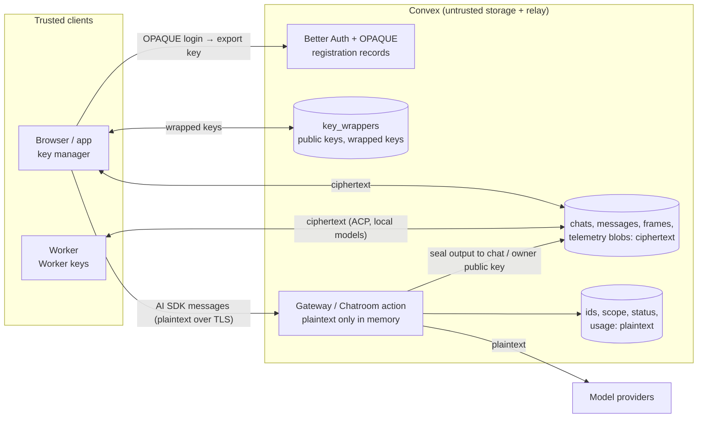

# End-to-End Encryption

Status: **partly implemented.** Design snapshot: 2026-11-05. Implementation plan and progress: [task 11](tasks/11_E2EE.md). Implemented so far: OPAQUE password login with account keys (AMK, identity keys, recovery key, device recovery), migration of classic accounts to OPAQUE, the browser key manager, workspace keys with access links, workspace phrase, key requests, trust prompts and safety numbers, chat keys with personal, shared and workspace scopes, and encrypted Chatroom content (messages, titles, queued prompts, attachments) for chats created by accounts with keys (phases 1 and 3–6 of task 11). Still plaintext: chats from before keys or from accounts without keys, ACP frames and session index, Worker task content, telemetry content, notifications and workspace and project names (see [data classification](E2EE/Data.md#current-state)).

Radium should treat its backend as **untrusted storage and an untrusted relay**. Content is encrypted by clients (browser, mobile app, Worker) to keys the backend never holds. The backend still sees plaintext **transiently** where it must process it, for example the prompt it forwards to an upstream model, but it does not keep that plaintext and it cannot read stored content afterwards.

Focused guides:

| Guide                                                | Contents                                                                                                  |
| ---------------------------------------------------- | --------------------------------------------------------------------------------------------------------- |
| [Authentication](E2EE/Authentication.md)             | OPAQUE password login in Better Auth, export key, password change, reset, recovery, migration of accounts |
| [Keys](E2EE/Keys.md)                                 | Key hierarchy, crypto suite, envelope format, workspaces and members, Workers, signing, rotation          |
| [Data](E2EE/Data.md)                                 | Table-by-table classification, how each server flow changes, telemetry, residual leakage, data migration  |
| [OPAQUE research](research/OPAQUE_Authentication.md) | Better Auth OPAQUE plugin audit, Proton/SRP comparison, prior art, Argon2id and passkey PRF               |

## Threat Model

**Protected against** (the "untrusted server"):

- A leaked or stolen Convex database, snapshot export, backup or log.
- A curious or compromised operator of the Convex deployment, including Convex Cloud when the rest of Radium is self-hosted.
- A backend that is compromised **after** the data was written: it cannot read stored chats, ACP sessions, telemetry content, notifications or attachments.
- A backend that tries to impersonate a user to a Worker: Workers accept commands only when signed by a user key they trust (see [Keys § Workers](E2EE/Keys.md#workers)).
- A backend that hands out a key it generated itself (to a workspace owner granting access, to a member accepting it, to a Worker): every client pins the keys it has accepted and stops with an approve/deny prompt when one changes, with safety numbers to compare out of band ([Keys § Trust system](E2EE/Keys.md#trust-system)).

**Not protected against:**

- Plaintext the backend processes while it is compromised. The Gateway must send prompts and receive outputs in plaintext to call upstream providers, and the built-in Chatroom agent loop runs inside Convex. A compromised backend sees every request it handles while compromised.
- Upstream model providers. They receive plaintext by definition; E2EE is about Radium's storage and relay, not about providers.
- A compromised **web asset origin**. If whoever serves the web app's JavaScript is malicious, it can ship code that captures passwords and unlocked keys. Neither OPAQUE nor SRP prevents this ([research](research/OPAQUE_Authentication.md)). The web app and Convex are deployed separately ([deployment](deployment.md)), so a Convex compromise is not by itself a web-asset compromise; native apps (the planned Expo app, Workers) are distributed as signed bundles.
- Metadata: IDs, timestamps, membership, which chat belongs to which workspace, sizes, model names, token counts and costs stay readable (see [residual leakage](E2EE/Data.md#residual-leakage)).
- Weak passwords against a fully malicious server: OPAQUE stops precomputation, but a server holding the OPAQUE records and its OPRF key can still run an offline dictionary attack per user ([RFC 9807 §10.11](https://www.rfc-editor.org/rfc/rfc9807.html#section-10.11)). The Argon2id key-stretching cost and the password policy bound this.
- Account takeover of the **login**. The backend is the auth server and can always reset an account; it gets new empty keys, and the account's contacts are warned of the key change ([Authentication § Forgot password](E2EE/Authentication.md#forgot-password)).
- Deletion, rollback or withholding of data by the server. Encryption gives confidentiality and integrity of each object, not completeness.

## Principles

1. **The server never holds a long-term decryption key for content.** It may hold public keys and write ciphertext to them; during a request it receives the plaintext it must process, plus per-file keys for attachments. It never receives a user, workspace or chat private key. The one exception is the temporary migration [custody key](E2EE/Data.md#custody-key) for accounts that have not set up encryption yet.
2. **Plaintext at the server is per request and in memory.** Anything the backend must persist is sealed before the write. No plaintext in scheduler arguments, logs, telemetry or error messages.
3. **Encrypt content, not authorization.** Ownership, membership, chat scope, status, timestamps and usage metadata stay plaintext so Convex can keep authorizing, routing, scheduling and enforcing limits. Cryptography adds a second wall: a personal chat is unreadable to the workspace owner because the owner does not hold its key, not only because a query refuses.
4. **Clients are the readers.** Rendering, search over titles, diffs of telemetry content and notification text move to the client.
5. **Workers are clients.** A Worker runs on the user's machine and holds its own keys. ACP sessions become end-to-end between the browser and the Worker; Convex only relays ciphertext.
6. **Random keys, wrapped many ways.** Passwords, recovery keys and passkeys wrap one random account key; changing a password never re-encrypts data.
7. **Versioned and boring crypto.** Standard constructions (OPAQUE RFC 9807, HPKE with the hybrid post-quantum KEM MLKEM768-X25519, AES-256-GCM, HKDF, Ed25519) from maintained libraries, behind one versioned envelope format.
8. **One cutover, nothing deleted.** E2EE is not a per-workspace mode with two code paths. Legacy plaintext is sealed by a migration, to its owners' keys or to a temporary custody key until they set up encryption (see [migration](E2EE/Data.md#migration)).

## Architecture

## Where Plaintext Exists

| Flow                                                    | Who sees plaintext                                                                 | Stored as                                                                                 |
| ------------------------------------------------------- | ---------------------------------------------------------------------------------- | ----------------------------------------------------------------------------------------- |
| Stored chats, titles, attachments, projects             | Clients holding the chat or workspace key                                          | Ciphertext                                                                                |
| ACP sessions (browser ↔ Worker)                         | Browser and Worker only                                                            | Ciphertext frames                                                                         |
| Built-in Chatroom turn                                  | Backend action during the turn (context, tool calls, output), then the provider    | Output sealed to the chat key                                                             |
| Gateway API request (external client, ACP Gateway mode) | Backend action during the request, then the provider                               | Telemetry sealed to the owner key                                                         |
| Local model request (DMR on a Worker)                   | Backend action during the request and the Worker; Convex rows hold ciphertext only | Ciphertext, deleted after the request ([transport](Local_Models/Transport.md#encryption)) |
| Telemetry content export (opt-in)                       | Backend action and the owner's export destination                                  | Not stored                                                                                |
| Notifications                                           | Recipient's client                                                                 | Sealed to the recipient                                                                   |
| Provider, MCP, Exa and export credentials               | Backend (it must call upstreams)                                                   | Secret Store, unchanged                                                                   |

Upstream credentials stay server-decryptable in [Secret Store](Radium_Gateway/Credentials.md): the backend cannot call a provider without them. Moving credentials to Workers is a separate, possible future feature, not part of this plan.

## Decisions

Adopted defaults; each is explained in the focused guide and can be revisited before implementation starts.

| Decision                | Default                                                                                                                                                                                                                                                                                          | Alternative considered                                                                                         |
| ----------------------- | ------------------------------------------------------------------------------------------------------------------------------------------------------------------------------------------------------------------------------------------------------------------------------------------------ | -------------------------------------------------------------------------------------------------------------- |
| Password protocol       | OPAQUE (RFC 9807) via `@serenity-kit/opaque` 1.x, one password                                                                                                                                                                                                                                   | SRP-6a (Proton); separate encryption password on top of current login                                          |
| Better Auth integration | Upgrade to Better Auth 1.7 / `@convex-dev/better-auth` 0.13 (next session); new `@alkalines/better-auth-opaque` package, reusable by other alkalines projects                                                                                                                                    | Use `better-auth-opaque@2.1.0` as is (blocked: discards export key, pre-RFC library)                           |
| Unlock on a device      | Keys remembered per device by default; per-device **Require my password to read past chats** keeps the unlocked key only in the Tab's `sessionStorage`, wrapped by a non-extractable device key, so closing the Tab forgets it and reading past content asks for the password (a normal sign-in) | Always ask (safer, more typing); raw key in `sessionStorage` (readable by scripts, written to disk)            |
| Workspace sharing       | Workspace keys granted per member to identity keys, created atomically with the workspace; access links carry a secret in the URL fragment; optional generated 12-word workspace key phrase; DASS-style trust prompts for every other key exchange                                               | Typed workspace password unlocked with OPAQUE (guessable offline by the backend, cannot be revoked per member) |
| Content encryption      | Key capsules: one HPKE encapsulation per write batch, per-object AES-256-GCM keys derived from it                                                                                                                                                                                                | Symmetric chat keys only (server could not write output without reading)                                       |
| Post-quantum            | Hybrid MLKEM768-X25519 (X-Wing) KEM from day one: native WebCrypto in Chromium, `@noble/post-quantum` elsewhere (Safari, Firefox, Convex, Worker); Ed25519 signatures until ML-DSA is broadly available                                                                                          | X25519 only, post-quantum later (stored chats exposed to harvest-now-decrypt-later)                            |
| Server-side processing  | Client sends the full history each turn as AI SDK does today; attachments travel as file reference + 32-byte key; server seals what it persists to public keys                                                                                                                                   | Client grants per-message keys and the server reads stored history (less data, different request shape)        |
| Recovery                | Operator-issued reset links from the Convex CLI (email later); data comes back with the recovery key or from another unlocked device; otherwise new keys, with old personal data kept for a later recovery key                                                                                   | Server-held escrow (defeats the threat model)                                                                  |
| Telemetry               | Content sealed to the workspace owner key; metadata plaintext; content export only in the capturing request                                                                                                                                                                                      | Encrypt metadata too (breaks budgets, limits, usage totals)                                                    |
| Rollout                 | Mandatory for everyone, one cutover with a sealing migration; accounts not yet set up stay in a deployment-held custody key until they are, nothing deleted                                                                                                                                      | Optional per-workspace mode (two code paths forever); deleting unmigrated content                              |
