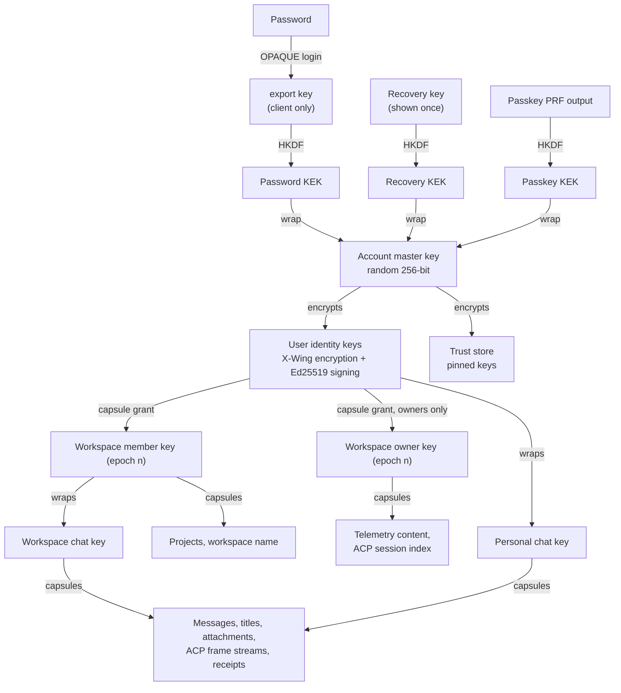

# E2EE Keys

Status: **partly implemented.** Part of [End-to-end encryption](../E2EE.md). Authentication and the export key are in [Authentication](Authentication.md); which fields use which key is in [Data](Data.md). Implemented: crypto suite 1, envelopes and capsules, account keys and device handling, workspace keys, grants, roster, access links, workspace phrase, key requests, the trust store and chat keys ([task 11](../tasks/11_E2EE.md) phases 3–5). Planned: Workers, request keys, suite upgrades.

## Crypto Suite

Suite `1`, used everywhere until a new suite is added:

| Purpose               | Construction                                                                                                                                                                                                                                       | Library                                                                                                                           |
| --------------------- | -------------------------------------------------------------------------------------------------------------------------------------------------------------------------------------------------------------------------------------------------- | --------------------------------------------------------------------------------------------------------------------------------- |
| Password login        | OPAQUE-3DH, ristretto255 + SHA-512, Argon2id stretching ([RFC 9807](https://www.rfc-editor.org/rfc/rfc9807.html))                                                                                                                                  | `@serenity-kit/opaque` 1.x, through [`@alkalines/better-auth-opaque`](Authentication.md#plugin-alkalinesbetter-auth-opaque)       |
| Public-key encryption | HPKE base mode: KEM **MLKEM768-X25519** (`0x647a`, the X-Wing construction), HKDF-SHA256, AES-256-GCM ([draft-ietf-hpke-pq-05](https://datatracker.ietf.org/doc/html/draft-ietf-hpke-pq), [RFC 9180](https://www.rfc-editor.org/rfc/rfc9180.html)) | [`hpke`](https://github.com/panva/hpke) 1.x + [`@panva/hpke-noble`](https://github.com/panva/hpke/tree/main/examples/noble-suite) |
| Key derivation        | HKDF-SHA-256, one `info` label per use (`radium/v1/account-kek`, …)                                                                                                                                                                                | WebCrypto                                                                                                                         |
| Content encryption    | AES-256-GCM, 96-bit nonce, 128-bit tag, AAD binding (below)                                                                                                                                                                                        | WebCrypto                                                                                                                         |
| Signatures            | Ed25519                                                                                                                                                                                                                                            | WebCrypto, `@noble/curves` where missing                                                                                          |

All of this lives in one runtime-neutral workspace package, `packages/crypto`, imported by `apps/web`, `packages/backend` and `packages/worker` (and later the Expo app). Nothing else calls WebCrypto or HPKE for content.

### Post-Quantum From Day One

Stored chats live for years, so data captured today could be decrypted by a future quantum computer ("harvest now, decrypt later"). Every public-key wrap therefore uses a **hybrid** KEM: ML-KEM-768 (FIPS 203) combined with X25519. An attacker has to break both; a flaw in ML-KEM or its young implementations still leaves X25519 protection.

Browser support decides the implementation, not the algorithm:

| Runtime                    | Native WebCrypto ML-KEM / X-Wing                                                                                                                                           | What Radium uses                      |
| -------------------------- | -------------------------------------------------------------------------------------------------------------------------------------------------------------------------- | ------------------------------------- |
| Chrome / Chromium 155+     | Shipping since 2026-10-06 (ML-KEM-768/1024, X-Wing, ML-DSA) ([Chrome guide](https://developer.chrome.com/docs/modern-web-guidance/guides/security/client-side-encryption)) | Native through `hpke`                 |
| Safari / WebKit            | Not shipping; position on hybrid KEMs is "support" with no implementation yet ([WebKit #704](https://github.com/WebKit/standards-positions/issues/704))                    | `@panva/hpke-noble` (pure TypeScript) |
| Firefox                    | Experimental only                                                                                                                                                          | `@panva/hpke-noble`                   |
| Convex, Bun (Worker), Node | —                                                                                                                                                                          | `@panva/hpke-noble`                   |

`hpke` (by Filip Skokan, author of `jose`, which the Worker already uses) has zero dependencies and picks native algorithms where the runtime offers them; `@panva/hpke-noble` supplies the same KEM, KDF and AEAD interfaces from Paul Miller's `@noble/*` libraries, so every runtime produces identical bytes. The pure-TypeScript path needs only `BigInt` and `crypto.getRandomValues`, so any Safari Radium can support anyway runs it.

Maturity and risks, recorded so they can be revisited:

- **Algorithm:** ML-KEM is final (FIPS 203). The hybrid's HPKE encoding is a Standards Track working-group draft (`draft-ietf-hpke-pq-05`), not yet an RFC; it is identical to X-Wing (`draft-connolly-cfrg-xwing-kem-11`) per the CFRG concrete hybrid KEM draft. Versions are pinned and tested against the draft's vectors; if the final RFC changes the encoding, it goes through the [suite upgrade](#suite-upgrades) procedure.
- **Implementation:** `@noble/post-quantum` 0.7.1 (2026-08-27) had a maintainer self-audit (April 2026) and an independent review by Quantakrypto (August 2026) with 18 findings, none in the primitives; ML-KEM fixes landed in 0.7.1 ([review](https://www.quantakrypto.com/audits/paulmillr/noble-post-quantum)). Its README still says there has been no conventional independent audit, and JavaScript cannot guarantee constant time. The backend only **encapsulates** (seals to public keys), apart from opening the temporary [custody key](Data.md#custody-key) during migration; decapsulation with users' private keys happens on clients and Workers.
- **Sizes:** an MLKEM768-X25519 public key is 1,216 bytes and each encapsulation 1,120 bytes (against 32 for X25519). Key capsules (below) amortize this to one encapsulation per write batch.
- **Signatures stay Ed25519 at first.** Forging a signature needs a quantum computer at the time of the attack, whereas decrypting stored data can happen any time later, so signatures are less urgent. Hybrid Ed25519 + ML-DSA-65 is planned as suite `2`, with the trigger and steps defined in [Suite upgrades](#suite-upgrades).

### Convex Runtime

The library stack is plain TypeScript plus WebCrypto: no WASM, no Node APIs, and `hpke` lists Cloudflare Workers, which Convex's default runtime resembles ([runtimes](https://docs.convex.dev/functions/runtimes)). **[INFERENCE]** It should run unchanged in Convex; this is the first spike in [task 11](../tasks/11_E2EE.md#phase-0-spikes).

One Convex rule shapes where crypto runs: queries and mutations are deterministic and their randomness is seeded, so they must not create keys, nonces or encapsulations. **Anything that needs randomness runs in an action** (or on a client); mutations only store results and may verify signatures, which is deterministic. Every place the backend seals today is already an action: the Gateway and Chatroom HTTP actions, telemetry capture inside them, local model requests. The data migration seals from an action that reads and writes through mutations ([Data § Migration](Data.md#migration)).

## Envelope Format

Every encrypted field is a Convex `v.bytes()` value holding one envelope:

| Field     | Size     | Meaning                                                                                    |
| --------- | -------- | ------------------------------------------------------------------------------------------ |
| `version` | 1 byte   | Envelope layout version (`1`)                                                              |
| `suite`   | 1 byte   | Crypto suite (`1` above)                                                                   |
| `kind`    | 1 byte   | `capsule` (key from a key capsule) or `sym` (AES-GCM under a key the reader already holds) |
| `keyRef`  | 16 bytes | Capsule ID, or the ID and epoch of the symmetric key                                       |
| `nonce`   | 12 bytes | AES-GCM nonce                                                                              |
| `body`    | rest     | AES-256-GCM ciphertext and tag of the padded plaintext                                     |

**Key capsules.** A `key_capsules` row holds one HPKE encapsulation to one recipient public key (chat, workspace owner, user identity, Worker) and a 32-byte capsule key sealed under it. Each object's key is derived from the capsule key: `HKDF(capsuleKey, "radium/v1/object" ‖ table ‖ recordId ‖ field)`. One capsule covers one write batch: a message the browser writes, all outputs of one Chatroom turn, one telemetry request, one ACP stream epoch, one notification. Capsules are deleted with the last object that references them.

Holding an **object key** opens exactly that object. Clients send the backend object keys only for attachments, so a turn can use a file without re-uploading it ([Data § Built-in Chatroom](Data.md#built-in-chatroom)); the capsule key itself never leaves the holder of the recipient private key.

**Associated data.** The AAD encodes `radium/v1`, the table, the owning workspace, the parent ID (chat, request, stream), the record ID and the field name. Moving a ciphertext into another chat, record or field fails decryption. Writers choose record IDs (client UUIDs) before encrypting, so the AAD never depends on an ID Convex assigns later.

**Padding.** Short, guessable fields (titles, names, notification bodies) are padded to 32-byte buckets; longer content to the next power of two up to 4 KiB and to 4 KiB multiples beyond.

## Key Hierarchy

All key pairs below the AMK are MLKEM768-X25519 encryption keys unless marked as signing keys.

### Account

- **Account master key (AMK):** random 32 bytes created by the client at sign-up (or migration). Never leaves a client unwrapped. It encrypts the identity private keys and the trust store, so rotating identity keys does not touch content.
- **Wrappers:** the AMK is wrapped (AES-256-GCM) independently under each unlock factor: the password KEK (from the OPAQUE export key), the recovery KEK and one passkey KEK per PRF-capable passkey. Adding or removing a factor touches one wrapper.
- **Identity keys:** one encryption key pair (receives grants) and one Ed25519 signing key pair (signs grants, rosters, trust decisions and Worker commands). Public keys are published on the user's key record; one **fingerprint** covers both.

### Workspaces

The owner's browser creates two key pairs when a workspace is created, and a new epoch of both whenever membership shrinks:

- **Member key:** granted to every member and owner. Protects workspace chats' keys, projects and the workspace name.
- **Owner key:** granted to owners only. Protects telemetry content and the ACP session index.

A **grant** is the key's private half sealed to a person's identity key (a box: one capsule plus one envelope), signed by the granter's identity signing key. Because identity keys unlock with the account password, a member's workspace keys unlock at the same moment: there is no second password for workspaces. A client accepts a granted key only when the grant signature is from the owner, from a member listed in the roster (re-grants) or from itself (a self-grant from a link or the phrase), **and** the key's public half matches the epoch listed in the owner-signed roster.

**Roster.** The owner's client signs a versioned roster per workspace: the current epoch, the hash of every epoch's member and owner public keys, the owner's identity and each member's identity fingerprint. Members verify it against their pin of the owner; each device remembers the highest roster version it has seen and treats a lower one as a rollback.

**Creation.** A workspace row gets its Convex ID first; the owner's browser then creates epoch 1 (both key pairs), its own grants of both private keys and roster version 1, and stores them in one mutation (`e2ee.bootstrapWorkspaceKeys`). Keys exist only after the ID does (the AAD and signatures bind it), so no workspace key ever exists only in a browser, and losing the owner's browser loses nothing ([Where keys live](#where-keys-live)). Workspaces without keys (created before keys existed, or by an interrupted client) are bootstrapped the same way the next time the owner is unlocked; their members' clients then ask for keys (below).

#### Adding a member: access links

The backend cannot hand out a workspace key it does not have, and it must not be able to slip in a key of its own. Adding a member therefore produces an **access link**, created by the owner's browser and passed on outside Radium (chat, message, in person):

1. The owner adds an existing user as today (`workspace_members`). The owner's browser generates a 256-bit secret `s` and uploads an invite row: the member key sealed under `HKDF(s, "radium/v1/invite")`, bound to the invited user and workspace, single use, expiring after 7 days.
2. The link is `<SITE_URL>/join/<inviteId>#<s>`. The part after `#` (the URL fragment) is never sent to any server by browsers, so Convex never sees `s`.
3. The invited user opens the link while signed in and unlocked. Their client decrypts the member key, grants it to their own identity key, and posts `HMAC(s, their identity public key)`. The invite row is deleted.
4. The next time an owner client is unlocked, it checks the HMAC (the owner's copy of `s` is stored sealed to the owner key), pins the member's identity key as **verified** (the secret proves the key came from whoever received the link), adds it to a new roster version and replaces the self-grant with an owner-signed grant.

The owner does not need to be online when the member joins. Treat a link like a Worker setup code: anyone holding it during its lifetime, together with a backend willing to accept them as the invited account, could obtain the member key.

**Without a link** (owner prefers not to share one), the member's client creates a key request when it finds no grant for the current epoch. The owner client shows the [trust prompt](#trust-system) for the member's key (first contact, safety number to compare) and grants only after the owner approves. After a member resets their keys, the same request can also be answered by any member listed in the roster, for the member key only.

#### Workspace key phrase (optional)

For teams that prefer one shared secret to per-person links, an owner can enable a **workspace key phrase**. It is safe because it is generated, not chosen:

1. The owner's browser generates 128 random bits and shows them once as 12 words. The owner shares the phrase outside Radium.
2. `HKDF(phrase, "radium/v1/workspace-phrase" ‖ workspaceId)` wraps the current member key; the wrapper is stored with the workspace keys. The phrase never reaches Convex.
3. A member enters the phrase once. Their client unwraps the member key, checks its public half against the owner-signed roster, grants it to their own identity key and posts `HMAC(phrase key, their identity public key)`, exactly like an access link. From then on the account password unlocks it.
4. Removing a member creates a new epoch that the old phrase does not wrap. The owner's browser offers a new phrase; the old one only opens epochs the removed member could already read.

Why this is safe where a typed workspace password is not:

| Risk                        | Typed workspace password (OPAQUE)                                                | Generated phrase                                                                          |
| --------------------------- | -------------------------------------------------------------------------------- | ----------------------------------------------------------------------------------------- |
| Backend guesses it offline  | Possible: it holds the OPAQUE record and OPRF key; human passwords are guessable | Infeasible: 2¹²⁸ possibilities, nothing to test guesses against except the wrapper itself |
| Backend substitutes a key   | Possible without extra checks                                                    | Fails: AEAD under the phrase key, plus the roster check                                   |
| Removed member keeps access | Until everyone gets a new password                                               | Only to epochs they already had                                                           |
| Daily use                   | Same password typed per workspace                                                | Typed once per member; then the account password                                          |

A memorable, human-chosen workspace password could only be made safe by moving the OPRF key out of Convex, for example evaluating the OPRF on the owner's Worker, which would then rate-limit guesses and must be online for joins. That is possible later but not planned.

#### Removing a member

Both keys move to a new epoch in the same mutation that removes the membership; the owner's client grants the new keys to every remaining member whose key it trusts and signs a new roster. Invites and pending requests of the old epoch are deleted. New writes use the new epoch immediately; the owner's client re-wraps existing workspace chat keys to the new member key (deleting the old-epoch wraps), and each workspace chat gets a new chat key epoch at its next client write, so later messages are unreadable to the removed member. Content they already could read is not protected retroactively.

### Chats

- Every chat has its own key pair, created by the client that creates the chat and signed by its identity key (a chat key **epoch**). Clients seal their own writes only to epochs signed by the creator, a roster member or themselves.
- Three visibilities: **personal** chats wrap the chat private key to the creator's identity key only, so they stay private from the workspace owner by cryptography, not only by query policy (`AGENTS.md`, [ownership](../Radium_Gateway/Ownership.md)); **shared** chats wrap it to the creator and to each member the creator picked (after a trust check), and the server's access check reads the same list (`chat_members`); **workspace** chats wrap it to the member key.
- Scope changes (creator only): widening (personal → shared/workspace, adding shared members) wraps every existing epoch to the new recipients, so they read the history. Narrowing (workspace → personal/shared, shared → personal, removing shared members) starts a new chat key epoch wrapped only to the remaining recipients; removed recipients keep what they could already read. Removing someone from the workspace also marks the shared chats they were on for a new epoch at the next write.
- Existing chats created before keys get a chat key the next time their creator opens them while unlocked; nothing is re-encrypted (old messages stay as they are until the [migration](Data.md#migration)).
- Anyone holding only the chat **public** key (backend, Worker, a locked client) can write to the chat through capsules; only holders of the private key can read.
- **Locked devices** create new chats from public keys verified while unlocked and cached on the device (the user's own identity key and each workspace's current member key; public data the server cannot write). The new epoch cannot be signed while locked; the device remembers it and signs it at its next unlock. Other clients do not seal their own writes to an unsigned epoch they did not create: they start a signed one.

### Workers

A Worker is a client with its own keys, stored next to the existing P-256 machine key in the OS keyring (`packages/worker/src/auth/state.ts`):

| Key                 | Purpose                                                                                           |
| ------------------- | ------------------------------------------------------------------------------------------------- |
| P-256 machine key   | Existing: authenticates to Convex ([machine authentication](../Worker/Machine_Authentication.md)) |
| Encryption key      | New: receives ACP commands, interaction answers, local model requests, task requests              |
| Ed25519 signing key | New: signs what the Worker produces (receipts, session index, model status)                       |

**Pairing.** The setup code (`radium-worker-v1.`) becomes `v2` and adds a 256-bit **pairing secret** generated in the owner's browser and never sent to Convex, plus the owner's signing public key. During enrollment the Worker publishes its public keys with an HMAC under the pairing secret; the owner's browser verifies it and signs a **Worker certificate** (Worker ID, workspace, public keys, capabilities, expiry). Both sides pin each other as **verified**. A backend that swaps either key fails the HMAC.

**Signed commands.** A Worker executes only commands signed by a key it trusts: the pinned owner key, or a member listed in the owner-signed roster with the needed permission. This covers ACP commands and interaction answers, local model management and Worker tool approvals. Without it a compromised backend could prompt an ACP agent or approve a Bash command on every enrolled machine. The built-in Chatroom's tool calls are authored by the agent loop in Convex, so they need a user-signed approval or a user-signed, scoped and expiring auto-approve grant ([Data § Worker tasks](Data.md#worker-tasks-from-the-built-in-agent)).

If the owner's signing key changes, a Worker refuses all commands and logs why until it is paired again; it has no screen to show a prompt on.

### Request Keys

When an action must exchange content with a Worker (local model inference, built-in agent tool results), it creates an HPKE sender context to the Worker's encryption key for that one request. Both sides derive a response key with the HPKE exporter (`radium/v1/response`), so the Worker's replies are encrypted back to the action without a second exchange. The context lives only in the action's memory ([local model transport](../Local_Models/Transport.md#encryption)).

## Trust System

The backend distributes public keys, so a compromised backend could hand out a key it generated and read whatever is then sealed to it. Radium uses the trust model already built for [DASS](https://github.com/alkalines/DASS) (`clients/spike/e2ee.ts`, `plugins/dass/e2eeIdentity.ts`): pinned keys, explicit approval, and safety numbers.

Each key the client meets is in one of four states:

| State           | Meaning                                                                                 | What the client does                                                                                                                                                            |
| --------------- | --------------------------------------------------------------------------------------- | ------------------------------------------------------------------------------------------------------------------------------------------------------------------------------- |
| `first-contact` | No pin yet                                                                              | Never pinned automatically. Prompt: approve (pin) or compare the safety number first.                                                                                           |
| `tofu`          | Pinned after approval, not compared                                                     | Use it; label as unverified.                                                                                                                                                    |
| `verified`      | Safety number compared out of band, or bound by an access link or Worker pairing secret | Use it; label as verified.                                                                                                                                                      |
| `changed`       | The backend presents a different key than the pin                                       | **Stop.** Nothing is sealed to, granted to or accepted from that key until the user approves the new key (re-pin, back to `tofu`) or denies it (old pin kept, backend flagged). |

- **Safety number:** SHA-256 over `radium/safety-v1/` and both users' identity public keys in sorted order, shown as digit groups, the same construction as DASS's `safetyNumber`. Two users compare it by any channel they trust; matching marks the pin `verified`.
- **Where it applies:** granting workspace keys (owner checks the member), accepting grants and rosters (member checks the owner's signing key), signing and sealing commands to Workers (Worker certificate), and sealing anything to another user (notifications caused by someone else). A user's own keys need no pin: the client decrypts its own private keys and derives the public keys itself.
- **Pins follow the user, not the device.** Unlike DASS, where pins live per device, Radium stores them in a **trust store**: one document per user, encrypted under the AMK and versioned. Approving a key on the laptop applies on the phone. The backend cannot edit pins (AES-GCM fails), only serve an older version; each device remembers the highest version it has seen and treats a lower one as a `changed` event. A brand-new device cannot detect such a rollback.
- **Prompts:** a `changed` key shows a blocking dialog naming the person or Worker and both fingerprints, with Approve and Deny. First contact shows inline where the action happens (adding a member, opening a workspace for the first time).
- **Later:** key transparency, an append-only log of identity keys that users can audit, as in [Proton's design](https://proton.me/files/proton_keytransparency_whitepaper.pdf).

DASS's trust code sits in GPL-3.0-or-later plugin files. Radium reuses the design; sharing code means extracting it into an alkalines package under a license both projects can use, next to [`@alkalines/better-auth-opaque`](Authentication.md#plugin-alkalinesbetter-auth-opaque).

## On The Device

### Remember or require the password

Each device has one setting, **Require my password to read past chats** (off by default), changed in Settings → Security; sign-in and unlock use it without asking:

| Setting       | Where the unlocked AMK lives                                                            | Reload         | Other browser tabs                                     | Last Radium browser tab closed                |
| ------------- | --------------------------------------------------------------------------------------- | -------------- | ------------------------------------------------------ | --------------------------------------------- |
| Off (default) | IndexedDB, **wrapped** by a non-extractable device key (below), keyed by user           | Stays unlocked | Unlocked                                               | Stays unlocked until sign-out or **Lock**     |
| On            | Each browser tab's `sessionStorage`, **wrapped** by the same kind of device key (below) | Stays unlocked | Unlocked as long as one Radium browser tab is unlocked | Forgotten; the next tab asks for the password |

Chats opened as Radium Tabs (the Tab strip) all live in one browser tab and share its keys, so any number of open chats unlock together. The rules below are about separate **browser** tabs or windows.

**Why wrapped.** The AMK itself must stay available as bytes in memory while unlocked: changing the password, regenerating the recovery key and helping another device recover all wrap the **same** AMK again, which a non-extractable AMK `CryptoKey` could not do. What is stored between page loads is therefore always ciphertext:

1. After unlock the client creates a random **device wrapping key** as a non-extractable AES-256-GCM `CryptoKey` and keeps it in IndexedDB, keyed by user. It is not tied to the Better Auth session, because unlocking is a new sign-in that replaces the session.
2. It encrypts the AMK with that key. With the setting off, the ciphertext goes to IndexedDB next to the key; with the setting on, only to the browser tab's `sessionStorage` (a string, never an extractable key written as plain bytes).
3. On reload it decrypts the AMK again. With the setting on, neither half is enough alone: the IndexedDB key decrypts nothing once every tab's `sessionStorage` is gone, and the blob is useless outside this browser profile.

Both settings give page scripts the same power as a non-extractable AMK would: they can use the device key, not copy it out of the browser.

**Several browser tabs.** `sessionStorage` is per browser tab, so the tabs coordinate over a same-origin `BroadcastChannel` (`radium-keys`). Only the wrapped blob, a plain string, is ever posted; the AMK and the wrapping key never are.

| Event in one browser tab    | Effect in the others                                                                                                                                                                                 |
| --------------------------- | ---------------------------------------------------------------------------------------------------------------------------------------------------------------------------------------------------- |
| Opened (no blob)            | It asks the channel; any unlocked tab answers with its blob; the new tab stores it and decrypts with the shared IndexedDB key. No answer means no unlocked tab is open, so it asks for the password. |
| Unlocked with the password  | It posts the new blob; every locked tab stores it and unlocks.                                                                                                                                       |
| Activity                    | It posts a heartbeat; auto-lock counts idle time across all tabs, not per tab.                                                                                                                       |
| Lock, auto-lock or sign-out | It deletes the wrapping key from IndexedDB and posts `lock`; every tab drops its in-memory keys and blob.                                                                                            |
| Last tab closed             | Nothing left holds the blob. The wrapping key alone decrypts nothing and is replaced at the next unlock.                                                                                             |

Same-origin scripts can read the channel, but they can also use the IndexedDB key directly; the channel adds no new exposure. Browsers that restore a previous session may restore `sessionStorage` too **[INFERENCE: verify per browser]**, so each blob carries the last activity time and a blob older than the auto-lock time is discarded on load: a restored tab comes back locked.

The client always holds the user's private keys after unlock: they are downloaded encrypted and decrypted locally with the password. The setting only decides where the unlocked AMK lives between page loads. OPAQUE's own "session key" cannot protect it: the server derives the same session key.

An optional auto-lock after idle time applies to both settings, and decrypted private keys and content stay in the key manager's memory (`apps/web/src/lib/crypto/`), never in React state, query caches or `localStorage`.

### Locked but signed in

A locked device is still signed in and can:

- see Session lists, Projects and usage with titles shown as locked;
- start **new** chats and use them normally: the client creates the new chat key in memory, and everything it writes is sealed to public keys, which need no unlock.

Opening an earlier chat, a title, telemetry content or a notification body asks for the password ("Unlock to read"). Unlocking is an ordinary OPAQUE sign-in; the new Better Auth session replaces the current one ([Authentication § Unlock](Authentication.md#unlock)). A passkey with PRF can unlock the same way.

The service worker can open Web Push payloads only when the setting is off; otherwise notifications show generic text.

Workers keep their keys in the OS keyring (default) or the `0600` state file in `file` credential-store mode, as the machine key already is.

### Where keys live

No private key is ever stored in plaintext, in Convex or in the browser:

| Key                                | In Convex                                                                                 | In the browser                                                                                                                                                        |
| ---------------------------------- | ----------------------------------------------------------------------------------------- | --------------------------------------------------------------------------------------------------------------------------------------------------------------------- |
| AMK                                | Only wrapped under the password, recovery and passkey KEKs                                | Memory while unlocked; between page loads only wrapped by the non-extractable device key (IndexedDB, or the Tab's `sessionStorage` with the require-password setting) |
| Identity private keys, trust store | Encrypted under the AMK                                                                   | Memory, decrypted after unlock                                                                                                                                        |
| Workspace private keys             | Sealed to each holder's identity key (grants), and to the phrase if enabled               | Memory                                                                                                                                                                |
| Chat private keys                  | Sealed to the member key (workspace chats) or the creator's identity key (personal chats) | Memory                                                                                                                                                                |
| Public keys, signatures, roster    | Plaintext                                                                                 | Cached                                                                                                                                                                |

"Non-extractable" means page JavaScript cannot read the device key's bytes, so the stored AMK cannot be copied out of the browser and opened elsewhere. Anyone who controls that signed-in browser profile can still **use** it, like an unlocked password manager; the require-password setting is for devices where that matters.

Losing a browser therefore never loses data: sign in anywhere and the same keys come back from Convex. What can be lost is listed under [Rotation and recovery](#rotation-and-recovery).

## Rotation And Recovery

| Event                                     | Effect                                                                                                                                                                                                                                                                                                                                                                                                                                                                                                                                                                    |
| ----------------------------------------- | ------------------------------------------------------------------------------------------------------------------------------------------------------------------------------------------------------------------------------------------------------------------------------------------------------------------------------------------------------------------------------------------------------------------------------------------------------------------------------------------------------------------------------------------------------------------------- |
| Password change                           | New OPAQUE record and new password wrapper of the same AMK, committed together. No content re-encryption.                                                                                                                                                                                                                                                                                                                                                                                                                                                                 |
| Forgot password + recovery key            | Recovery KEK unwraps the AMK; new OPAQUE record and password wrapper. Nothing lost.                                                                                                                                                                                                                                                                                                                                                                                                                                                                                       |
| Forgot password + another unlocked device | That device hands the AMK over through a one-time secret; new OPAQUE record and password wrapper. Nothing lost ([Authentication § Forgot password](Authentication.md#forgot-password)).                                                                                                                                                                                                                                                                                                                                                                                   |
| Forgot password, no recovery              | Login is restored with a new AMK and identity keys. Personal chats and personal data become unreadable but are kept, together with the old key bundle, so a recovery key found later can still restore them. Everyone who pinned the old key sees `changed` and must approve. Workspace keys come back from any other holder: any member can re-grant the member key, any other owner the owner key. A sole owner without a recovery key loses the owner key (telemetry content, ACP session index) but gets the member key back from any member or the workspace phrase. |
| Owner's browser lost                      | Nothing lost: sign in elsewhere ([Where keys live](#where-keys-live)).                                                                                                                                                                                                                                                                                                                                                                                                                                                                                                    |
| New device                                | Password login unwraps the AMK and the trust store. No device approval step.                                                                                                                                                                                                                                                                                                                                                                                                                                                                                              |
| Member removed                            | New member and owner key epochs; lazy chat key rotation (above).                                                                                                                                                                                                                                                                                                                                                                                                                                                                                                          |
| Worker revoked                            | Its certificate leaves the roster; nothing new is sealed to it. Already delivered content is not recalled.                                                                                                                                                                                                                                                                                                                                                                                                                                                                |
| Suspected key compromise                  | "Rotate identity keys" creates new identity keys and re-wraps every grant the user holds; contacts see `changed` and approve.                                                                                                                                                                                                                                                                                                                                                                                                                                             |

The recovery key is 256 random bits shown once as 24 words, with a forced confirmation step. It can be regenerated (replacing its wrapper) from an unlocked client.

## Suite Upgrades

Algorithms will change: post-quantum signatures are the known next step, and the final HPKE post-quantum RFC may change the draft's encoding. Upgrades follow one procedure so a future change is a new suite definition plus a run of existing machinery, not a redesign.

**Built in from the first release:**

- Every key record, wrapper, capsule, envelope and signature carries its suite ID. Readers dispatch on it; nothing assumes suite `1`.
- An identity record holds a **list** of keys per purpose (encryption, signing), each with its suite. A new key is certified by a signature from the previous key of the same purpose, so pins carry over: clients that pinned the old key accept the new one silently because the pinned key vouches for it. Only an uncertified change shows `changed`.
- A deployment setting (`e2ee_policy` row, changed by an internal mutation from the CLI) lists, per purpose, the suites clients may **write** and the minimum suite verifiers **accept**.
- A **key upgrade runner** in `packages/crypto`, run by every client after unlock and by every Worker at start. Private keys exist only on clients and Workers, so upgrades must run there, not in Convex. It is idempotent and resumable, records progress per user and Worker in `key_upgrades`, and reports counts to an owner/operator query so the next phase can be timed.

**Procedure for any new suite:**

| Phase      | Change                                                                                                                                                                                           | Policy                        |
| ---------- | ------------------------------------------------------------------------------------------------------------------------------------------------------------------------------------------------ | ----------------------------- |
| 1. Read    | Ship code that verifies and opens the new suite. Nothing writes it yet.                                                                                                                          | Accept old and new            |
| 2. Add     | The runner generates new keys, certifies them with the old ones, re-signs rosters and trust stores; Workers re-issue certificates.                                                               | Write old                     |
| 3. Prefer  | New signatures, grants and capsules use the new suite. The runner re-wraps grants and AMK-protected records; existing capsules are left alone (content is never re-encrypted).                   | Write new, accept old and new |
| 4. Require | When `key_upgrades` shows every active user and Worker on the new suite, verifiers reject old-only signatures. Users who come back later are upgraded at their next unlock before anything else. | Write new, accept new only    |

**Planned: suite `2`, hybrid signatures.** Ed25519 plus ML-DSA-65 (FIPS 204); a signature is valid only when both verify. Sizes: public key 32 + 1,952 bytes, signature 64 + 3,309 bytes. Implementation as for the KEM: native WebCrypto in Chromium (ML-DSA ships in Chrome 155), `@noble/post-quantum` `ml_dsa65` elsewhere, including Convex for verification. Start phase 1 when WebKit ships ML-DSA in WebCrypto or when relying on the pure-TypeScript signer everywhere is accepted, whichever comes first. Steps are in [task 11 § Later](../tasks/11_E2EE.md#later-suite-upgrades).

**Possible: HPKE encoding change.** If the RFC that replaces `draft-ietf-hpke-pq-05` encodes MLKEM768-X25519 differently, the RFC encoding becomes a new KEM suite through the same four phases.
