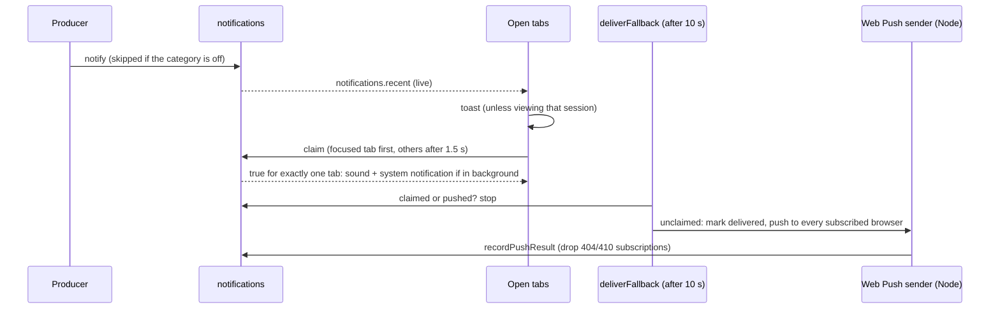

# Notifications

Radium notifies a user when one of their Chatroom runs finishes, waits for them, or fails, and tells workspace owners when the [usage limits](Radium_Gateway/Limits.md) of their credentials change. An open browser tab shows a toast and plays a sound; when no tab is open, the user's subscribed browsers get a Web Push notification instead. A phone app (Expo) is planned as the channel between the two.

## Implemented

### Producers

Every notification goes through `notify` (`packages/backend/src/notifications/notify.ts`), one row per recipient in `notifications`.

| Kind                                                                                                                        | Category    | Recipient                     | Fires when                                                                                                        |
| --------------------------------------------------------------------------------------------------------------------------- | ----------- | ----------------------------- | ----------------------------------------------------------------------------------------------------------------- |
| `session_finished`                                                                                                          | `finished`  | The user who sent the request | A Chatroom request completed                                                                                      |
| `session_approval`, `session_question`                                                                                      | `attention` | The user who sent the request | The request ended on a tool call waiting for approval, or on a `question` call                                    |
| `session_failed`                                                                                                            | `failed`    | The user who sent the request | An error chunk was streamed; the body carries the formatted error                                                 |
| `limit_low`, `limit_critical`, `limit_exhausted`, `limit_reset`, `credential_expired`, `credential_restored`, `poll_failed` | `limits`    | The workspace owner           | `recordLimitEvent` recorded the event ([Limits](Radium_Gateway/Limits.md#events)); archived workspaces stay quiet |

Session notifications come from the end of `POST /api/aisdk/chat` (`src/http/aisdk.chat.ts`, `onEnd`), after the messages are saved; `sessionNotificationKind` (`src/notifications/session.ts`) classifies the end the same way the web client finds pending approvals and questions. A request the user stopped, or one whose browser disconnected, notifies nobody. Because a run is tied to the request of the tab that started it, session notifications always start while a tab is open; the other channels matter when that tab is in the background or closes during the push grace below. A session notification carries only the session title (plus the error for failures), never message content.

### Delivery



- **Open tab.** Every open tab of the user watches `notifications.recent` and acts only on rows that arrive while it is open. It shows a toast in the notifications Toaster (top right, newest on top, up to five, 8 s, fading in place) unless the user is looking at that session in a focused, visible tab. The tab then calls `notifications.claim`; exactly one caller wins, and only while the notification is under 5 minutes old and was neither claimed nor pushed. The winner plays the category's sound when enabled and, when it is not the focused, visible tab, shows a system notification through the service worker. A tab without focus waits 1.5 s before claiming so a focused tab wins. Claiming is what keeps a device from ringing twice.
- **Phone (planned).** `deliverFallback` carries an `@todo(expo)` for the Expo app: send through [`@convex-dev/expo-push-notifications`](https://www.convex.dev/components/push-notifications) when the user has a registered phone, before desktop push. No app or token storage exists yet; Settings shows a `Planned` row.
- **Desktop push.** Ten seconds after creation, an unclaimed notification is marked `delivery` and sent by `notifications_push:send` (`src/notifications/web-push.ts`, `web-push` library, Node runtime) to every subscribed browser of the user, with a 1-hour TTL for sessions and 12 hours for limits. The service worker (`apps/web/public/notifications-sw.js`) shows it even with every tab closed. Subscriptions the push service reports gone (404/410) are deleted; other failures are logged and not retried. A tab that reconnects later skips pushed notifications.

A toast is a round card (`components/notifications/notification-toast.tsx`): category tile, title, and up to two lines of body. Clicking the card opens its target and dismisses it; the X on its top-left corner (shown on hover or focus, always on touch screens) or a swipe only dismisses. Clicking a card, a system notification, or a pushed notification opens the session, or Gateway > Limits after switching to the notification's workspace (from a pushed notification that opens a new window, the current workspace is used). The service worker focuses an open Radium window and posts the target to it, or opens a new window.

### Sound

Each category has a short Web Audio cue (`components/notifications/notification-sounds.ts`), synthesized as soft bell-like notes (a few sine partials, a fast attack, a long decay, a low-pass filter, and a small synthetic reverb): a rising fifth for finished, two taps and a lift for attention, a falling minor third for failed, one low note for limits. Browsers allow audio only after a user gesture on the page, so a tab plays sounds once the user has clicked or typed in it since it loaded; a background tab with that activation still plays. Pushed notifications use the operating system's notification sound.

### Preferences And Devices

**Settings > Account > Notifications** (`components/notifications/notifications-panel.tsx`):

- **This device:** `System notifications` asks for the browser's notification permission (enabling it also subscribes to push when available). `Push while Radium is closed` subscribes or unsubscribes this browser (`Enable`, `Turn off`), or shows an `Unconfigured` tag when the deployment has no VAPID keys and `Unavailable` when the browser cannot receive push. `Send test` shows a toast, plays the attention cue, and shows a system notification locally.
- **Notify me about:** per category, a preview button for its sound, `Sound`, and `Notify` (create notifications at all, on every channel). Stored per user in `user_preferences.notifications` (`notifications.getPreferences`, `notifications.setPreference`); defaults are on, with sound for every category except limits.
- **Push devices:** every browser subscribed for the user (`notifications.listDevices`), marked `This device` for the current one, with `Remove`.

A browser profile receives pushes for whoever subscribed it last: signing in as another user re-registers the existing subscription for that user. Signing out does not unsubscribe the browser.

### Data And Retention

- `notifications`: recipient, workspace, kind, title, body, optional chat or limit event, `createdAt`, `seenAt` (claimed), `delivery` (pushed: time, device count, delivered count). Pruned after 7 days by an hourly cron.
- `push_subscriptions`: user, endpoint, keys, browser label, `lastDeliveredAt`. Endpoints must be HTTPS URLs on a known push service (FCM, Mozilla autopush, WNS, APNs), because the backend POSTs to them; at most 20 per user.

### Configuration

Web Push needs VAPID keys on the Convex deployment; without them, tabs and system notifications from open tabs still work and Settings tags push `Unconfigured`.

```bash
bunx web-push generate-vapid-keys
bunx convex env set WEB_PUSH_VAPID_PUBLIC_KEY <public key>
bunx convex env set WEB_PUSH_VAPID_PRIVATE_KEY <private key>
bunx convex env set WEB_PUSH_SUBJECT mailto:admin@example.com   # optional; defaults to SITE_URL
```

Push services require the subject to be a `mailto:` or `https:` URL. Changing the key pair invalidates every existing subscription; users enable push again. The service worker needs a secure context (HTTPS, or `localhost`); Safari delivers Web Push only to an installed web app.

## Limitations

- Toasts and sounds come only from open Radium tabs; no in-app inbox lists past notifications.
- Session notifications cover the built-in agent's requests; Worker task progress and future ACP agents do not notify yet.
- The Expo phone channel is planned (`@todo(expo)` in `src/notifications/inbox.ts`).
- Push delivery is not retried after a non-404/410 failure.

## Verification

```bash
bun run test
bun run --cwd apps/web vite:build
```

`convex/notifications.test.ts` covers session-outcome classification, recipient isolation, single claim, claim expiry, the push fallback (skipped once claimed, sent once, not without VAPID keys or devices), preferences, owner-only limit notifications, and the push endpoint allowlist, all with `convex-test`. These are offline checks: the schema and functions have not been pushed to a deployment, and Web Push to a real push service, the service worker click flow, and the settings page against a live backend have not been exercised. The toast pile, its exit, the Web Audio cues, and a service-worker system notification were checked in a throwaway browser page.
