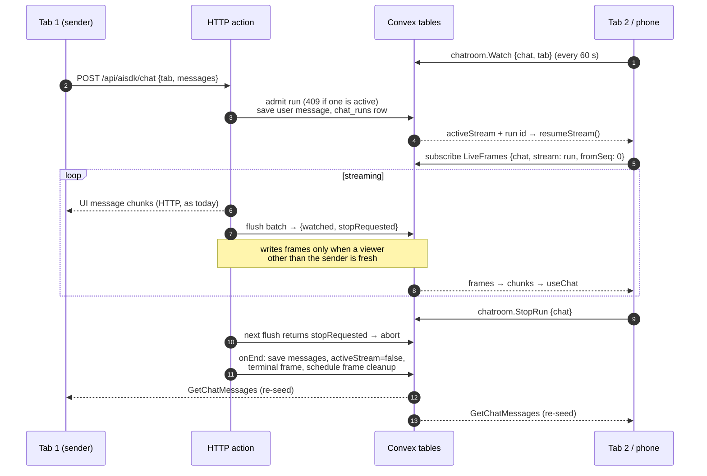

# Live Sessions Across Tabs

Status: **proposed, not implemented.** Applies to the built-in agent; ACP
Sessions use the same live layer ([ACP transport](../ACP/Transport.md)).

Goal: every Tab and device that has a Session open sees an in-flight reply as it
streams, can stop it, and a reload does not lose it. Without Redis: Convex
already gives every client a subscription, so the stream is relayed through
small, short-lived Convex documents instead of a pub/sub server.

## Today

| Behavior | Where |
| --- | --- |
| Only the Tab that sent the request receives the stream (`createUIMessageStreamResponse` over `POST /api/aisdk/chat`) | `packages/backend/src/http/aisdk.chat.ts` |
| The turn, including the new user message, is saved only at the end (`toUIMessageStream` `onEnd` → `internal.aisdk.EditChat`) | same |
| Other Tabs see `activeStream: true`, so their run state reads `streaming`, but show no content until the end, then re-seed `useChat` from `GetChatMessages` | `apps/web/src/components/session/session-screen.tsx` (seeding effect, `sessionRunState`) |
| Generation is tied to the sender's connection (`streamText({ abortSignal: req.signal })`): closing or reloading that Tab aborts the turn and records `Interrupted` | `aisdk.chat.ts` |
| Nothing stops a second request while one runs; two Tabs can start overlapping turns and the last `onEnd` wins | no `activeStream` check before `EditChat` |
| A request whose action dies before `onEnd` leaves `activeStream: true` | no reaper |

The AI SDK's own resumable streams (`resumable-stream`) keep each stream in Redis
pub/sub and replay it to reconnecting clients. That is the part Convex can replace.

## Design

### 1. Run admission

The HTTP action starts a run only through one mutation that:

- rejects the request with `409 already running` when the chat has an active run
  whose lease is fresh;
- inserts a `chat_runs` row `{chat, run, user, senderTab, startedAt,
  leaseAt, stopRequested}` and sets `aisdk_chats.activeStream = true` (unchanged
  meaning for Home and run state);
- saves the incoming history up to and including the new user message, so other
  Tabs show the prompt immediately and a reload never loses it. `saveChatMessages`
  already writes only changed positions, so this is usually one row.

The run's frequently changing fields live in `chat_runs`, not on the chat, so
lease renewals and stop requests do not invalidate `ListChats`.

### 2. Recording

`toUIMessageStream` output is `tee()`d. One branch is the HTTP response, as
today. The other is consumed by the action itself:

- It keeps every chunk of the run in memory (a run's chunks are bounded by its
  response size).
- Every **300 ms while watched, 2 s while not**, or immediately at boundary chunks
  (`tool-input-available`, tool outputs, `finish-step`, `finish`, `error`), it calls
  `internal.chatroom.live.flush({chat, run, chunks})`.
- `flush` reads `chat_viewers` for the chat (indexed, small) and decides:
  - **Not watched** (no fresh viewer except the sender's own streaming Tab): write
    nothing; return `{watched: false, stopRequested}`. The action keeps buffering.
  - **Watched, first time:** write the whole backlog as frames from sequence 0,
    then return `{watched: true}`.
  - **Watched:** append the batch as the next frame.
  - Every 15 s it also renews `chat_runs.leaseAt`.
- Frames are `chat_frames` rows `{chat, stream: run, seqFrom, seqTo, format: "ui",
  payload: UIMessageChunk[]}`, at most 32 KiB each.

With nobody else watching, a run costs one mutation call every 2 s and **no
frame writes**: a Session open in a single Tab behaves as today.

### 3. Watching and reading

- Every Tab showing a Session calls `chatroom.Watch({chat, tab, direct?})` on
  open and every 60 seconds. `tab` is a per-Tab ID kept in `sessionStorage`
  (survives reload). `direct` names the run this Tab is receiving over its own
  HTTP response; the sender's Tab therefore does not trigger frame writes for
  itself, and after a reload (no HTTP stream any more) it counts as a viewer.
- `session-screen.tsx` wraps `DefaultChatTransport` in a Radium transport:
  `sendMessages` is unchanged; **`reconnectToStream({chatId})`** subscribes to
  `chatroom.LiveFrames({chat, stream: run, fromSeq})` through the Convex client
  and returns a `ReadableStream<UIMessageChunk>` fed from frames in sequence
  order, or `null` when no run is active. It sets `resumeStreamIsReplay: true`
  because frames replay from the start of the run.
- A Tab that sees `activeStream` with a run it is not streaming calls
  `useChat`'s `resumeStream()`. The in-progress assistant message then flows
  through the same `useChat` state, so Steps, reasoning, tool input streaming,
  Code Mode inner calls and run state render exactly as in the sender's Tab.
- At the terminal frame the stream closes; when `activeStream` turns false,
  the existing re-seed from `GetChatMessages` replaces the replayed message with
  the saved one.

### 4. Stop from any Tab

`chatroom.StopRun({chat})` sets `chat_runs.stopRequested` (same authorization as
sending). The next `flush` returns it and the action aborts its own
`AbortController`, which also feeds `streamText`. Worst-case delay is one flush
interval (2 s unwatched, 300 ms watched). The sender's Stop button uses the same
mutation, so every Tab stops a run the same way.

### 5. Approvals, questions and Code Mode

- Tool approvals and `question` calls end the stream; `onEnd` saves the
  messages, so every Tab re-seeds and shows the Approval or Question prompt.
  Answering sends a new request, which run admission serializes: a second Tab
  answering the same call gets `409` and re-seeds instead of starting a
  duplicate turn.
- Code Mode prompts are already rows in `codemode_interactions`. Other Tabs
  subscribe to the run's open interactions and show the same stacked prompts;
  answering stays limited to the user who sent the request, as today.

## Detached Runs (Phase 2)

Phase 1 keeps today's rule that closing the sender's Tab aborts the turn. Phase
2 removes it:

- `streamText` gets only the action's own `AbortController` (Stop), not
  `req.signal`. The recording branch of the tee keeps consuming when the HTTP
  branch is cancelled, so generation and `onEnd` continue after the sender
  disconnects. Closing a Tab is no longer an interruption; Stop is the only
  user cancellation.
- The reloaded sender Tab becomes a viewer (its heartbeat no longer has
  `direct`), so frames start flowing to it within one unwatched interval and
  `resumeStream()` continues the reply.
- A cron marks runs whose `leaseAt` is older than 60 s as failed (`Run lost`),
  clears `activeStream`, and records the interruption, covering an action
  killed at its execution limit or by a deployment. The partial reply is lost
  unless it was being watched.

**Must verify before Phase 2:** that a Convex HTTP action keeps running after
its client disconnects and its response stream is cancelled, and the deployed
execution limit for HTTP actions (Convex's limits page and actions page give
different numbers). If disconnection kills the action, Phase 2 needs the
generation moved into a scheduled action, with the HTTP response itself reading
frames.

## Shared Live Layer

Built-in and ACP Sessions use the same two tables and functions:

| Piece | Built-in agent | ACP agent |
| --- | --- | --- |
| `chat_viewers {chat, tab, user, lastSeenAt, direct?}` | Decides whether `flush` writes frames | Decides whether the Session is warm |
| `chat_frames {chat, stream, seqFrom, seqTo, format, payload, …}` | `stream` = run ID, `format: "ui"`, payload = UI message chunks | `stream` = `acp:<epoch>`, `format: "acp"`, payload = timeline ops |
| `chatroom.Watch`, `chatroom.LiveFrames` | Same functions | Same functions |
| Producer | HTTP action | Worker |
| Frame lifetime | Run end + 60 s (content is saved in `chat_messages`) | Until the Session goes cold (content stays in the agent) |
| Cleanup | Per-minute cron: viewers older than 5 min; frames of finished runs older than 2 min | Same cron, plus cold-session deletion |

Authorization is the chat's: `LiveFrames` and `Watch` call the same access
check as `GetChatMessages`, and personal chats stay private.

## Load Profile

Expectations to measure, not guarantees:

| Situation | Extra Convex work per run |
| --- | --- |
| One Tab, nobody else watching | 1 run row, 1 early message save, a no-write `flush` call every 2 s, lease renewal every 15 s |
| A second Tab or device watching | + 3–4 frame inserts per second while text streams, independent of how many extra viewers |
| Viewer joins mid-run | 1 backlog write (all chunks so far, split into 32 KiB frames) |
| Each open Tab | 1 heartbeat per minute |

## Rollout

1. Run admission (409, `chat_runs`, early user-message save) and the stale-run
   cron. These fix overlapping turns and stuck `activeStream` on their own.
2. `chat_viewers`, `chatroom.Watch`, recording/`flush`, `chat_frames`,
   `LiveFrames`, the Radium transport's `reconnectToStream`, Stop from any Tab.
3. Detached runs, after the verification above.

## Sources

- [AI SDK `ChatTransport.reconnectToStream` / `resumeStreamIsReplay`](https://ai-sdk.dev/docs/ai-sdk-ui/chatbot-resume-streams) and
  `node_modules/ai` 7.x type definitions in this repo
- [Convex Agent delta streaming](https://docs.convex.dev/agents/streaming): the
  same save-deltas-and-subscribe pattern without Redis
- [Convex HTTP actions](https://docs.convex.dev/functions/http-actions) and
  [limits](https://docs.convex.dev/production/state/limits)
