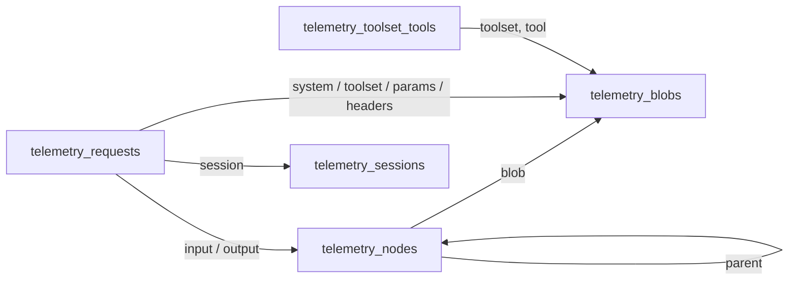

# Gateway Telemetry

Telemetry is opt-in request capture at the Radium Gateway. Every chat completion
that passes through `createCompletion` (`src/http/chat_completion.ts`) — external
OpenAI-compatible calls and the Chatroom's in-process Gateway calls alike — can be
stored in Convex with its full request, routing attempts, output, usage, and
session lineage. It is separate from [operational logging](../logging.md) and
analytics, and it is not an audit ledger.

Paths below are relative to `packages/backend/`.

## Settings

`workspace_settings.telemetry` (owner-only, `convex/observability/telemetry.ts`):

| Field           | Default | Effect                                                                                         |
| --------------- | ------- | ---------------------------------------------------------------------------------------------- |
| `enabled`       | `false` | Nothing is captured while off. Disabling also clears the two recording flags.                  |
| `recordInputs`  | `false` | Store message, system-instruction, and tool-definition content. Off keeps fingerprints + meta. |
| `recordOutputs` | `false` | Store model output content. Off keeps fingerprints + meta.                                     |
| `retentionDays` | absent  | Delete requests older than this many days. Absent keeps requests until deleted.                |

Requests from a member's personal chat never record content, and are hidden from
the owner's telemetry views (personal chats stay private even from owners).

Structured reasoning, including signatures and encrypted continuation state, is message content subject to these same recording controls. Encryption does not exempt it from privacy rules. Output assembly preserves custom-tool strings and separate interleaved calls; opaque-only reasoning output is retained without being rendered as visible reasoning.

Requests record requested and served service tiers separately, together with estimated, provider-reported and upstream inference costs when available. Usage includes cache reads, total cache writes and the known 1-hour write subset. OTLP exports these operational facts even when message-content privacy mode is enabled; content and opaque continuation payloads are omitted in that mode.

## Storage Model

Requests are decomposed into content-addressed pieces so an agent loop that
resends the same history, system prompt, and tools stores them once.



- **Fingerprints.** Content is serialized with RFC 8785 JSON canonicalization
  (`src/telemetry/canonical.ts`: sorted keys, no whitespace, one number/string
  spelling) and hashed with SHA-256 over `workspaceId + canonical JSON`
  (`src/telemetry/hash.ts`). Equal content in one workspace has one row; the same
  content in another workspace has a different hash and its own row. Dedup never
  crosses workspaces.
- **Blobs** (`telemetry_blobs`, unique per `(workspace, hash)`): message, leading
  system/developer messages, each tool definition, the ordered toolset, params
  (the raw body minus `messages`/`tools`, so `temperature`, `top_k`, `reasoning`,
  `metadata`, `trace`, and unknown fields survive), and allowlisted headers
  (never credentials). Content above 900,000 bytes goes to Convex file storage.
  With recording off, a blob keeps only its hash, size, and meta (role, tool or
  tool-call names).
- **Conversation tree** (`telemetry_nodes`): one immutable node per message
  position; `hash = H(workspace, parent hash, message hash)`. A request points at
  its last input node and its output node. Shared prefixes are stored once. A
  rollback, edit, or retry adds a sibling under the shared prefix; nothing is
  replaced, so every branch stays readable.
- **Sessions** (`telemetry_sessions`): keyed by the routing session
  (`src/routing/session.ts`): Chatroom chat, client session headers, body
  `session_id`/`prompt_cache_key`/`user`, else the first-turn message hash.
  Subagents keep their parent session key.

### Lineage And Changes

Each request records how its conversation relates to earlier requests:

| Lineage     | Meaning                                                                                    |
| ----------- | ------------------------------------------------------------------------------------------ |
| `root`      | First request of a conversation                                                            |
| `continue`  | Extends a previous request's output (or input when it had no output)                       |
| `retry`     | Resends exactly a previous request's input (regenerate)                                    |
| `rewrite`   | Extends a previous input but replaces that request's stored output                         |
| `branch`    | Diverges at a message that already had a continuation (rollback, edit); both branches stay |
| `compacted` | Shares no stored prefix while the session already has requests                             |

`changes` compares the request with the previous request in its session and
records differing system instructions, toolset, params, and model. The UI shows
system-prompt text diffs, tool added/removed/changed/reordered lists, and
param key diffs.

## Capture Flow

1. The entry point loads settings through
   `internal.observability.telemetry.getSettingsForWorkspace` and keeps the raw
   JSON body before validation.
2. `src/telemetry/capture.ts` hashes the request in the background while routing
   runs, finds the deepest stored prefix with a binary search (prefix existence is
   monotone), and writes only missing blobs and nodes
   (`convex/observability/telemetryIngest.ts`). Writes are ordered blobs → nodes →
   request row, in idempotent batches sized under Convex transaction limits.
3. Every routing attempt (provider, credential, model, timing, outcome, status)
   is recorded. The committed output is assembled from the stream or JSON body.
4. After the response finishes, `finishRequest` inserts the request row once per
   `(workspace, requestId)`, computes lineage and changes, links the
   `chat_completions` usage record, and schedules export.

Capture failures are logged and never fail or delay the client response.
Concurrent ingestion is safe: Convex mutations are serializable, so two requests
inserting the same hash cannot both succeed; the loser re-runs and reuses the row.

## Reads

`convex/observability/telemetry.ts` (owner-only): settings, `listRequests`,
`getRequest`, `getRequestMessages` (paged chain walk), `listSessions`,
`getSession` (timeline and branch tree), and `getSummary`. Requests tied to a
chat follow Chatroom visibility. UI: Gateway → Telemetry
(`apps/web/src/components/gateway/telemetry-*`). A request page shows one
conversation in the order the model received it (tools, system instructions,
messages, output). Messages already sent in earlier requests fold into an
accordion, and each tool call shares a card with its result. A session page
draws its requests as a left-to-right Mermaid flowchart (rendered with the
`@streamdown/mermaid` plugin at its strict security level): clicking a request
opens it, and clicking a grouped run of unchanged requests expands it. It also
shows the latest request's conversation as "General messages".

## Retention And Deletion

`convex/observability/telemetryRetention.ts`: owners delete a request or a whole
session; an hourly cron applies `retentionDays`. Deleted requests enqueue their
blobs and nodes in `telemetry_gc`; `collectGarbage` deletes a row only when no
request, child node, or toolset still references it, then walks up the tree.

## Export

`convex/observability/telemetryExport.ts`: owner-managed destinations per
workspace, `otlp` (OTLP/HTTP JSON to `<endpoint>/v1/traces`) or `webhook` (same
payload to the endpoint). Each destination has privacy mode (strips messages,
system instructions, tool definitions, and output), a sampling rate decided per
session so sessions stay whole, and API-key include/exclude filters (exclude
wins). Header values are stored in Secret Store and never returned. Export runs
in a scheduled action after the request is stored, so it adds no latency.

Spans use the OpenTelemetry GenAI semantic conventions
(`gen_ai.request.*`, `gen_ai.usage.*`, `gen_ai.conversation.id`,
`gen_ai.system_instructions`, `gen_ai.tool.definitions`, input/output messages)
plus `radium.*` attributes, one child span per routing attempt. The OpenRouter
`trace` body field (`trace_id`, `parent_span_id`, `trace_name`,
`generation_name`, custom keys) is honored.

Remote endpoints must use HTTPS; plain HTTP is accepted only for loopback.

## Legacy Traces

Rows from the former AI SDK collector (`telemetry_traces`, `telemetry_spans`,
`telemetry_payloads`) are moved by `migrations:telemetryTracesToRequests` into
`telemetry_requests` with `legacy` set; their truncated payloads become `legacy`
blobs flagged `truncated`. Those tables remain in the schema only until the
migration has run:

1. Deploy, then run `npx convex run migrations:runTelemetryTraces` (a dry run
   first: `npx convex run migrations:runTelemetryTraces '{"dryRun": true}'`).
2. Verify the three tables are empty.
3. In a follow-up deploy, remove the three tables and their `legacyTelemetry*`
   validators from the schema.

## Known Limitations

- Only OpenAI Chat Completions is captured, because it is the only implemented
  Gateway protocol.
- Captured output is the OpenAI-format assistant message assembled by the
  Gateway; when a client echoes it back in a different shape, lineage reports
  `rewrite` instead of `continue`.
- Large first-time histories are ingested in several mutations; a crash between
  batches leaves unreferenced nodes that garbage collection does not see until a
  later request references and deletes them.
- Application-level encryption of captured content is not implemented.

## Verification

```sh
bun run test
```
