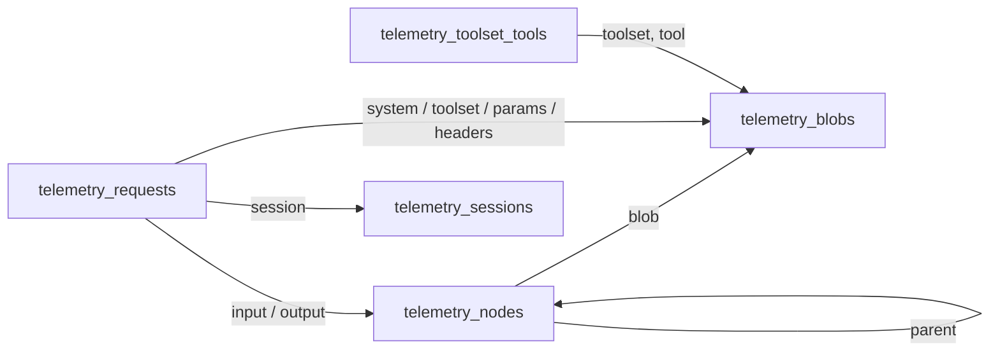

# Gateway Telemetry

Telemetry is opt-in request capture at the Radium Gateway. Every chat completion
that passes through `createCompletion` (`src/http/chat_completion.ts`) — external
OpenAI-compatible calls and the Chatroom's in-process Gateway calls alike — can be
stored in Convex with its full request, routing attempts, output, usage, and
session lineage. It is separate from [operational logging](../logging.md) and
analytics, and it is not an audit ledger.

Paths below are relative to `packages/backend/`.

## Settings

`workspace_settings.telemetry` (owner-only, `convex/observability/telemetry.ts`):

| Field           | Default | Effect                                                                                         |
| --------------- | ------- | ---------------------------------------------------------------------------------------------- |
| `enabled`       | `false` | Nothing is captured while off. Disabling also clears the two recording flags.                  |
| `recordInputs`  | `false` | Seal message, system, tool, parameter and allowlisted-header content to the owner key; off keeps keyed fingerprints and sizes. |
| `recordOutputs` | `false` | Seal model output to the owner key; off keeps keyed fingerprints and sizes. |
| `retentionDays` | absent  | Delete requests older than this many days. Absent keeps requests until deleted.                |

Requests from a member's personal chat never record content, and are hidden from
the owner's telemetry views (personal chats stay private even from owners).

Structured reasoning, including signatures and encrypted continuation state, is message content subject to these same recording controls. Encryption does not exempt it from privacy rules. Output assembly preserves custom-tool strings and separate interleaved calls; opaque-only reasoning output is retained without being rendered as visible reasoning.

Requests record requested and served service tiers separately, together with estimated, provider-reported and upstream inference costs when available. Usage includes cache reads, total cache writes and the known 1-hour write subset. OTLP exports these operational facts even when message-content privacy mode is enabled; content and opaque continuation payloads are omitted in that mode.

## Storage Model

Requests are decomposed into content-addressed pieces so an agent loop that
resends the same history, system prompt, and tools stores them once.



- **Fingerprints.** RFC 8785 canonical JSON is hashed with HMAC-SHA-256 under a per-workspace key derived from `TELEMETRY_HASH_SECRET` (`src/telemetry/hash.ts`). Equality and deduplication never cross workspaces. Node chains and message-derived routing sessions use separate hash domains. Missing/invalid secrets disable capture and that fallback, not explicit routing session IDs.
- **Blobs** (`telemetry_blobs`, unique per `(workspace, hash)`): messages, system/developer messages, tool definitions, ordered toolsets, raw parameters and allowlisted headers. New content and descriptive metadata (roles and tool names) are sealed to the workspace owner public key. Each capturing request generates one capsule; its descriptor is carried by each referring sealed object so deduplicated content survives deletion of the originating request. Large envelopes go to File Storage. Without keys, content is suppressed rather than stored plaintext. Legacy plaintext remains for phase 9.
- **Conversation tree** (`telemetry_nodes`): one immutable node per message
  position; `hash = H(workspace, parent hash, message hash)`. A request points at
  its last input node and its output node. Shared prefixes are stored once. A
  rollback, edit, or retry adds a sibling under the shared prefix; nothing is
  replaced, so every branch stays readable.
- **Sessions** (`telemetry_sessions`): keyed by the routing session
  (`src/routing/session.ts`): Chatroom chat, client session headers, body
  `session_id`/`prompt_cache_key`/`user`, else the first-turn message hash.
  Subagents keep their parent session key.

### Lineage And Changes

Each request records how its conversation relates to earlier requests:

| Lineage     | Meaning                                                                                    |
| ----------- | ------------------------------------------------------------------------------------------ |
| `root`      | First request of a conversation                                                            |
| `continue`  | Extends a previous request's output (or input when it had no output)                       |
| `retry`     | Resends exactly a previous request's input (regenerate)                                    |
| `rewrite`   | Extends a previous input but replaces that request's stored output                         |
| `branch`    | Diverges at a message that already had a continuation (rollback, edit); both branches stay |
| `compacted` | Shares no stored prefix while the session already has requests                             |

`changes` compares the request with the previous request in its session and
records differing system instructions, toolset, params, and model. The UI shows
system-prompt text diffs, tool added/removed/changed/reordered lists, and
param key diffs.

## Capture Flow

1. The entry point loads settings through
   `internal.observability.telemetry.getSettingsForWorkspace` and keeps the raw
   JSON body before validation. A key whose **Telemetry** setting is _Off_
   (`api_keys.telemetry`, set in Gateway → API keys, or on the Worker's row for
   [Worker keys](../ACP/Agents.md#telemetry)) skips capture entirely.
2. `src/telemetry/capture.ts` hashes the request in the background while routing
   runs, finds the deepest stored prefix with a binary search (prefix existence is
   monotone), and writes only missing blobs and nodes
   (`convex/observability/telemetryIngest.ts`). Writes are ordered blobs → nodes →
   request row, in idempotent batches sized under Convex transaction limits.
3. Every routing attempt (provider, credential, model, timing, outcome, status)
   is recorded. The committed output is assembled from the stream or JSON body.
4. Once the output is complete (before the JSON response is returned or the stream closes), `finishRequest` inserts the request row once per
   `(workspace, requestId)`, computes lineage and changes, links the
   `chat_completions` usage record, and schedules metadata export. Explicit content destinations are sent from the active capture's memory, never scheduler arguments.

Capture failures log only fixed messages and never fail the client response. Content export is best-effort in the completion path: the response (or stream close) waits at most one second for it after the request row is written, and a slower destination may be cut off when the action ends; there is no durable plaintext replay.
Concurrent ingestion is safe: Convex mutations are serializable, so two requests
inserting the same hash cannot both succeed; the loser re-runs and reuses the row.

## Reads

`convex/observability/telemetry.ts` (owner-only): settings, `listRequests`,
`getRequest`, `getRequestMessages` (paged chain walk), `listSessions`,
`getSession` (timeline and branch tree), and `getSummary`. Requests tied to a
chat follow Chatroom visibility. UI: Gateway → Telemetry
(`apps/web/src/components/gateway/telemetry-*`). A request page shows one
conversation in the order the model received it (tools, system instructions,
messages, output). Messages already sent in earlier requests fold into an
accordion, and each tool call shares a card with its result. A session page
draws its requests as a left-to-right Mermaid flowchart (rendered with the
`@streamdown/mermaid` plugin at its strict security level): clicking a request
opens it, and clicking a grouped run of unchanged requests expands it. It also
shows the latest request's conversation as "General messages". Sealed fields are opened locally with verified owner-key grants, including historical epochs. Decrypted views live only in memory and are cleared on lock, sign-out and trust changes; failures never fall back to plaintext siblings. System, parameter and tool diffs use decrypted content in the browser.

## Retention And Deletion

`convex/observability/telemetryRetention.ts`: owners delete a request or a whole
session; an hourly cron applies `retentionDays`. Deleted requests enqueue their
blobs and nodes in `telemetry_gc`; `collectGarbage` deletes a row only when no
request, child node, or toolset still references it, then walks up the tree.

## Export

`convex/observability/telemetryExport.ts`: owner-managed destinations per
workspace, `otlp` (OTLP/HTTP JSON to `<endpoint>/v1/traces`) or `webhook` (same
payload to the endpoint). New destinations default to privacy mode (metadata only), with session-stable sampling and API-key include/exclude filters (exclude wins). Header values are stored in Secret Store and never returned.

Scheduled delivery is metadata-only and cannot open stored ciphertext. Turning privacy mode off explicitly authorizes plaintext content delivery from the capturing request's memory once the response output is complete, subject to input/output recording settings and private-chat visibility. The response waits at most one second for it (`CONTENT_EXPORT_WAIT_MS` in `src/telemetry/capture.ts`); a crash or a slower destination can lose content delivery, and it cannot be replayed later from storage. The destination is a plaintext recipient by owner choice.

Spans use the OpenTelemetry GenAI semantic conventions
(`gen_ai.request.*`, `gen_ai.usage.*`, `gen_ai.conversation.id`,
`gen_ai.system_instructions`, `gen_ai.tool.definitions`, input/output messages)
plus `radium.*` attributes, one child span per routing attempt. The OpenRouter
`trace` body field (`trace_id`, `parent_span_id`, `trace_name`,
`generation_name`, custom keys) is honored.

Remote endpoints must use HTTPS; plain HTTP is accepted only for loopback.

## Legacy Traces

Phase 9 can seal `telemetry_traces`, `telemetry_spans` and `telemetry_payloads` in place, alongside modern telemetry rows. Existing native ciphertext and keyed fingerprints stay unchanged; only proven unkeyed fingerprints are rekeyed. Shared legacy blobs require audience-attribution proof, and mixed/unknown audiences remain custodial under the approved privacy fallback. [Rollout and verification](../deployment.md#e2ee-phase-9-rollout-approval-required).

The older `migrations:runTelemetryTraces` is a plaintext representation conversion, not the E2EE migration. It must not run on rows already carrying encrypted historical sidecars; its guard refuses them. Do not remove the legacy tables merely because the E2EE sealing job completed: schema narrowing is a separate approved deployment.

## Known Limitations

- Only OpenAI Chat Completions is captured, because it is the only implemented
  Gateway protocol.
- Captured output is the OpenAI-format assistant message assembled by the
  Gateway; when a client echoes it back in a different shape, lineage reports
  `rewrite` instead of `continue`.
- Large first-time histories are ingested in several mutations; a crash between
  batches leaves unreferenced nodes that garbage collection does not see until a
  later request references and deletes them.
- Legacy rows are not re-encrypted by this change. Owner-key loss makes new captured content unreadable without another grant/recovery path; metadata remains usable.
- Keyed Chatroom chats retain content-capture suppression. Gateway capture can seal content when configured and owner keys exist.

## Verification

```sh
bun run test
```
