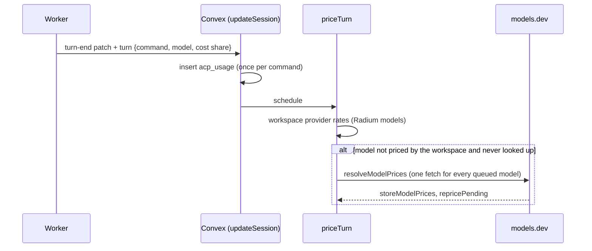

# Observability And Usage

## Implemented Organization

Radium's registered observability APIs live under
`packages/backend/convex/observability/`. This is a shared namespace with
purpose-specific owners:

| Module                  | Responsibility                                                                                                                                               | Persistence / shared code                                                                                                       |
| ----------------------- | ------------------------------------------------------------------------------------------------------------------------------------------------------------ | ------------------------------------------------------------------------------------------------------------------------------- |
| `events.ts`             | Authenticated browser operational-event ingestion and per-actor rate limiting                                                                                | Isolated logging Component; `packages/backend/src/logging/` owns the generic v1 envelope and best-effort backend console logger |
| `usage.ts`              | Generation history (`getGenerations`), activity aggregation (`getActivity`, implemented in `src/usage/activity.ts`), and recent usage estimates (`getUsage`) | `chat_completions` and `acp_usage`; one bounded workspace/legacy read and chat-visibility policy feeds all three queries        |
| `../agent_usage.ts`     | ACP turn pricing, models.dev matching, per-Session estimated cost (`GetChatCost`, built-in and ACP)                                                          | `acp_usage`, `acp_model_prices`, `chat_completions.by_chatId`; `packages/backend/src/usage/acp.ts` and `agent_usage.ts`         |
| `telemetry.ts`          | Opt-in Gateway capture settings, request/session reads, change and branch views, summaries                                                                   | `telemetry_*` tables; `packages/backend/src/telemetry/` owns canonical hashing, decomposition, capture, and read helpers        |
| `telemetryIngest.ts`    | Internal content-addressed ingestion, lineage, and change detection                                                                                          | Called only by the Gateway capture in `src/telemetry/capture.ts`                                                                |
| `telemetryRetention.ts` | Owner deletes, retention cron, and reference-checked garbage collection                                                                                      | `telemetry_gc` queue                                                                                                            |
| `telemetryExport.ts`    | Owner-managed OTLP/webhook destinations and scheduled delivery                                                                                               | `telemetry_destinations`; header secrets in Secret Store                                                                        |

The old `logging`, `logs`, and `usage` modules re-export their original
functions for compatibility with existing clients and in-flight function
references. They own no independent implementations. The former `telemetry` and
`observability/aiTraces` trace APIs were removed with the AI SDK collector; see
[Gateway telemetry](Radium_Gateway/Telemetry.md).

## Data And Authorization Flow

- Browser operational events pass through Better Auth session validation in
  `events.ingest`. The app derives the actor and applies the limiter before calling
  the isolated Component. This policy belongs in the app wrapper: Components do
  not inherit application auth. See [operational logging](logging.md) for envelope
  bounds, failure behavior, and the console-only backend sink.
- Usage queries require the workspace owner, merge bounded workspace and legacy
  reads, deduplicate completion IDs, and exclude other users' personal chats.
  Costs are historical operational estimates, never charges or balances.
- Agent usage rows follow their chat's visibility the same way, so the owner never
  sees another user's personal ACP Session in Activity.
- Gateway telemetry is owner-only and hides requests from other users' personal
  chats. Internal ingestion revalidates server-derived workspace, key, and chat
  associations. Capture is disabled by default and input/output recording remains
  independently controlled. See [Gateway telemetry](Radium_Gateway/Telemetry.md).

## Agent Usage

ACP agents call their own providers, so the Gateway never sees those requests unless the agent is pointed at the Gateway (by hand today; Gateway mode is still planned). Their cost is tracked from what the Worker already knows at the end of each prompt turn; Convex only prices it.



- **Worker reports, once per turn.** The turn-end `updateSession` patch carries `turn`: the prompt command (idempotency key, so a retried patch never counts twice), the model choice at turn start (`selectedAcpModel`), and the turn's share of the agent's cumulative `usage_update` cost when both ends are known in one currency (zero for a session created in that Worker process). Tokens come from `PromptResponse.usage`, read as the turn's usage (agent-client-protocol#1860: Copilot CLI reports session totals and would be overcounted). Nothing is polled; the Worker is never asked again.
- **Normalizing tokens.** ACP does not say whether cache tokens are inside `inputTokens` or whether thought tokens are inside `outputTokens`; `normalizeAcpUsage` picks the reading whose implied total matches the agent's `totalTokens`, then the Gateway's `estimateCompletionCost` prices it.
- **Pricing order.** The workspace's enabled providers first (the agent's routed provider by upstream id, else any provider with the same Radium model by normalized slug); else a cached models.dev match (`acp_model_prices`, per workspace, agent and model choice). A model never looked up queues one lookup, and its turns wait as `pending` until the resolver stores the match. Matches refresh weekly, misses and failed fetches daily, in the background. Matching is conservative: exact `provider/model` (OpenCode uses models.dev ids), then an ID equal within the inferred lab's provider, then the longest versioned catalogue name inside the choice's name or description; a versionless alias (`opus`) stays unpriced.
- **Cost.** `cost = estimatedCost ?? reportedCost`: the list-price estimate wins even when the agent reports its own cost, because subscription and subsidized plans report 0 or a discount and owners compare harnesses at API rates. The agent's figure stays on the row (`reportedCost`, `agentCost`) and fills in only when no estimate is possible; other currencies are never converted. Historical rows are not repriced when rates change.
- **Reads.** `getActivity` merges Gateway completions, ACP turns and local CLI usage (`sources: "gateway"` leaves the last two out; the Activity menu reads _Gateway, ACP and CLIs_ / _Gateway only_) and breaks them down by day, model (agent usage joins Radium models through a model slug), harness (Radium agent, Gateway API, each agent) and Project (read from the chat now; `none` for unfiled sessions, `outside` for Gateway calls without a chat). Agent usage is one harness row and one cost figure whether a session ran through Radium or in a terminal: a CLI session joins the ACP agent that indexed it, else the agent whose definition runs that CLI (`agentForSource`), else its own row. `project` narrows every figure. The Activity page keeps the sources choice in `localStorage`; Home's Project header opens an owner-only 30-day summary that subscribes only while open. `agent_usage.GetChatCost` gives every Session's estimated total (built-in Gateway completions, or an ACP Session's local rows plus uncovered turns) to anyone who can open it; the context meter shows it as _Session estimate_, next to the agent's own figure for ACP Sessions, and subscribes only while the Session is on screen.

### Local CLI Usage (ccusage)

Coding CLIs log every model call on their own machine, including sessions run in a terminal or another editor. Each Worker reads those logs with [ccusage](https://ccusage.com) (a direct `packages/worker` dependency, MIT, prebuilt per platform) and uploads totals, never content (`packages/worker/src/usage/local-usage.ts`, contract in `packages/backend/src/usage/local_contract.ts`).

- **Sync.** On connect and every 15 minutes, the Worker reads the backend's cursor (`localUsageCursor`), runs one `ccusage daily` report to find the days with usage (a new Worker backfills 90 days), then `ccusage session --since D --until D` for each such day in UTC, which splits multi-day sessions exactly. Rows are one per session per day (`local_usage`); a day identical to the last upload is not sent, and `reportLocalUsage` does not rewrite unchanged rows, so a quiet machine costs one ccusage run and no writes. Finished days use ccusage's bundled prices (`--offline`); today and yesterday fetch current ones. Failures (no supported CLI data, missing binary) are stored on `local_usage_syncs` and shown on Activity per Worker; the cursor does not advance.
- **Pricing.** ccusage's cost is kept as reported. A model ccusage cannot price gets Radium's estimate through the same resolver as ACP turns (workspace rates, then models.dev, keyed `local:<source>`, with the source tried as the routing provider since ccusage drops it: `opencode/glm-5.3-flash-free`). Readers use `cost ?? estimatedCost`; a model still waiting for its first lookup counts as pricing, one with no price anywhere as unknown. A reported row whose unpriced models were never estimated is priced again, which also covers rows uploaded before a failed pricing run.
- **Reconciliation, per session.** ccusage's session id is the CLI's own id, which ACP agents also use as their ACP session id, so a row joins the Radium chat bound to it (`acp_sessions`). For that chat, a Radium-priced turn is replaced by local rows only when ccusage read the session's logs that day after the turn ended (`isTurnCovered`); turns it has not seen yet keep counting. ACP agents ccusage cannot read (unsupported CLIs, logs elsewhere) never get local rows, so their turns always count; nothing is configured per agent and nothing counts twice.
- **Agents on the Gateway.** An agent pointed at the Gateway is seen twice: as Gateway completions and in its own logs. A direct Gateway call stores the client's session id (`chat_completions.clientSession`, from `clientSessionId`: the session header, body `session_id` or `prompt_cache_key`). OpenCode sends its session id (`x-session-id: ses_…`), the same id ACP and ccusage use; pi and Qwen Code send none, and Codex and Claude Code cannot use the Gateway's Chat Completions API. A call whose id matches an agent session (bound chat, session index, or a ccusage row) joins that agent's harness row and Project, and for that session and UTC day the Gateway's exact figures replace its ccusage rows and turn reports, in Activity and in the Session estimate. A session that used the Gateway and another provider on the same day counts only the Gateway part. Calls with no matching id stay _Gateway API_. At most 200 distinct ids are resolved per Activity read, since some clients send a fresh `prompt_cache_key` per call. Sessions on an ACP agent's [Gateway profile](ACP/Agents.md#gateway-mode) never count their turn reports at all: their Gateway completions are the only record, so an agent that sends no session id is not counted twice.
- **Projects.** A session not bound to a chat takes the Project whose folder on that Worker equals the session's `cwd` in the agent session index (`acp_agent_sessions`, synced from `session/list`); otherwise it is unfiled (_No project_), like an unfiled chat. Rows bound to another user's personal chat are hidden from the owner like every other usage row.

## Extending Operational Events

Non-AI backend events belong to the operational-event contract, not Gateway
telemetry or completion usage. Existing Convex code can emit bounded operational
events with `logger` from `packages/backend/src/logging/server.ts`. It currently
writes to the Convex console only. New event names do not require an envelope or
table change; keep metadata non-sensitive and reuse opaque correlation fields.

Persistent backend events are **planned**, not implemented. A future server-owned
adapter must derive actor/workspace attribution at its authorized entry point;
the browser wrapper still accepts only the frontend source. Workspace-owned
events need an explicit workspace authorization/retention design before adding a
read API. Do not infer workspace access from the current actor-only Component
rows.

## Known Limitations And Verification

Operational events have no read API or automatic retention. Gateway telemetry
retention is a per-workspace setting. Usage and telemetry summaries are bounded
windows, not complete accounting or analytics pipelines. There is no required
hosted collector.

Run local regressions from the repository root:

```bash
bun run --cwd packages/backend test convex/ownership-review.test.ts src/logging src/telemetry
```

Handler coverage checks canonical/compatibility usage reads, duplicate legacy
attribution, owner/member boundaries, and personal-chat filtering for usage and
AI traces. Logging unit coverage does not prove authenticated Component ingestion
or rate limiting; the [observability follow-up](tasks/08_Local_Observability.md)
tracks that integration coverage and persistence expansion. Local tests do not
verify a deployment.

### Refactor Checks

- `bun run --cwd packages/backend test convex/ownership-review.test.ts src/logging src/telemetry`: 31 tests passed.
- `bun run --cwd packages/backend test src/http`: 17 tests passed.
- Offline API-only generation completed with the guarded command in
  [deployment configuration](deployment.md#offline-api-binding-codegen). It writes
  the local generated declaration, which is ignored in this checkout; no functions
  were uploaded and no deployment data was changed.
- Changed files were formatted with `apps/web/node_modules/.bin/oxfmt`; the root
  `bun run format` script could not resolve that executable.
- Scoped ESLint was blocked because the root `eslint.config.mjs` cannot resolve
  its `eslint` import from the workspace root.
- `apps/web/node_modules/.bin/tsc --noEmit -p packages/backend/tsconfig.json`
  was blocked by the backend's `rootDir: src` excluding its Convex files. Retrying
  with `--rootDir packages/backend` exposed strict/test typing issues elsewhere;
  the canonical observability modules and new regression-test calls produced no
  diagnostics.
- `apps/web/node_modules/.bin/tsc --noEmit -p apps/web/tsconfig.json` reported
  workspace alias, AI SDK version, and auth/UI type errors. Neither package has a
  clean typecheck result; these checks are not deployment verification.
