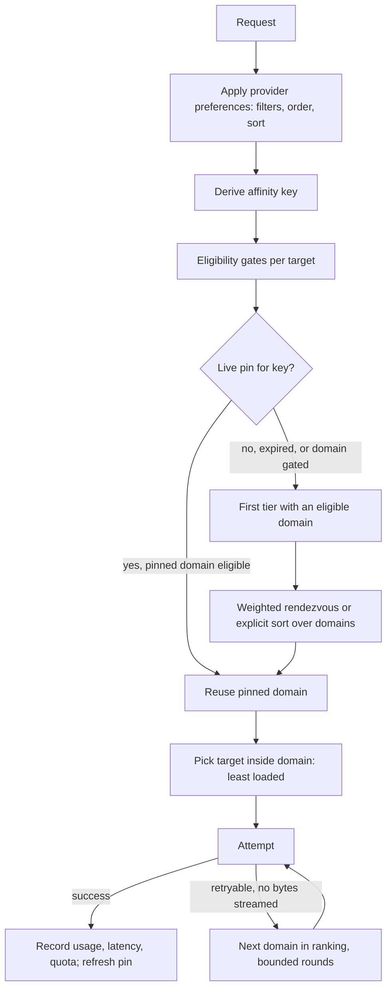

# Gateway Auto-Routing Research

Research snapshot: 2026-10-25. On 2026-10-25 the owner chose to implement CLIProxyAPI's model first; that slice is documented in [Gateway routing](../Radium_Gateway/LoadBalancer.md) and supersedes the "Current State" table and the CLIProxyAPI "Not Adopted" list below (it uses a fixed affinity TTL, provider-level bindings, the assistant-turn hash, and exclude-only quota). The cache-domain rendezvous placement and quota pacing in "Proposed Design" remain proposals for [task 05](../tasks/05_Gateway_Load_Balancer.md). Multi-account pools depend on the upstream-instance model in [task 04](../tasks/04_Upstream_Instances.md).

The algorithm is provider-agnostic. Provider specifics live in adapters, which
declare cache scope, cache lifetime, cache hints, and quota signal parsers; the
router consumes only those declarations.

## Current State

Verified against the checked-in source:

| Area                 | Behavior                                                                                                                                                                                                                                         | Location                                                  |
| -------------------- | ------------------------------------------------------------------------------------------------------------------------------------------------------------------------------------------------------------------------------------------------ | --------------------------------------------------------- |
| Candidate resolution | Enabled, credentialed workspace providers that list the model; `request.provider` (string) filters to one slug                                                                                                                                   | `convex/providers.ts` `resolveProviderCandidatesForModel` |
| Selection            | Uniform random per request, so consecutive turns of one conversation can land on different upstreams                                                                                                                                             | `src/ai_balancer.ts`                                      |
| Accounts             | One credential per `(workspace, provider slug)`; several accounts of one provider cannot be represented                                                                                                                                          | Secret Store namespace `workspaceProviderSecretNamespace` |
| Failover             | None; AI SDK `maxRetries` defaults to 0                                                                                                                                                                                                          | `src/translators/openai.ts`                               |
| Cache hints          | `prompt_cache_key \|\| user` is passed only as OpenRouter `user`; no `prompt_cache_key`, `session_id`, or Anthropic `cache_control` reaches upstreams                                                                                            | `src/translators/openai.ts`, `src/providers.ts`           |
| Usage signals        | `chat_completions` records `ttft`, `gen_time`, prompt/cached/completion tokens per request                                                                                                                                                       | `convex/schema.ts`, `src/http/chat_completion.ts`         |
| Quota signals        | No adapter exposes upstream limits. Example: the ChatGPT subscription library copies only `content-type` from upstream responses and rewraps 429 bodies as `{ error, status, detail }`; its `rate_limit` state is a local 30 req/min abuse guard | `@opencoredev/loginwithchatgpt-server` `handleResponses`  |

## Requirements

1. Opt-in objectives: availability, throughput (TPS/TTFT), quota utilization
   across N accounts of any provider, cost, and explicit weights.
2. Cache consistency: a conversation keeps hitting the same cache domain unless a
   hard failure forces a move.
3. Works without usage-limit data, and improves automatically when a usage
   integration supplies it.
4. Deterministic across stateless Convex action invocations; no global hot record.
5. Requests may pass an OpenRouter-style `provider` preferences object; the
   existing `provider` string keeps working as a hard pin.

## Upstream Cache Semantics

Routing must preserve affinity to the scope that owns the cache, not to an
individual key or endpoint.

| Upstream                                                   | Cache scope                                                                                                     | Routing hint                                           | Idle lifetime                    |
| ---------------------------------------------------------- | --------------------------------------------------------------------------------------------------------------- | ------------------------------------------------------ | -------------------------------- |
| OpenAI API                                                 | Organization; machine chosen by prefix hash plus `prompt_cache_key`; ~15 req/min per prefix+key before overflow | `prompt_cache_key`                                     | Minutes; model-dependent         |
| Anthropic API                                              | Workspace (direct API, Foundry, Claude Platform on AWS); organization on Bedrock/Vertex                         | `cache_control` breakpoints                            | 5 min default, 1 h opt-in        |
| OpenRouter                                                 | Per account, model, and conversation sticky provider routing; disabled by `provider.order`                      | `session_id` / `x-session-id`, else `prompt_cache_key` | 10 min, reset per success        |
| Login-based plans (subscription OAuth/session credentials) | Per logged-in account                                                                                           | Adapter-specific                                       | Adapter-declared; default 10 min |
| vLLM/SGLang/Ollama                                         | Per server process (prefix/KV cache)                                                                            | None; affinity by routing only                         | Until evicted                    |

Consequences:

- Two API keys in the same OpenAI organization or Anthropic workspace are one
  cache domain; balancing between them costs no cache.
- Each logged-in plan account and each self-hosted server is its own cache domain.
- Radium in front of OpenRouter is a two-level router. Radium must forward its
  affinity key as `session_id` and avoid `provider.order`, or OpenRouter's own
  stickiness is lost.

## Algorithm Survey

| Algorithm                                                               | Provides                                                                                      | Misses                                         | Use here                                            |
| ----------------------------------------------------------------------- | --------------------------------------------------------------------------------------------- | ---------------------------------------------- | --------------------------------------------------- |
| Random / weighted shuffle (current, LiteLLM default)                    | Spread                                                                                        | Any affinity                                   | Replace                                             |
| Round-robin, smooth weighted round-robin, fill-first (CLIProxyAPI)      | Even or weighted spread; fill-first drains one account at a time                              | Affinity without a session cache; quota timing | Not used; see simulation                            |
| Consistent / rendezvous hashing (HRW)                                   | Deterministic key→target without shared state; minimal remapping when targets change          | Load or quota awareness                        | Placement core                                      |
| Weighted rendezvous hashing                                             | HRW with share proportional to weight                                                         | Stability when weights move                    | Placement core, weights from policy                 |
| Consistent hashing with bounded loads (Mirrokni, Thorup, Zadimoghaddam) | Affinity plus a hard per-bin capacity; overflow walks to the next bin                         | Quota windows                                  | Gate model: walk HRW ranking past saturated targets |
| SGLang cache-aware router                                               | Prefix affinity until imbalance exceeds absolute and relative thresholds, then shortest queue | Account quotas                                 | Hysteresis pattern for leaving a pin                |
| P2C + Peak EWMA (Finagle, Linkerd)                                      | Fast reaction to slow backends, low tail latency                                              | Determinism; fast-failing hosts look fast      | TPS/TTFT weight; failures handled by gates          |
| Cooldown / circuit breaker (LiteLLM, CLIProxyAPI)                       | Removes failing targets                                                                       | Ranking by remaining quota                     | Availability gate with per-error classes            |
| Budget pacing (remaining budget ÷ remaining time)                       | Spends expiring capacity before it resets, protects nearly-exhausted budgets                  | Needs quota estimates                          | Quota objective                                     |

## Prior Art: CLIProxyAPI

[CLIProxyAPI](https://github.com/router-for-me/CLIProxyAPI) is a Go proxy that pools
many subscription and API-key credentials. Findings from the source at commit
`307803510bce` (2026-10-25); paths are relative to `sdk/cliproxy/`.

### How It Routes

| Aspect               | Behavior                                                                                                                                                                                                                                                 | Source                                                       |
| -------------------- | -------------------------------------------------------------------------------------------------------------------------------------------------------------------------------------------------------------------------------------------------------- | ------------------------------------------------------------ |
| Order of decisions   | Provider first, then credential. Priority is a strict integer tier across all providers; only the highest tier with an eligible credential is considered                                                                                                 | `auth/scheduler.go`, `auth/selector.go`                      |
| Strategies           | `round-robin` (default; successor by sorted credential ID), `weighted-round-robin` (nginx smooth WRR, weight 1–1,000,000, 0 excludes), `fill-first` (lowest ID until blocked)                                                                            | `auth/selector.go`, `service_config.go`                      |
| Session affinity     | Opt-in (`routing.session-affinity: false` by default). Wraps the strategy: session → credential binding, used regardless of priority or weight while the credential is available                                                                         | `auth/selector.go` `SessionAffinitySelector`                 |
| Session key          | More than 20 sources in order: client-specific headers (Claude Code, Codex, OpenCode, pi, Antigravity), generic `X-Session-ID`/`X-Conversation-Id`, body `session_id`/`thread_id`, `prompt_cache_key`, conversation IDs, then a hash fallback            | `session/info.go`                                            |
| Hash fallback        | FNV-64a of first 100 bytes of system, first user, and first assistant message. Primary key includes the assistant turn; the fallback key omits it, so turn 1's key carries over to later turns                                                           | `auth/selector.go` `extractMessageHashIDs`                   |
| Prefix matcher       | Without an explicit ID, a Merkle longest-common-prefix index over canonicalized turns finds the credential that served the longest known prefix, and detects forks and compaction                                                                        | `session/lcp.go`                                             |
| Binding storage      | In-memory, 65,536 entries, key `provider::session::model`, sliding TTL (default 1 h), no persistence                                                                                                                                                     | `auth/session_cache.go`                                      |
| Subagents            | Child sessions inherit the parent's credential through a parent fallback key without moving the parent's binding                                                                                                                                         | `auth/selector.go`                                           |
| Rebinding            | `rebind-on: any` (default) rebinds on any credential failure. `quota` keeps the binding through 408/5xx/empty streams (that request fails over only) and rebinds on 401/402/403/404/429, model-support errors, and `invalid_grant`                       | `auth/selector.go`                                           |
| Cooldowns            | 429: `max(Retry-After, 10 s)`, else exponential 1 s → 30 min; concurrent failures inside an open window do not escalate; later failures only extend. 401/402/403: 30 min. 404/model-unsupported: 12 h. 408/5xx: 60 s. Credential-wide or per-model scope | `auth/conductor_cooldown.go`                                 |
| Stale-result fencing | Each attempt carries an execution sequence; a success dispatched before a cooldown was recorded cannot clear it                                                                                                                                          | `auth/conductor_cooldown.go`                                 |
| Reset sanity         | Claude reset deadlines beyond 7 d + 1 h are dropped as billing boundaries and fuzzed by 1–30 s; Devin resets beyond 8 d are ignored                                                                                                                      | `internal/runtime/executor/helps/`                           |
| Quota data           | `x-codex-*`, `anthropic-ratelimit-unified-*`, `Retry-After` are captured into a snapshot for management views only. Selection never reads it: quota only excludes, through cooldown deadlines                                                            | `auth/quota_signals.go`                                      |
| Retry                | Up to `request-retry` (3) extra rounds; each tries untried credentials, then waits for the soonest cooldown up to `max-retry-interval` (30 s) with jitter                                                                                                | `auth/conductor_execution.go`, `auth/conductor_selection.go` |
| Streaming            | Failover only before the first non-empty payload; an optional bootstrap buffer catches overload errors sent inside an HTTP 200 stream                                                                                                                    | `auth/conductor_stream.go`                                   |
| Error rules          | Per-provider rules: status + body substring/regex → `stop`, `continue`, `stop-and-cooldown`, `continue-and-cooldown`                                                                                                                                     | `auth/conductor_request_scoped_errors.go`                    |
| Multi-node           | All cursors, bindings, and cooldowns are process memory; cooldowns optionally saved to `.cds` files. Clusters delegate selection to an external "Home" control plane not included in the repo                                                            | `auth/conductor_home.go`, `auth/cooldown_state.go`           |

### Adopted

- Client session headers as affinity sources: `X-Claude-Code-Session-Id`, Codex
  `session_id`, `X-Session-Affinity`, `X-Session-ID`, `X-Conversation-Id`, and body
  `conversation`/`conversation_id`.
- Parent-key fallback so subagents land on the parent's cache domain.
- Two rebind classes: transient failures fail over for one request and keep the
  pin; quota, auth, and model-support failures move it.
- Cooldown mechanics: one escalation per open window, extend-only deadlines,
  `Retry-After` floor, discard reset deadlines longer than the longest known
  window, jitter on recovery, and stale-success fencing.
- Bounded retry rounds that wait for the soonest cooldown.
- Stream bootstrap buffering before the first payload.
- Owner-configurable error rules per provider.

### Not Adopted

- **In-memory state.** Convex actions share no process memory; pins and health
  must be documents, and placement must be deterministic without cursors.
- **Exclude-only quota.** CLIProxyAPI already captures usage headers but does not
  rank by them. Round-robin and fill-first ignore when windows reset; fill-first
  served the least demand near capacity in the simulation below.
- **Fixed 1 h affinity TTL.** Pins here last as long as the domain's cache, so
  rebalancing happens exactly when the cache is cold anyway.
- **Credential-level binding.** Pins bind to a cache domain, so keys sharing an
  organization or workspace stay interchangeable.
- **Assistant turn in the hash fallback.** Conversations with identical openings
  share the same cached prefix; grouping them helps caching, and load is bounded by
  the eligibility gates.
- **Merkle prefix matcher.** Too heavy for the first slices; worth revisiting for
  self-hosted targets where the router owns KV-cache locality.

## Proposed Design

### Vocabulary

- **Target**: schedulable upstream from task 04 — adapter, account credential,
  endpoint, upstream model ID.
- **Cache domain**: set of targets sharing prompt caches (one plan account, one
  OpenAI organization, one Anthropic workspace, one OpenRouter account, one local
  server). Declared by adapter, overridable by the owner.
- **Tier**: ordered priority group, for example flat-rate plans → cheap BYOK →
  OpenRouter. Lower tiers receive new conversations only when higher tiers have no
  eligible domain.
- **Affinity key**: stable identity of the unit of work whose prefix is reused.
- **Adapter contract**: cache scope, cache lifetime, cache hint mapping, quota
  signal parser, and error classification per adapter.

### Pipeline

### 1. Affinity Key

First present value wins, scoped by `workspace + public model ID`:

1. `session_id` body field or `x-session-id` header (OpenRouter-compatible).
2. Client session headers: `X-Claude-Code-Session-Id`, Codex `session_id`,
   `X-Session-Affinity`, `X-Conversation-Id`.
3. `prompt_cache_key`, then body `conversation`/`conversation_id`, then deprecated
   `user`.
4. Chatroom `chatId` from the server-authorized chat context.
5. Hash of tool definitions, first system message, and first non-system message
   (OpenRouter's default derivation).

A parent reference (for example `X-Parent-Session-ID` or `parent_session_id`) is a
fallback key: an unpinned child inherits the parent's pinned domain without
extending or moving the parent pin. Different models never share a cache, so the
model is part of the key.

### 2. Eligibility Gates

Binary, evaluated per target before scoring:

- Model offered, target enabled, credential present (existing resolver checks).
- Allowed by request preferences (`only`, `ignore`, `allow_fallbacks`,
  `max_price`).
- Health not cooling (see Availability).
- Every known quota window above a reserve. The reserve approximates one more turn
  for the conversation: last prompt plus completion tokens for this key, else a
  workspace median.
- Concurrency or RPM/TPM cap not reached, where configured.

A domain is eligible when at least one of its targets is eligible.

### 3. Placement: Tiers Plus Weighted Rendezvous

For an unpinned key, inside the first tier with an eligible domain:

$$
\text{score}(k, d) = \frac{w_d}{-\ln h(k, d)}, \qquad h(k,d) \in (0,1)
$$

`h` is a uniform hash of key and domain ID; the highest score wins. Properties:

- Same key and same state snapshot produce the same domain in every action
  invocation, without coordination.
- Long-run share per domain is proportional to `w_d`.
- Adding or removing a domain only moves keys that ranked it first.
- The full descending ranking is the deterministic failover order.

Inside the chosen domain, pick the target with the fewest in-flight requests or
lowest window usage; this is cache-neutral by definition.

### 4. Pins and Migration

Weights change continuously (quota headroom, latency), which would reshuffle
pure HRW results mid-conversation. A pin freezes the decision:

- On the first successful response, store `affinity key → domain` with
  `expiresAt = now + domain cache lifetime`. Each success extends it.
- While the pin is live and the domain passes the gates, reuse it regardless of
  current weights, tier, or request `order`.
- When the pin expires, the upstream cache is already cold, so re-placement by
  current weights and tiers is free. This is where rebalancing happens.
- Transient failures (408, 5xx, timeout, empty stream) fail over for that request
  only; the pin stays, because the pinned cache is still warm.
- Quota exhaustion, auth failure, and model-support errors gate the domain and
  move the pin to the domain that succeeds. It does not bounce back on recovery,
  because the warm cache now lives on the new domain.
- Optional soft migration (throughput objective only): leave a live pin only when
  degradation persists beyond SGLang-style absolute and relative thresholds and
  the estimated benefit exceeds the cache-miss cost, estimated from the key's last
  `cached_tokens` multiplied by the uncached minus cached input price.

Pins are one document per affinity key with an expiry index. Refresh writes should
be coalesced into the existing completion-record mutation and skipped when less
than half the lifetime has elapsed.

### 5. Policies

The owner enables objectives per workspace; each contributes a gate, a weight
factor, or tier order. Weights multiply.

| Objective                | Mechanism                                                                                                                          | Data                                      |
| ------------------------ | ---------------------------------------------------------------------------------------------------------------------------------- | ----------------------------------------- |
| Availability (always on) | Cooldown state per target or per target+model; one probe after expiry                                                              | Error class, `Retry-After`, reset headers |
| Zero marginal cost first | Tier order: flat-rate plans and self-hosted targets before metered keys                                                            | Target billing kind                       |
| Quota pacing             | $w_d = c_d \cdot \rho_d$ (below)                                                                                                   | Quota windows                             |
| Throughput               | $w_d = 1 / (\text{TTFT}_{ewma} + \text{tokens}_{expected} / \text{TPS}_{ewma})$, restricted to domains within a buffer of the best | `chat_completions` timings                |
| Cost                     | $w_d = 1/\text{price}^2$ (OpenRouter default)                                                                                      | Model pricing                             |
| Manual weights           | Static $w_d$                                                                                                                       | Owner configuration                       |

**Availability classes**:

| Signal                                    | Effect                                                                                     |
| ----------------------------------------- | ------------------------------------------------------------------------------------------ |
| 401/403, revoked session, `invalid_grant` | Target disabled until credentials change; surface in UI                                    |
| 429 short rate limit                      | Cooldown to `max(Retry-After, floor)` or reset header; else exponential backoff with a cap |
| 429 quota exhausted                       | Window marked exhausted until its reset; no health penalty                                 |
| 404, model unsupported                    | Target+model disabled for hours, or until the model list changes                           |
| 5xx, timeout, connection error            | Short cooldown; escalate on repeats                                                        |
| 400, context length, client abort         | Not a target fault; no effect                                                              |
| Owner error rule match                    | Rule action: stop or continue, with or without cooldown                                    |

Cooldown rules: concurrent failures inside an open window escalate the backoff
once; later failures only extend deadlines; reset deadlines longer than the
longest known window are discarded; recovery times get jitter; a success
dispatched before a cooldown was recorded cannot clear it.

**Quota pacing.** For each target, each resetting quota window $w$ has remaining
capacity $R_w$ and time to reset $t_w$. The binding constraint is the smallest
sustainable burn rate, compared in common units:

$$
\rho_d = \frac{\min_w R_w / t_w}{\min_w C_w / T_w}
$$

$C_w$ and $T_w$ are the window's full capacity and length, so $\rho_d = 1$ means
on pace, above 1 means capacity will reset unused, below 1 means the target will
hit a wall before its reset. $\rho$ is dimensionless, so it compares unlike
targets (a 5-hour plan window, a per-minute API limit, a local server's concurrency).
$c_d$ is the target's absolute capacity share (plan size; configured, learned, or
1). Targets without resetting windows use $\rho_d = 1$; non-resetting budgets such
as prepaid credits are gates, not pacing inputs.

Windows reported only as percentages are converted to common units through the
ratio of their deltas, since the same usage moves every window of an account;
otherwise a configured ratio is used.

Routing new conversations in proportion to this weight:

- sends traffic to accounts whose capacity is about to reset unused;
- starves accounts near a long-window wall long before they hit it;
- under overload, drains all accounts toward their resets together instead of
  exhausting one early.

Equal percentage usage across accounts is a worse target when resets are
staggered; see the simulation below.

### 6. Quota Knowledge Ladder

Each quota window is stored as `{ windowId, length, remaining, resetsAt, source,
observedAt }`. Windows are identified by length, not by provider labels such as
primary/secondary. The best available source wins, and pacing degrades gracefully:

| Source       | Example                                                                                                                          | Confidence                          |
| ------------ | -------------------------------------------------------------------------------------------------------------------------------- | ----------------------------------- |
| `live`       | Adapter-parsed response headers (`x-ratelimit-*`, `anthropic-ratelimit-*`, plan usage headers), provider usage endpoints         | High until stale                    |
| `configured` | Owner enters plan or limits; Radium meters usage from `chat_completions` over the rolling window                                 | Medium; misses usage outside Radium |
| `learned`    | On each quota 429, record tokens metered in the window as a capacity sample and the reported reset; keep a conservative estimate | Medium after a few samples          |
| `none`       | Equal or manual weights; least metered usage within the domain; reactive cooldown only                                           | Low                                 |

Rules:

- Live data overrides estimates but expires: a live snapshot older than its window
  falls back to metered deltas from `observedAt`.
- Exhaustion is detected from status and body, not only headers; limit 429s do not
  always carry the full header set.
- Long reset values on a 429 are re-checked against later live snapshots instead
  of trusted as a fixed cooldown.
- Usage outside Radium, such as the provider's own apps on the same account, makes
  metered and learned estimates optimistic; reactive 429 handling remains the
  backstop.

### 7. Failover

- Attempt order: remaining ranking in the current tier, then the next tier.
- Bounded rounds: each round tries untried domains; between rounds, wait for the
  soonest cooldown if it ends within a bound (for example 30 s), with jitter.
- Overall deadline and abort propagation stop further attempts.
- Retry only before the first payload reaches the caller; buffer the stream until
  then so in-band errors in an HTTP 200 stream still fail over. Never restart a
  stream.
- Each attempt is recorded once, with target and outcome; usage is counted only
  for the attempt that produced output.

### 8. State Ownership

| State                             | Owner                                                    | Notes                                                                |
| --------------------------------- | -------------------------------------------------------- | -------------------------------------------------------------------- |
| Eligibility, ranking, weights     | Pure functions in `src/`                                 | Deterministic unit tests, per task 05                                |
| Pins                              | Table keyed by workspace and affinity hash, expiry index | One document per conversation; no hot record                         |
| Target health and quota snapshots | One document per target                                  | Throttle writes; update on state change or at most every few seconds |
| Throughput EWMA                   | Derived from `chat_completions` or a per-target rollup   | Sampled updates                                                      |
| RPM/TPM caps                      | Mounted `@convex-dev/rate-limiter`, sharded per target   | Already a backend component                                          |

### 9. Request Provider Preferences

`provider` accepts either the existing string or an OpenRouter-compatible object.
Slugs refer to the workspace's Radium providers; after task 04, target IDs are
accepted as well.

| Field                                                | Radium semantics                                                                                                           |
| ---------------------------------------------------- | -------------------------------------------------------------------------------------------------------------------------- |
| string                                               | Same as `{ only: [slug], allow_fallbacks: false }`; current behavior                                                       |
| `order`                                              | Replaces workspace tiers for this request; each listed provider is its own tier, in order                                  |
| `allow_fallbacks`                                    | `false` restricts candidates to `order`; default `true` appends the remaining tiers                                        |
| `only` / `ignore`                                    | Eligibility filters                                                                                                        |
| `sort`                                               | `price`, `throughput`, or `latency` (or `{ by, partition }`): deterministic sort replaces weighted placement inside a tier |
| `preferred_min_throughput` / `preferred_max_latency` | Soft: domains meeting the threshold rank first; never blocks the request                                                   |
| `max_price`                                          | Hard gate; no eligible domain returns an error                                                                             |
| `require_parameters`                                 | Gate on adapter-declared parameter support                                                                                 |
| `upstream`                                           | Opaque object forwarded to a nested router target, such as OpenRouter's own `provider`                                     |

Unlike OpenRouter, an explicit `order` or `sort` does not disable stickiness: a
live pin still wins until it expires or its domain is gated, because leaving a warm
cache for a preference costs the cache. A request that must never use a domain
expresses that with `only`, `ignore`, or `allow_fallbacks: false`, which are gates
and break pins.

## Simulation Evidence

A throwaway simulation (not checked in) modeled 3 accounts, each with a 5-hour
window and a weekly window worth 5 full 5-hour windows, staggered weekly resets,
sticky conversations of 5–40 turns, and day/night demand, over 21 days and 6 seeds.
Served share of demand:

| Demand vs. capacity | Random | Fill first | Equalize weekly use | Pacing min(R/t) |
| ------------------- | ------ | ---------- | ------------------- | --------------- |
| Low                 | 100.0% | 100.0%     | 100.0%              | 100.0%          |
| Near capacity       | 94.5%  | 88.4%      | 91.8%               | 98.6%           |
| Overloaded          | 70.9%  | 70.6%      | 69.7%               | 73.0%           |

Forced pin migrations near capacity: pacing 10.0, random 10.7, equalize 17.7, fill
first 21.3. Random approximates round-robin. The model is synthetic: identical
accounts, one uniform cost per turn, and no usage outside Radium. A checked-in
deterministic simulator should replace it before tuning.

## Prerequisites and Gaps

1. Task 04: multiple credentials per provider and a target/domain identity.
   Without it, only cross-provider routing is possible.
2. Adapter contract: cache scope, lifetime, hint mapping (`prompt_cache_key` for
   OpenAI and OpenAI-compatible targets, `session_id` for OpenRouter,
   `cache_control` for Anthropic), quota parser, and error classification.
3. Quota visibility per adapter: adapters must surface upstream limit headers and
   raw 429 bodies. The ChatGPT subscription library currently drops both.
4. Request shape stability: identical tool order, instructions, and reasoning
   headers per conversation, since prefix hashing and byte-identical prompts drive
   upstream caches.
5. A future usage-limit integration plugs into the ladder as a `live` source;
   routing code consumes only quota windows.

## Proposed Slices

1. Affinity key, pins, weighted rendezvous with equal weights, cooldown gates,
   bounded pre-stream failover, and the `provider` object's filters and `order`.
   Replaces random routing; no quota data needed.
2. Adapter contract: cache hints, cache lifetimes, error classification, and
   request-shape stability.
3. Quota window model with `configured`, `learned`, and `none` sources; pacing
   weight; zero-marginal-cost tiers.
4. Live quota parsers per adapter (headers, usage endpoints).
5. Throughput weight, `sort` and performance thresholds, optional soft migration.
6. Workspace routing settings UI: manual or auto, objectives, tiers, weights,
   per-target limits, error rules, and estimated versus live quota display.

## Open Questions

- Should cost and pacing combine multiplicatively, or should cost only order tiers?

## Sources

- [CLIProxyAPI](https://github.com/router-for-me/CLIProxyAPI) at commit
  `307803510bce87f986fcf7b1a84190f105c7b4aa`
- [OpenRouter prompt caching and sticky routing](https://openrouter.ai/docs/guides/best-practices/prompt-caching)
- [OpenRouter provider selection](https://openrouter.ai/docs/guides/routing/provider-selection)
- [OpenAI prompt caching](https://developers.openai.com/api/docs/guides/prompt-caching)
  and [Prompt Caching 201](https://developers.openai.com/cookbook/examples/prompt_caching_201)
- [Anthropic prompt caching](https://platform.claude.com/docs/en/build-with-claude/prompt-caching)
- [Consistent Hashing with Bounded Loads](https://arxiv.org/abs/1608.01350)
- [SGLang Model Gateway](https://docs.sglang.io/docs/advanced_features/sgl_model_gateway)
  and [SGLang v0.4 cache-aware load balancer](https://www.lmsys.org/blog/2024-12-04-sglang-v0-4/)
- [Finagle load balancers](https://twitter.github.io/finagle/guide/Clients.html) and
  [Linkerd: Beyond Round Robin](https://linkerd.io/2016/03/16/beyond-round-robin-load-balancing-for-latency/)
- [LiteLLM routing](https://docs.litellm.ai/docs/routing)
- Plan quota headers (unofficial):
  [Rhythm #1568](https://github.com/ajhochy/Rhythm/issues/1568),
  [agent-quota-gateway #313](https://github.com/SHUKE-LABS/agent-quota-gateway/issues/313),
  [CLIProxyAPI #5639](https://github.com/router-for-me/CLIProxyAPI/issues/5639),
  [subswitch #82](https://github.com/dean0x/subswitch/issues/82)
