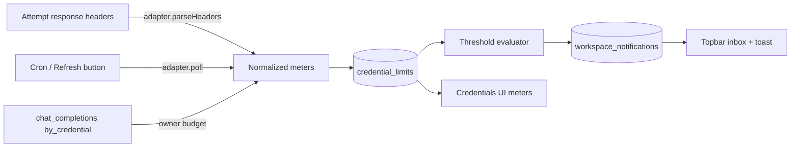

# Gateway Usage Limits Research

Research snapshot: 2026-10-26. On 2026-10-26 the owner approved slices 1–4 and 6:
ChatGPT is polled every 5 minutes plus on demand, OpenRouter takes an optional
management key, and metered budgets are included. Notification delivery (slice 5)
was replaced by recorded limit events that a later session delivers. The result is
documented in [Gateway usage limits](../Radium_Gateway/Limits.md), which supersedes
the "Current State" table and the event and interface details below. Routing on
remaining quota (pacing) stays in the [auto-routing research](Gateway_Auto_Routing.md#6-quota-knowledge-ladder).

## Current State

Verified against the checked-in source:

| Area                            | Behavior                                                                                                                                                                                                                                | Location                                                  |
| ------------------------------- | --------------------------------------------------------------------------------------------------------------------------------------------------------------------------------------------------------------------------------------- | --------------------------------------------------------- |
| Limit state                     | None per credential. Cooldowns are the only quota-related state and only react to failures                                                                                                                                              | `convex/schema.ts` `routing_cooldowns`                    |
| Header reads                    | Only on non-2xx responses, only for reset deadlines (`retry-after[-ms]`, rejected `anthropic-ratelimit-unified-*-reset`, body `resets_at`/`resets_in_seconds`)                                                                          | `src/routing/failures.ts` `upstreamRetryAfterMs`          |
| Provider construction           | One construction point per attempt that knows the credential and accepts a custom `fetch`                                                                                                                                               | `src/routing/connector.ts` `createRoutedProvider`         |
| ChatGPT success headers         | Dropped: `handleResponses` copies only `content-type` from the Codex response. The library's `ChatGPTConfig.fetch` option is the raw upstream fetch (`codex-transport.js` `baseFetch`), and Radium builds the handler per request scope | `@opencoredev/loginwithchatgpt-server` 0.2.0 `handler.js` |
| ChatGPT tokens                  | Held in `subscription_state` (`session`) by the library; exported only with `dangerouslyAllowTokenExport: true`, which Radium does not set                                                                                              | `src/subscriptions/chatgpt.ts`                            |
| `subscription_state.rate_limit` | The library's own 30 req/min abuse guard, not an upstream quota                                                                                                                                                                         | `convex/subscriptions.ts`                                 |
| Usage attribution               | `chat_completions.request.credential` with tokens and `pricing.cost`, indexed `by_credential`                                                                                                                                           | `convex/schema.ts`                                        |
| Schedulers                      | `convex/crons.ts` runs worker pruning and `routing.prune` (10 min)                                                                                                                                                                      | `convex/crons.ts`                                         |
| Notifications                   | None persisted. The web app has ephemeral sonner toasts only                                                                                                                                                                            | `apps/web/src/app/__root.tsx`                             |
| Credential UI                   | `CredentialRow` renders name, preview, priority/weight, switch, menu; data from `providers.listCredentials`                                                                                                                             | `components/gateway/credentials-dialog.tsx`               |

## Upstream Signals

Three ways to learn a limit, plus the reactive 429 path that already exists:

| Technique              | Cost                                             | Freshness                                               | Coverage                                  |
| ---------------------- | ------------------------------------------------ | ------------------------------------------------------- | ----------------------------------------- |
| Passive header capture | Free; rides on real traffic                      | Current while the credential is used; stale when idle   | Only upstreams that send limit headers    |
| Active usage poll      | One extra call per credential per poll; 429 risk | Works for idle credentials                              | Only upstreams with a usage endpoint      |
| Local metering         | A query over `chat_completions`                  | Exact for Radium traffic, blind to usage outside Radium | Any provider, against an owner-set budget |
| Reactive (existing)    | Free                                             | Exact "blocked until"                                   | No early warning                          |

### OpenRouter (API key)

- `GET https://openrouter.ai/api/v1/key` with the inference key ([docs](https://openrouter.ai/docs/api_reference/limits.md)). Fields: `limit` and `limit_remaining` (credits ≈ USD, `null` = unlimited), `limit_reset` (`daily`/`weekly`/`monthly`/`null`, UTC boundaries), `usage`, `usage_daily`, `usage_weekly`, `usage_monthly`, `byok_usage*`, `include_byok_in_limit`, `is_free_tier`, `free_model_daily_requests {used, limit, remaining}`, `budgets[] {scope, limit_usd, spend_usd, remaining_usd, reset_interval, resets_at}`, `effective_budget` (the budget that blocks first). `rate_limit` is deprecated.
- Account balance: `GET /api/v1/credits` → `total_credits - total_usage`. The API reference says it needs a **management key** and returns 403 otherwise ([docs](https://openrouter.ai/docs/api/api-reference/credits/get-remaining-credits.md)); CodexBar reports it sometimes accepts an inference key ([docs](https://github.com/steipete/CodexBar/blob/main/docs/openrouter.md)). Plan for an optional management key.
- The per-key cap is not the account balance: a key with $30 of cap can sit on an account with $1.90 of credit, so both are shown.
- Successful responses carry no `X-RateLimit-*` headers; every response body carries `usage.cost`, which Radium already records. 402 bodies carry `error.metadata.limit_source` (`openrouter_key_limit`, `openrouter_credits`, `openrouter_in_flight_budget`); 403 budget bodies carry `limit_usd`, `spend_usd`, `resets_at`.

### ChatGPT subscription (Codex)

From `openai/codex` at `dd55214`:

- **Passive headers** on `chatgpt.com/backend-api/codex/responses` (`codex-rs/codex-api/src/rate_limits.rs`): `x-codex-{primary,secondary}-used-percent` (0–100), `-window-minutes`, `-reset-at` (unix seconds; older captures use `-reset-after-seconds`, so parse both); `x-codex-credits-has-credits`, `-unlimited`, `-balance`; `x-codex-active-limit`, `x-codex-plan-type`, `x-codex-rate-limit-reached-type`; extra metered limits as `x-codex-<name>-primary-*`.
- **Usage endpoint** `GET https://chatgpt.com/backend-api/wham/usage` with `Authorization: Bearer <access token>` and `ChatGPT-Account-Id` (`backend-client/src/client.rs`). Omitting the account header can return another workspace's usage ([report](https://github.com/itsmylife44/cliproxyapi-dashboard/issues/310)). Payload: `plan_type`, `rate_limit {allowed, limit_reached, primary_window, secondary_window}`, each window `{used_percent, limit_window_seconds, reset_after_seconds, reset_at}`; `credits {has_credits, unlimited, balance}`; `additional_rate_limits[] {limit_name, metered_feature, rate_limit}`; `rate_limit_reached_type`.
- Windows must be identified by `limit_window_seconds`, not by "primary/secondary": typically 5 h and weekly, but free plans report a 30-day window ([CodexBar](https://github.com/steipete/CodexBar/blob/main/docs/codex.md)).
- The Codex TUI polls about every 60 s and still draws 429s ([codex#10869](https://github.com/openai/codex/issues/10869)); back off per credential.
- Both are undocumented. OpenAI now runs an official Sign in with ChatGPT plan-usage program; hosted apps must apply ([cookbook](https://developers.openai.com/cookbook/articles/sign-in-with-chatgpt)). Polling adds no new exposure beyond the inference proxy Radium already runs, but it can break without notice.

### Other providers

| Provider            | Signal                                                                                                                                                                                                                 | Notes                                                                                                                                                                   |
| ------------------- | ---------------------------------------------------------------------------------------------------------------------------------------------------------------------------------------------------------------------- | ----------------------------------------------------------------------------------------------------------------------------------------------------------------------- |
| Claude subscription | `GET api.anthropic.com/api/oauth/usage` (`five_hour`, `seven_day*` `{utilization, resets_at}`, `extra_usage`); `anthropic-ratelimit-unified-*` headers (fraction 0–1, `representative-claim` names the binding window) | Undocumented; Anthropic forbids routing plan credentials for third parties ([terms](https://code.claude.com/docs/en/legal-and-compliance)). No adapter exists in Radium |
| Anthropic API key   | `anthropic-ratelimit-{requests,tokens,input-tokens,output-tokens}-{limit,remaining,reset}` on every response ([docs](https://platform.claude.com/docs/en/api/rate-limits.md))                                          | Per-minute token buckets; no balance endpoint without an Admin key                                                                                                      |
| OpenAI API key      | `x-ratelimit-{limit,remaining,reset}-{requests,tokens}`, reset as a duration (`6m0s`) ([docs](https://developers.openai.com/api/docs/guides/rate-limits.md))                                                           | No balance endpoint without an `sk-admin` key                                                                                                                           |
| DeepSeek            | `GET /user/balance` → `is_available`, `balance_infos[] {currency, total_balance}` ([docs](https://api-docs.deepseek.com/api/get-user-balance))                                                                         | Inference key                                                                                                                                                           |
| Moonshot / Kimi     | `GET /v1/users/me/balance` → `available_balance`                                                                                                                                                                       | Inference key; secondary source                                                                                                                                         |
| xAI                 | `usage.cost_in_usd_ticks` per response; balance needs a management key ([docs](https://docs.x.ai/developers/cost-tracking))                                                                                            |                                                                                                                                                                         |
| Groq                | `x-ratelimit-*` (requests per day, tokens per minute)                                                                                                                                                                  | No balance API                                                                                                                                                          |

Per-minute rate-limit headers (OpenAI, Anthropic, Groq) refill within seconds. They matter to routing, not to "running low" notifications, and are left out of the first slice.

### Prior art

- **CLIProxyAPI** captures `x-codex-*` and `anthropic-ratelimit-unified-*` into a per-credential snapshot replaced on every response, kept separate from cooldown state (`sdk/cliproxy/auth/quota_signals.go`); it normalizes `wham/usage` payloads into the same header shape (`helps/codex_quota.go`) so both sources feed one parser; its management UI polls usage on demand through a token-substituting proxy call. Selection never reads the snapshot.
- **CodexBar** polls on demand per source (Codex `wham/usage`, OpenRouter `/key` + `/credits`), keeps the last known value with its age when a fetch fails, and backs off 5 min after a 429.
- **LiteLLM** meters spend locally per key against owner budgets and exposes `x-litellm-key-remaining-*` headers.

## Proposed Design



### 1. Meter Model

Everything normalizes to meters. One `credential_limits` document per credential
(legacy credentials keyed by provider), replaced per source:

```ts
type Meter = {
  id: string; // stable per adapter: "codex:primary", "openrouter:key", "openrouter:credits"
  label: string; // "5-hour", "Weekly", "Key limit", "Account balance"
  scope: "credential" | "account"; // account = shared by every key of the upstream account
  unit: "percent" | "usd" | "credits" | "requests";
  used?: number; // percent meters: 0–100
  limit?: number; // absent for percent meters and uncapped balances
  remaining?: number; // balances without a cap (OpenRouter credits, DeepSeek)
  windowSeconds?: number; // identifies the window; absent = no reset
  resetsAt?: number; // ms epoch
  source: "header" | "poll" | "error" | "metered";
  observedAt: number;
};
```

- `credential_limits`: `workspace`, `provider`, `credential?`, `meters: Meter[]`,
  `plan?` (e.g. ChatGPT `plan_type`), `pollError?`, `nextPollAt`, `updatedAt`.
  Indexes `by_workspace`, `by_credential`, `by_nextPollAt`.
- Fraction used is derived, never stored: `used/limit`, or `used/100` for percent.
  Balances without a limit are judged by `remaining` against an owner threshold.
- A meter past `resetsAt` is shown as reset (0 % used, "awaiting fresh data") instead
  of the stale value.
- Writes are throttled in the mutation: skip if every meter's fraction moved less
  than 1 point and the last write is under 60 s old. Avoids one write per completion.
- Deleting a credential deletes its row (same place cooldowns are removed).

### 2. Limit Adapters

Provider-specific code lives behind one interface in `src/limits/`:

```ts
interface LimitAdapter {
  parseHeaders?(headers: Headers, now: number): Meter[] | undefined;
  parseError?(status: number, body: unknown, now: number): Meter[] | undefined;
  poll?(ctx: ActionCtx, credential: RoutableCredential): Promise<LimitSnapshot>;
  pollIntervalMs?: number;
}
```

Resolution: OAuth credentials by `oauth_flow` (extending `SubscriptionAdapter` in
`src/subscriptions/registry.ts` with `limits`); API-key credentials by AI SDK
package plus base URL host (`@openrouter/ai-sdk-provider` or `openrouter.ai` →
OpenRouter). Providers without an adapter get only metered budgets.

| Adapter          | `parseHeaders`                         | `parseError`                                    | `poll`                                                                |
| ---------------- | -------------------------------------- | ----------------------------------------------- | --------------------------------------------------------------------- |
| `chatgpt-device` | `x-codex-*` → percent meters + credits | `usage_limit_reached` → 100 % until `resets_at` | `wham/usage` → same meters, plus `plan_type`                          |
| OpenRouter       | —                                      | 402/403 `limit_source` → exhausted meter        | `/key` → key limit and budgets; `/credits` if a management key is set |

### 3. Capture Paths

1. **Passive.** `createRoutedProvider` wraps the connector `fetch` and hands the
   adapter's parsed meters to the attempt result; `reportOutcome` sends them to
   `routing.reportResult`, which already runs once per attempt, so no new mutation
   per request. For ChatGPT the wrapper goes into `createChatGPTHandler({ fetch })`
   (the library's raw upstream fetch), because the proxy strips headers before the
   AI SDK sees them.
2. **Active.** A cron (every 5 min) runs `limits.pollDue`, which takes rows with
   `nextPollAt <= now` and polls them in an action. A credential with a passive
   snapshot under 10 min old is skipped. A 429 or error stores `pollError` and
   backs off (5 min doubling to 1 h); the last meters stay with their age. Owners
   get a Refresh action per credential, limited to once a minute.
   - ChatGPT: the action needs the access token and account ID. The library exports
     them only with `dangerouslyAllowTokenExport: true`; they would stay inside the
     backend action and never reach a client. Alternative without export: passive
     headers only, so idle accounts show their last value with its age.
   - OpenRouter: `/key` with the stored key. `/credits` needs a management key,
     stored as an optional extra credential value, never used for inference.
3. **Metered budgets.** For providers without signals (OpenAI and Anthropic API keys,
   custom providers), the owner may set a budget per credential: amount in USD and a
   period (day, week, month, UTC). The meter is the sum of `pricing.cost` over
   `chat_completions.by_credential` since the period start, computed in the query
   (bounded by the period) rather than stored. Labelled "Radium usage only".

### 4. Notifications

- `workspace_notifications`: `workspace`, `kind` (`limit_low`, `limit_exhausted`,
  `limit_reset`, `poll_failed`), `credential?`, `meterId?`, `level`, `message`,
  `createdAt`, `readAt?`. Owner-only; pruned after 30 days.
- Evaluator runs inside the snapshot mutation, comparing old and new fractions per
  meter against workspace thresholds (default warn 80 %, critical 95 %, exhausted
  100 %; balances: warn under an owner amount). One notification per upward
  crossing; a meter re-arms only after its window resets or its fraction falls
  below the threshold minus 5 points, so oscillation around 80 % cannot spam.
- Settings live in `workspace_settings.limits` (thresholds, enabled kinds).
- Delivery in this slice: a topbar inbox (bell with unread count, list, mark read)
  backed by a reactive query, and a toast when a new critical notification
  arrives in an open tab. Email and webhooks are later channels on the same table.

### 5. Interface

- **Credential row** (`CredentialRow`): up to two compact bars, the tightest meters
  (highest fraction, soonest reset), e.g. `5h ▰▰▰▱▱ 62 % · resets 1h 40m`; balances as
  `$4.20 left`. Colors follow thresholds. Tooltip: every meter, source, and age
  ("from headers 3 min ago", "poll failed: 429").
- **Gateway > Limits panel**: all credentials across providers in one table, sorted
  by tightest meter, with plan, every window, reset countdown, data age, and
  Refresh; plus threshold settings and the metered budget editor.
- **Credential edit dialog**: budget fields (all providers) and the OpenRouter
  management key field.
- `providers.listCredentials` gains a `limits` summary; the panel uses a dedicated
  `limits.list` query so credential lists don't re-render on every snapshot.

## Not In Scope

- Using meters in selection (pacing, pre-emptive exclusion). Cooldowns remain the
  only quota effect on routing; the snapshot is the input the routing research
  asks for.
- Per-minute rate-limit headers (OpenAI, Anthropic, Groq) as meters.
- Claude subscription adapters (no Radium flow exists, and the terms forbid routing).
- Email and webhook delivery.

## Proposed Slices

1. Schema (`credential_limits`, `workspace_notifications`, `workspace_settings.limits`),
   meter normalization, throttled snapshot writes, cleanup on credential removal.
2. ChatGPT adapter: passive `x-codex-*` capture through the handler `fetch`,
   `usage_limit_reached` parsing, `wham/usage` poll.
3. OpenRouter adapter: `/key` poll, optional management key and `/credits`,
   402/403 `limit_source` parsing.
4. Metered budgets.
5. Threshold evaluator, notifications table, topbar inbox, toasts.
6. Credential row meters, Gateway > Limits panel, settings, docs.

## Open Questions

- ChatGPT idle accounts: enable server-side token export for `wham/usage` polling,
  or rely on passive headers only?
- OpenRouter account balance: accept an optional management key per credential?
- Include metered budgets for providers without limit APIs in this session?
- Notification channel: in-app inbox only for now?

## Sources

- [OpenRouter limits](https://openrouter.ai/docs/api_reference/limits.md), [credits](https://openrouter.ai/docs/api/api-reference/credits/get-remaining-credits.md), [usage accounting](https://openrouter.ai/docs/cookbook/administration/usage-accounting.md)
- [openai/codex](https://github.com/openai/codex) at `dd55214`: `codex-rs/codex-api/src/rate_limits.rs`, `codex-rs/backend-client/src/client.rs`, `codex-rs/codex-backend-openapi-models/src/models/`
- [CLIProxyAPI](https://github.com/router-for-me/CLIProxyAPI) at `1f917e7`: `sdk/cliproxy/auth/quota_signals.go`, `internal/runtime/executor/helps/codex_quota.go`
- [CodexBar](https://github.com/steipete/CodexBar) at `9f026e0`: `docs/codex.md`, `docs/openrouter.md`, `docs/claude.md`
- [Anthropic rate limits](https://platform.claude.com/docs/en/api/rate-limits.md), [OpenAI rate limits](https://developers.openai.com/api/docs/guides/rate-limits.md), [DeepSeek balance](https://api-docs.deepseek.com/api/get-user-balance)
- [Sign in with ChatGPT](https://developers.openai.com/cookbook/articles/sign-in-with-chatgpt), [Claude Code legal and compliance](https://code.claude.com/docs/en/legal-and-compliance)
