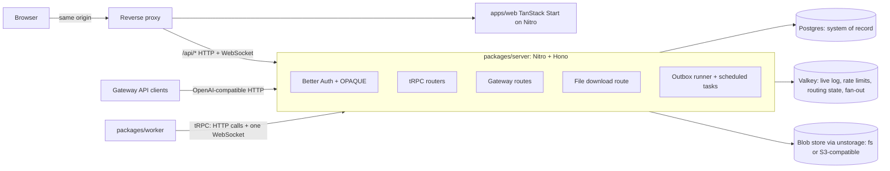

# 14 Backend rewrite: Convex → Nitro, Hono, Drizzle, Postgres, Valkey

Status: **planned, not started.** Branch `refactor/new-backend`. Target release: 1.0.

This is a fresh plan. The earlier attempt (branch `refactor/abandon-convex`, its tRPC/Electric design and any `Backend_Migration` doc) is **not** a base: do not copy its code or schema. [Backend pre-rewrite report](../Backend_Pre_Rewrite_Report.md) is a month-old inventory; the inventory below supersedes it where they differ.

## Why

- Self-hosting: Convex is a second runtime (local backend binary, admin key, function push, `3210`/`3211` origins, `scripts/convex-ready.ts`) that homelab operators must run and upgrade.
- I/O: live features are built by writing rows so subscribers see them. ACP writes `chat_frames` at 2–4 inserts/s per warm session plus `acp_streams` counters, `chat_viewers` heartbeats every 60 s per Tab and two minutely/5-minute crons to clean them up. `routing.pick`/`reportResult` write per upstream attempt. None of that needs to be durable database state.
- Scale: no pub/sub between peers, ~60 `runAfter(0)` continuation chains exist only to stay under Convex transaction limits, 1 MiB document limit shaped blob splitting.

## Decisions

| Topic                             | Decision                                                                                                                                                                                                                                                                                                                                                                                                                                                                                                                                                                                                                                                                                                                                                                                                                                                                                                                                                                                                                                                                                                                                       |
| --------------------------------- | ---------------------------------------------------------------------------------------------------------------------------------------------------------------------------------------------------------------------------------------------------------------------------------------------------------------------------------------------------------------------------------------------------------------------------------------------------------------------------------------------------------------------------------------------------------------------------------------------------------------------------------------------------------------------------------------------------------------------------------------------------------------------------------------------------------------------------------------------------------------------------------------------------------------------------------------------------------------------------------------------------------------------------------------------------------------------------------------------------------------------------------------------- |
| HTTP server                       | New `packages/server`: Nitro v3 (`nitro` already used by `apps/web`) with a Hono app as the server entry.                                                                                                                                                                                                                                                                                                                                                                                                                                                                                                                                                                                                                                                                                                                                                                                                                                                                                                                                                                                                                                      |
| API                               | **tRPC v11 is the one API for every first-party client**: web, Worker, the planned Expo/watch apps, the admin dashboard and operator CLIs. Mounted in Hono (`@hono/trpc-server`); web uses `@trpc/tanstack-react-query`; Worker and CLIs use the vanilla client. Queries and mutations go over HTTP (`httpBatchLink`); subscriptions go over one WebSocket per client (see Live data). The only non-tRPC routes are ones whose shape is fixed outside Radium: the OpenAI-compatible Gateway (`/api/openai/v1/*`, plain Hono routes speaking the OpenAI wire format for third-party clients), the AI SDK chat protocol (`POST /api/chat`, `GET /api/chat/:id/stream`, consumed by `useChat`'s `DefaultChatTransport`), the Better Auth handler (`/api/auth/*`, its client SDK and OPAQUE plugin) and file downloads (`GET /api/files/:id`, because ``/download links need a URL and tRPC outputs are JSON). Everything else, including chat stop, Worker challenge/complete auth and file uploads (tRPC `FormData` input), is a procedure. No Convex function has callers outside this repository, so nothing needs a compatibility route. |
| Database                          | Postgres via Drizzle ORM + drizzle-kit migrations.                                                                                                                                                                                                                                                                                                                                                                                                                                                                                                                                                                                                                                                                                                                                                                                                                                                                                                                                                                                                                                                                                             |
| Cache / ephemeral state / fan-out | Valkey.                                                                                                                                                                                                                                                                                                                                                                                                                                                                                                                                                                                                                                                                                                                                                                                                                                                                                                                                                                                                                                                                                                                                        |
| Live data                         | **Chat generations:** the AI SDK's standard [resumable streams](https://ai-sdk.dev/docs/ai-sdk-ui/chatbot-resume-streams) (`resume: true` + [`resumable-stream`](https://github.com/vercel/resumable-stream) on Valkey). **Everything else live:** tRPC subscriptions over one Valkey-backed append log (`src/live/`), resumable with `tracked(offset)` + `lastEventId`, for the per-user invalidation feed, the per-Worker downlink and ACP frames. Subscription transport: **one WebSocket per browser Tab or Worker** (`wsLink`, all subscriptions multiplexed on it, like Convex's single socket) on Bun/Node; the same procedures over SSE (`httpSubscriptionLink`) only on edge presets that cannot hold WebSockets. No Durable Streams, no Electric sync, no Cloudflare Durable Objects; see [Live layer](#live-layer) for why.                                                                                                                                                                                                                                                                                                         |
| Topology                          | Separate server process; web (TanStack Start) and server ship together in one image/compose and share **one origin** behind a reverse proxy (Caddy in compose): `/api/*` including WebSocket upgrades → server, everything else → web. Better Auth cookies are first-party and no CORS/`VITE_*_URL` origin config is needed. In development, Vite's proxy forwards `/api` with `ws: true`. Gateway clients may also call the server directly.                                                                                                                                                                                                                                                                                                                                                                                                                                                                                                                                                                                                                                                                                                  |
| Runtimes                          | Bun is the reference self-host runtime (Bun.SQL, Bun.redis). Node and edge presets (Cloudflare, Vercel) must stay possible: domain code talks to small ports (below), never to `Bun.*` directly.                                                                                                                                                                                                                                                                                                                                                                                                                                                                                                                                                                                                                                                                                                                                                                                                                                                                                                                                               |
| File storage                      | One API for every backend: Nitro's built-in storage layer ([unstorage](https://unstorage.unjs.io)), `useStorage("blobs")`, with the driver picked by configuration: `fs` (default, a compose volume) or `s3` (any S3-compatible store: AWS, R2, MinIO, Garage; fetch-based, so it also runs on edge). Domain code never knows which one is mounted.                                                                                                                                                                                                                                                                                                                                                                                                                                                                                                                                                                                                                                                                                                                                                                                            |
| Existing deployments              | One-shot importer from `convex export` into Postgres before 1.0. Legacy pre-workspace and pre-E2EE data must be fully migrated **on Convex** first; the new schema does not carry it.                                                                                                                                                                                                                                                                                                                                                                                                                                                                                                                                                                                                                                                                                                                                                                                                                                                                                                                                                          |
| Admin dashboard                   | Last phase.                                                                                                                                                                                                                                                                                                                                                                                                                                                                                                                                                                                                                                                                                                                                                                                                                                                                                                                                                                                                                                                                                                                                    |

## Hard invariants found in the current code

1. **IDs are bound into ciphertext.** E2EE AAD includes Convex document IDs and Better Auth user IDs: `notificationAad(userId, workspace, notification._id)` (`apps/web/src/lib/crypto/notification-content.ts`), `{ workspace, table, parent: e2eeId, record: fileId, … }` (`chat-content.ts`), `pairingAad(workspaceId, ownerId, pairingId)` (`workers.ts`), `workerTaskAad({ workspaceId, chatId, requestId })` (`backend/src/worker/chat-tools.ts`), `deviceAad(userId, keyId)` (`key-manager.ts`), trust stores keyed by `userId`. Worker signatures (`binding`, `sessionProof`, signed commands) bind the same IDs. Therefore: **primary keys are `text`; imported rows keep their Convex `_id` and Better Auth `id` verbatim; new rows get UUIDv7 strings.** No old→new ID remapping. The `table` strings inside AAD (`"aisdk_chats"`, `"chat_messages"`, …) are protocol constants and stay even if a Postgres table is renamed.
2. **Secret Store format is portable and must be preserved byte-for-byte.** AES-256-GCM per-secret DEK wrapped by `SECRET_STORE_KEYS` KEK versions; AAD binds `["value", namespace, name]` and `["dek", namespace, name, keyVersion]`. Port the scheme (WebCrypto) to a `secrets` table and copy rows verbatim; keep namespace strings (`workspace:{ws}:provider:{p}`, `…:tools`, `…:mcp:{id}`, `…:telemetry:{dest}`, `e2ee:custody`) unchanged.
3. **`OPAQUE_SERVER_SETUP` never rotates**; `account.registrationRecord` etc. copy verbatim.
4. **Worker revocation is immediate**: every Worker call re-reads workspace archive state, key and `identityEpoch` (`backend/src/worker/machine.ts`). Keep that (cacheable only with explicit invalidation on revoke).
5. **Serialized decisions** that relied on Convex OCC need explicit SQL: ACP `claimCommand` (`UPDATE … WHERE status = 'pending' RETURNING`), `worker_tasks` unique `(workspace, worker, requestId)`, revision-checked transitions, `.unique()` lookups → unique indexes, `assertLegacyWritesAllowed` disappears with the cutover tables.
6. **`runAfter` is transactional in Convex.** Anything enqueued from a mutation must go through an outbox row written in the same Postgres transaction, never fire-and-forget after commit.
7. Privacy contract is unchanged: personal chats private even from owners, telemetry owner-only and filtered, write-only credentials (`AGENTS.md`, `Radium_Gateway/Ownership.md`).

## Target architecture

### What replaces each Convex feature

| Convex today                                                                                                                                                                             | Replacement                                                                                                                                                                                                                                                                                                                                                                                                                                                                                             |
| ---------------------------------------------------------------------------------------------------------------------------------------------------------------------------------------- | ------------------------------------------------------------------------------------------------------------------------------------------------------------------------------------------------------------------------------------------------------------------------------------------------------------------------------------------------------------------------------------------------------------------------------------------------------------------------------------------------------- |
| `schema.ts` (82 tables, ~185 indexes, no search/vector indexes)                                                                                                                          | Drizzle schema in `packages/server`; nested objects/arrays → `jsonb`, `v.bytes()` → `bytea`, `_creationTime` → `created_at`.                                                                                                                                                                                                                                                                                                                                                                            |
| Queries/mutations/actions (~300 registrations) and `workspaceQuery`/`ownedWorkspaceQuery`/`workerQuery` builders                                                                         | tRPC procedures with `sessionProcedure`, `workspaceProcedure`, `ownedWorkspaceProcedure`, `workerProcedure` middleware injecting the same `ctx.identity`/`ctx.workspace`/`ctx.worker`.                                                                                                                                                                                                                                                                                                                  |
| `convex/values` validators shared with web (76+ `src/` files)                                                                                                                            | zod schemas in shared contract modules; Convex-free.                                                                                                                                                                                                                                                                                                                                                                                                                                                    |
| Reactive `useQuery(convexQuery(...))` (~85 sites)                                                                                                                                        | TanStack Query via tRPC plus one per-user **invalidation subscription**: writes append `{ keys }` to the user's log, the client invalidates matching tRPC query keys. `tracked(offset)` resume means no missed invalidations after reconnect. It shares the Tab's single WebSocket with every other subscription.                                                                                                                                                                                       |
| ACP `chat_frames` + `acp_streams` + `chat_viewers` + warm/cold crons                                                                                                                     | Worker `acp.appendFrames` mutation writes to the live log; viewers use the `acp.frames` subscription. The Worker's `epoch`/`seq`/duplicate-retry contract is kept and checked atomically in Valkey (Lua) instead of `acp_streams` rows. Viewers are just subscribers; no heartbeats. Lifecycle (`acp_sessions`, turn usage) stays in Postgres at turn boundaries.                                                                                                                                       |
| `POST /api/aisdk/chat` (one Tab gets the stream, saved at end)                                                                                                                           | AI SDK resumable streams: `POST /api/chat` keeps today's handler shape (`streamText` → UI message stream through the Gateway pipeline) and hands the SSE stream to `resumable-stream`; any Tab/device attaches with `GET /api/chat/:id/stream`. Generation no longer dies with the sender's request; stop is an explicit `chat.stop` mutation. Final messages persist once at the end. Supersedes the [Live Sessions proposal](../Radium_Chatroom/Live_Sessions.md). See [Chat streams](#chat-streams). |
| Worker `ConvexClient` WebSocket subscriptions (`workers.current`, `worker_tasks.assigned`, ACP `assignedCommands`, `warmSessions`, `answeredInteractions`, `gatewayState`, trust roster) | tRPC procedures for calls; one per-Worker **downlink subscription** (`worker.downlink`, resumable by offset) carrying change notices and command envelopes, on the Worker's single WebSocket. The Worker JWT goes in tRPC `connectionParams`; a refreshed token reconnects the socket.                                                                                                                                                                                                                  |
| `ctx.scheduler.runAfter` (~60 sites)                                                                                                                                                     | `jobs` outbox table written in the caller's transaction; runner claims with `FOR UPDATE SKIP LOCKED`, retries with backoff. Many continuation chains (`continueMemberRemoval`, `clearColdChat`, telemetry GC pages) collapse into single SQL statements.                                                                                                                                                                                                                                                |
| `crons.ts` (13 interval jobs)                                                                                                                                                            | Nitro `scheduledTasks` (croner on Bun/Node, Cron Triggers on Cloudflare, Vercel Cron). Several crons disappear (`acp.coolSessions`, viewer cleanup) or become Valkey TTLs (`workers.pruneChallenges`, `routing.prune`).                                                                                                                                                                                                                                                                                 |
| File Storage (`chat_files`, large telemetry blobs, legacy storage)                                                                                                                       | unstorage `blobs` mount (see Decisions). Uploads through a tRPC `FormData` mutation (20 MiB cap), downloads through the authorized `GET /api/files/:id` route, replacing Convex's unauthenticated `getUrl` URLs.                                                                                                                                                                                                                                                                                        |
| `@convex-dev/rate-limiter` (6 limiters)                                                                                                                                                  | Valkey token bucket / fixed window with the same parameters; Better Auth `rateLimit` → Valkey `secondaryStorage`.                                                                                                                                                                                                                                                                                                                                                                                       |
| `convex-secret-store`                                                                                                                                                                    | `secrets` (+ `secret_events`) table with the ported scheme (invariant 2).                                                                                                                                                                                                                                                                                                                                                                                                                               |
| Better Auth Convex adapter + `convex()` JWT plugin + `auth.config.ts`                                                                                                                    | Better Auth Drizzle adapter, cookie sessions on the shared origin; `convex()` plugin and `jwks` table removed. Worker JWTs verified directly with `jose` against `WORKER_AUTH_JWKS`.                                                                                                                                                                                                                                                                                                                    |
| `workerIdentity` component (`packages/worker-component`)                                                                                                                                 | Three ordinary tables in the server schema; package deleted.                                                                                                                                                                                                                                                                                                                                                                                                                                            |
| `logging` component                                                                                                                                                                      | One `log_events` table.                                                                                                                                                                                                                                                                                                                                                                                                                                                                                 |
| `@convex-dev/migrations`, `e2ee_migration*`                                                                                                                                              | drizzle-kit migrations; Convex-era backfills run on Convex before export (see Phase 10).                                                                                                                                                                                                                                                                                                                                                                                                                |
| `"use node"` actions (`web-push`, migration crypto)                                                                                                                                      | Normal server code on Bun/Node; edge needs a WebCrypto Web Push implementation.                                                                                                                                                                                                                                                                                                                                                                                                                         |

### Runtime ports

Domain code depends only on these; each has a Bun adapter first, Node in the same phase where cheap, edge later.

| Port                                                            | Bun                                                                                       | Node                       | Edge (later)                          |
| --------------------------------------------------------------- | ----------------------------------------------------------------------------------------- | -------------------------- | ------------------------------------- |
| `db` (Drizzle instance)                                         | `drizzle-orm/bun-sql`                                                                     | `drizzle-orm/postgres-js`  | Hyperdrive/Neon driver                |
| `kv` (get/set/TTL, INCR, Lua for limiters and live-log appends) | `Bun.redis`                                                                               | `ioredis`                  | TCP socket client or HTTP Redis       |
| `bus` (publish/subscribe wake-ups for live subscriptions)       | `Bun.redis` duplicate connection                                                          | `ioredis`                  | polling fallback                      |
| `blobs`                                                         | unstorage `fs` / `s3`                                                                     | unstorage `fs` / `s3`      | unstorage `s3` (R2)                   |
| `jobs` runner                                                   | in-process poller                                                                         | in-process poller          | scheduled drain + `waitUntil`         |
| Subscription transport                                          | WebSocket (Nitro/crossws)                                                                 | WebSocket (Nitro/crossws)  | SSE                                   |
| `resumable-stream` pub/sub                                      | `resumable-stream/generic` with a small `Publisher`/`Subscriber` adapter over `Bun.redis` | `resumable-stream/ioredis` | TCP socket client; verify in phase 12 |

Do not add a generic repository layer on top of Drizzle; the port is the Drizzle instance.

## Live layer

### Why tRPC subscriptions and not Durable Streams

Both give ordered, offset-resumable streams. Durable Streams' extra value is CDN-cacheable catch-up reads, clients in many languages, a conformance suite and a ready AI SDK transport: features for public, high fan-out or third-party consumers. Radium's consumers are its own authenticated clients on a self-hosted server, and we would have to write the Durable Streams server ourselves anyway (the official TypeScript server is development-only; production is a Caddy plugin). Using it would add a second protocol, a second auth path and a second client stack next to tRPC. tRPC subscriptions reuse the procedure middleware (session, workspace, Worker auth), are typed end to end, and `tracked()` + `lastEventId` provide the same resume-from-offset behavior once the server keeps a log. Chat generations don't need either: the AI SDK already ships a standard resumable path (below). What remains to build is producer deduplication for ACP frames, which is the `epoch`/`seq` check that already exists.

### Why one WebSocket and not SSE

An SSE subscription keeps one HTTP request open for as long as it lives. Over HTTP/1.1 a browser allows only 6 open connections per origin, **shared by all Tabs**; once long-lived streams take them, normal queries and mutations queue behind them and the app looks frozen. HTTP/2 removes the limit, but browsers only speak HTTP/2 over HTTPS, and a homelab install on `http://192.168.x.x` is plain HTTP. WebSockets do not count toward that limit, and tRPC's `wsLink` multiplexes every subscription of a client over one socket, the same shape as Convex today. The server code does not change between transports: a subscription procedure is an async generator that tRPC serves over WebSocket or SSE, so edge presets switch the client link, not the routers.

Queries and mutations stay on HTTP: they are short (they don't hold a connection), they work for SSR prefetch and `FormData` uploads, and per-request auth stays simple.

### Design

- **Log.** One Valkey stream per topic (`user:{id}`, `worker:{id}`, `acp:{chat}:{epoch}`). The entry ID is the offset and the `tracked()` event ID. Appends go through Lua so idempotency checks and closing are atomic. Length is capped per topic.
- **Fan-out.** One shared `bus` subscriber connection per server process wakes local subscribers, which then read the new entries (`XRANGE` from their offset). There is no blocking Valkey connection per client.
- **Subscriptions.** Each subscription authorizes through the normal procedure middleware, replays entries after `lastEventId`, then tails. A subscription can be ended by the server at any time (deploys, edge time limits); the client reconnects with its last ID and loses nothing that is still in the log.
- **WebSocket server.** Nitro's WebSocket support (crossws) owns the socket; tRPC's `getWSConnectionHandler` serves the router on it through a small shim implementing tRPC's `WSClient` interface (`readyState`, `send`, `close`, `on('message'|'close')`). Off-the-shelf Bun adapters (`trpc-bun-adapter`, `trpc-bun`) take over `Bun.serve` and conflict with Nitro owning the server, so they don't fit. Browser sockets authenticate from the session cookie on the upgrade request; sign-out and session revocation close the user's sockets through the `bus`. Hidden Tabs keep their socket but unsubscribe from session streams.

### Chat streams

Chat generations follow the AI SDK's documented resumable-stream setup instead of a custom tRPC transport: `useChat({ resume: true })` with `DefaultChatTransport`, and `resumable-stream` on the server. That library costs one `INCR` + `SUBSCRIBE` per generation when nobody reconnects; chunks are only published to Valkey when a second reader asks for them. The producer keeps the replay buffer in its own memory, so resume works for as long as the generating server process is alive.

1. `POST /api/chat` checks there is no active stream for the chat (`409` otherwise), saves the user message, runs `streamText` with a server-side `AbortController` (not the request's signal) and, in `consumeSseStream`, creates the resumable stream and records `active_stream_id` on the chat. A per-stream heartbeat key in Valkey marks the producer as alive.
2. Other Tabs and devices learn a stream started from the invalidation feed and call `resumeStream()`; reloads resume on mount. Both hit `GET /api/chat/:id/stream`, which authorizes chat access, then returns the full replay (`DefaultChatTransport` treats it as a replay and rebuilds the message without duplicates).
3. On finish, stop or failure, in this order: persist the final messages and clear `active_stream_id` in one Postgres transaction → let the stream end → publish an invalidation for the chat.
4. `GET /api/chat/:id/stream` returns `204` when `active_stream_id` is empty **or** `resumable-stream` reports the stream already done. Because step 3 persists before the stream ends, a `204` always means "the reply is saved".
5. The client transport is `DefaultChatTransport` with `reconnectToStream` extended to refetch the chat's messages when it gets `204`, and the same refetch runs when a stream ends. Live content stays on screen until the refetch resolves, so the reply never blanks out. This covers the race of loading a chat while its run is finishing.
6. `chat.stop` (tRPC mutation) publishes an abort over the `bus` to the process that owns the generation; that process persists the partial reply through step 3. `useChat`'s own `stop()` only drops the connection, per the AI SDK docs.
7. A scheduled task clears `active_stream_id` and records `Interrupted` for streams whose heartbeat expired (server crash or redeploy mid-generation). Today nothing reaps a run that dies before `onEnd`.

ACP frames are produced by the Worker, not by a server-side `streamText`, so they stay on the live log: the Worker appends with `epoch`/`seq`, viewers subscribe through tRPC, and turn boundaries end with a terminal event. Their retention follows the current warm/cold rules in [ACP transport](../ACP/Transport.md), as TTLs instead of crons.

## Package layout

- `packages/server` (new): `nitro.config.ts`, `server.ts` (Hono entry), `src/<domain>/` (router, policy, persistence together, per `AGENTS.md`), `src/db/schema/*.ts`, `drizzle/` migrations, `src/ports/`, `src/live/` (log, bus fan-out, subscription helper), `tasks/`.
- `packages/contracts`: zod schemas, shared types and pure domain helpers the web and Worker import today from `backend/src/*` (94 web files). No database or runtime code. The current empty leftover directories `packages/contracts` and `packages/server` (untracked `node_modules`/`.output` only) are replaced.
- `packages/backend` and `packages/worker-component`: frozen reference during the rewrite, deleted at cutover.
- `packages/crypto`: unchanged (already runtime-neutral).

## Phases

Each phase is one or more sessions and ends with its exit check.

### Port behavior, rewrite the code

`packages/backend` is the behavioral reference (policies, protocol contracts, tests), not code to transliterate. Much of it is generic workaround for Convex limits; rewrite it where Postgres/Valkey/tRPC allow something faster or simpler, and record the reason in the PR. Known targets:

| Convex-shaped code                                                                                                                       | Rewrite direction                                                                                                                                                              |
| ---------------------------------------------------------------------------------------------------------------------------------------- | ------------------------------------------------------------------------------------------------------------------------------------------------------------------------------ |
| `runAfter(0)` self-rescheduling pagination (`continueMemberRemoval`, `acp/retention.ts`, `telemetryRetention.ts`, `deleteSessionPages`)  | Set-based `DELETE … WHERE` / `ON DELETE CASCADE`; batched only where lock time requires it.                                                                                    |
| Workspace context loaded per function (`helpers.ts` builders re-reading workspace + settings)                                            | One joined read in `workspaceProcedure` per request; request-scoped, never cross-request cached without invalidation.                                                          |
| `recordCompletion` (~6 reads, 1–3 writes) and `routing.pick`/`reportResult` writes per attempt                                           | One `INSERT … SELECT`/CTE per completion; routing cursors, session affinity and cooldowns as Valkey keys with TTL, atomic Lua.                                                 |
| Telemetry capture (`deepestExistingPrefix`, `existingBlobs`, batched `ingestBlobs`/`ingestNodes` mutations sized for transaction limits) | One transaction with `INSERT … ON CONFLICT DO NOTHING` over arrays; blob reverse-lookup indexes replaced by FKs/refcounts so GC is a query, not a scan queue (`telemetry_gc`). |
| 1 MiB document workarounds (blob splitting, `batchSize: 5`, epoch rollover at 1 MiB)                                                     | Removed where the limit was the only reason; size caps that protect clients stay.                                                                                              |
| List queries fetching then filtering in JS, N+1 reads in list views (`ListChats`, telemetry lists)                                       | Joins and keyset pagination on indexed columns.                                                                                                                                |
| Reactive queries returning whole documents so subscriptions re-run                                                                       | Narrow tRPC outputs; invalidation by key, not by row change.                                                                                                                   |
| Convex `v` validators duplicated as TS unions (`workspaces/provider.ts` vs `types/ai_provider.ts`)                                       | One zod schema, type inferred.                                                                                                                                                 |

Hot paths (Gateway completion, chat turn, Worker calls, live layer) get a micro-benchmark against compose services when rewritten; numbers go in the PR. tRPC routers are split per domain and procedures declare output schemas, keeping client type-checking fast at ~300 procedures.

### Phase list

| #   | Phase                           | Scope                                                                                                                                                                                                                                                                                                                                                                                                                                                                                                                                                                                                                                                                                                                                                                                                                      | Exit check                                                                                                                                                                                                                                                                                                   |
| --- | ------------------------------- | -------------------------------------------------------------------------------------------------------------------------------------------------------------------------------------------------------------------------------------------------------------------------------------------------------------------------------------------------------------------------------------------------------------------------------------------------------------------------------------------------------------------------------------------------------------------------------------------------------------------------------------------------------------------------------------------------------------------------------------------------------------------------------------------------------------------------- | ------------------------------------------------------------------------------------------------------------------------------------------------------------------------------------------------------------------------------------------------------------------------------------------------------------ |
| 0   | Foundation                      | `packages/server` scaffold (Nitro `bun` preset, Hono entry, tRPC root router + context + error formatting, env schema), `AppRouter` type exported for `import type` by every client, ports with Bun + Node adapters, Drizzle config, compose with Postgres + Valkey for dev/tests, Caddy entry proxy and Vite dev proxy (`ws: true`), crossws ↔ tRPC WebSocket shim, root `dev` script without Convex ordering, CI job for typecheck + server tests.                                                                                                                                                                                                                                                                                                                                                                       | Server boots on Bun and Node against compose services; health route; a typed tRPC query from web (through the proxy) and from a Bun script; a test subscription over the WebSocket through the proxy.                                                                                                        |
| 1   | Auth and core platform          | Better Auth 1.7.x (Drizzle adapter, `@alkalines/better-auth-opaque`, Valkey secondary storage, trusted client-IP handling from `src/e2ee/auth-ingress.ts`), tRPC `sessionProcedure`/`workspaceProcedure`/`ownedWorkspaceProcedure`, Secret Store port, rate limiters (as tRPC middleware), `jobs` outbox + scheduled tasks, unstorage `blobs` mount with `fs` and `s3` drivers, logging ingest. OPAQUE: plugin 0.2.0 already avoids relying on transactions (task 13, decision 2) and wraps its own writes in one when the adapter supports it, which Drizzle does; add a Drizzle/Postgres test target to the plugin repository next to `test:convex`.                                                                                                                                                                     | Sign-up/sign-in (OPAQUE and classic legacy path) end to end in the browser; Secret Store round-trips rows encrypted by the Convex component format (fixture); the same upload/download test passes on `fs` and on an S3-compatible store.                                                                    |
| 2   | Live layer                      | `src/live/`: Valkey log with Lua appends (idempotency, close, TTL), `bus` fan-out, `tracked()` subscription helper with replay and authorization, socket close on sign-out/revocation, per-user invalidation feed, web invalidation client. `resumable-stream` context with the Bun `Publisher`/`Subscriber` adapter.                                                                                                                                                                                                                                                                                                                                                                                                                                                                                                      | On Bun and Node, over WebSocket and over SSE: a subscription resumes from `lastEventId` without gaps or duplicates after a forced disconnect; duplicate producer retries are ignored; ten Tabs on plain HTTP stay responsive. A `resumable-stream` test stream resumes from a second client on Bun and Node. |
| 3   | Workspaces                      | Workspaces, members, settings, projects, preferences, names (sealed). Ownership/privacy policy ported from `src/workspaces/policy.ts`.                                                                                                                                                                                                                                                                                                                                                                                                                                                                                                                                                                                                                                                                                     | Owner/member/non-member matrix tests against real Postgres.                                                                                                                                                                                                                                                  |
| 4   | Gateway                         | Providers, models, authors, workspace configurations/credentials, API keys, routing (cursors, sessions, cooldowns in Valkey; decisions atomic via Lua or row locks), limits + adapters, ChatGPT subscription routes, `/api/openai/v1/chat/completions` + `/models`, `recordCompletion`.                                                                                                                                                                                                                                                                                                                                                                                                                                                                                                                                    | JSON + SSE completions with usage rows; key revocation; tombstoned provider not routable; model listing.                                                                                                                                                                                                     |
| 5   | Chatroom                        | Chats, messages, members, files (unstorage), tools, MCP, Exa, Code Mode interactions, title generation (outbox job), `POST /api/chat` + `GET /api/chat/:id/stream` + `chat.stop` following [Chat streams](#chat-streams), single active stream per chat, heartbeat reaper.                                                                                                                                                                                                                                                                                                                                                                                                                                                                                                                                                 | Two Tabs see the same in-flight reply; reload resumes; closing the sender Tab does not stop the run; resuming after the run finished gets `204` and shows the saved reply; killing the server mid-run leaves the chat `Interrupted`, not stuck streaming; personal chat invisible to owner.                  |
| 6   | E2EE                            | Identities, key bundles, device recovery, trust stores, workspace epochs/grants/rosters/invites/phrases/join requests, Worker keys/pairings, chat keys/wraps/capsules. Web `lib/crypto/*` moves from `cryptoClient()` to tRPC. Cutover machinery is not ported.                                                                                                                                                                                                                                                                                                                                                                                                                                                                                                                                                            | Existing `radium-crypto` + web crypto tests pass; new device joins and decrypts a chat created before the switch (imported fixture).                                                                                                                                                                         |
| 7   | Worker                          | Enrollment, challenge/complete auth (tRPC public procedures), JWT in `connectionParams`, `workerProcedure`, presence, tasks + chat calls, Gateway access, downlink subscription; `packages/worker` drops `convex/browser` for the tRPC vanilla client (`httpBatchLink` + `wsLink`).                                                                                                                                                                                                                                                                                                                                                                                                                                                                                                                                        | Fresh enroll, pair, edit + Bash task via Chatroom, revoke cuts access on next call and closes the socket.                                                                                                                                                                                                    |
| 8   | ACP                             | Agents/definitions, sessions, commands, interactions, deferred cleanups, usage + model prices, local usage; frames on the live log.                                                                                                                                                                                                                                                                                                                                                                                                                                                                                                                                                                                                                                                                                        | Warm ACP session streams to two viewers; Worker restart recovers epoch; zero Postgres writes per frame.                                                                                                                                                                                                      |
| 9   | Telemetry, notifications, usage | Telemetry capture/ingest/retention/GC/export (OTLP), destinations, notifications + sealing + Web Push, activity/usage reads, operational logs.                                                                                                                                                                                                                                                                                                                                                                                                                                                                                                                                                                                                                                                                             | Capture on → owner sees request, member doesn't; export test destination; push delivered.                                                                                                                                                                                                                    |
| 10  | Importer                        | CLI: `convex export` ZIP → Postgres + blob store. Preconditions checked from the export: ownership backfill (`migrations.ts runAll` + every `verify*`) complete, E2EE cutover complete (`e2ee_migration_state.cutoverComplete`), no rows needing `legacyContent` custody — otherwise refuse and point to the Convex runbook. Copies IDs verbatim, Secret Store rows verbatim, `_storage` files to blobs; per-table counts and edge checks.                                                                                                                                                                                                                                                                                                                                                                                 | Import of a real non-production export; app works on imported data, including decrypting old chats.                                                                                                                                                                                                          |
| 11  | Cutover                         | Delete `packages/backend`, `packages/worker-component`, Convex dependencies/env/scripts; new Dockerfile + compose (web, server, Postgres, Valkey, Caddy); rewrite `architecture.md`, `deployment.md`, `api.md`, Worker/ACP transport docs, `docs/README.md`. **Adapt `AGENTS.md`**: Commands and setup (dev/test/typecheck scripts, env files), Wiring and code ownership (`packages/server` domains, tRPC as the only first-party API, ports, live layer), Verification (real Postgres/Valkey tests, live-layer resume tests), Authorization and persisted compatibility (drop legacy bridge rules, keep ID/AAD and Secret Store invariants), Deployment/generated files (drizzle-kit migrations instead of Convex codegen/deploy). Remove every Convex-specific rule; keep product, interface and code-clarity sections. | Clean `docker compose up` quickstart verified on a fresh machine; `AGENTS.md` names no Convex command or path.                                                                                                                                                                                               |
| 12  | Edge presets                    | Edge adapters for ports, SSE subscription link, Cloudflare/Vercel build, documented limits (subscription durations, HTTP/2 required for SSE, no in-process runner, OPAQUE WASM loading).                                                                                                                                                                                                                                                                                                                                                                                                                                                                                                                                                                                                                                   | Deployed preview passes the live-layer resume tests + Gateway smoke.                                                                                                                                                                                                                                         |
| 13  | Admin dashboard                 | Instance-level administration (users, workspaces, jobs, storage, health). Design separately.                                                                                                                                                                                                                                                                                                                                                                                                                                                                                                                                                                                                                                                                                                                               | —                                                                                                                                                                                                                                                                                                            |

Phases 3–9 depend on 0–2; 6 precedes 7–8 (Worker/ACP need keys); otherwise 3–9 can be parallel sessions with one owner per domain.

## Data rules for the new schema

- Not carried: `balances`, `keys`, `chatroom_settings`, `telemetry_traces`/`spans`/`payloads`, `ai_apps` (confirm no writers), `storage_sweeps`, `e2ee_migration_state`/`jobs`, `e2ee_legacy_custody`/`storage`, `e2ee_telemetry_proofs`/`revisions`, `chat_frames`, `chat_viewers`, `acp_streams`, Better Auth `jwks`/`rateLimit`.
- Fields dropped: `legacyContent`, `legacyHashVersion`, `custodyFree*`, `workspaces.legacy*`/`telemetryProofRevision`, `api_keys.legacyKey`, `chat_completions.bill.balance`/`bill.key`, `aisdk_chats.balance`/`messages[]`/`chat_completions[]`/`messages_queue`, `telemetry_requests.legacy`. `mcp_servers.workspace` becomes `NOT NULL`.
- Real foreign keys with explicit `ON DELETE` policy per edge (Convex had none); a table without one documents why.
- `jsonb` only for genuinely nested documents (provider snapshots, message parts, routing weights); scalar fields that are filtered or indexed become columns.
- Ephemeral state lives in Valkey with TTLs, not Postgres: challenges, routing cursors/sessions/cooldowns, rate limits, Code Mode interactions, live-log entries.

## Verification policy for this rewrite

- Server tests run against real Postgres and Valkey from compose; no `convex-test`-style mocks for persistence or auth.
- Each phase adds authorization-matrix tests for its procedures (owner, member, other user, personal chat creator, revoked Worker).
- Live-layer resume and end-of-stream tests run in CI against real Valkey.
- Web is verified in a browser per phase; Worker against a real server.
- Report unit, integration, browser and skipped verification separately (as in `AGENTS.md`).

## Open questions

- None blocking Phase 0.
